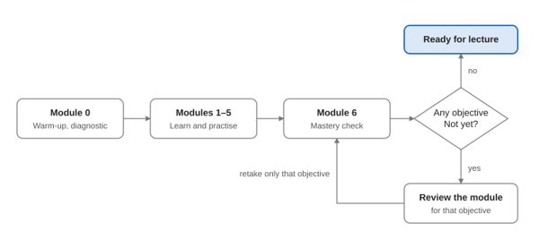

# Introduction and instructional design approach

## Purpose of the application

Ctrl Academy is a pre-lecture, tutor-style application for COS212 students. It teaches one data structure, graphs, and one algorithm, Breadth-First Search (BFS). Students use it before they attend the COS212 lecture on this topic, and it assumes no prior knowledge of graphs or BFS. A full session takes about 75 minutes and is split into seven short modules (0 to 6). Students can stop after any module and continue later.
This document describes how the application teaches: who the learners are, what they must learn, how the lessons are designed, and how we will check that the design works. The SE document describes how the application is built. Both documents describe the same prototype.

## Why we chose graphs and BFS

Graphs are a core topic in computer science. The CS2023 curriculum places graphs and graph traversal, including BFS, in its Algorithmic Foundations knowledge area [40]. BFS is also the base for later graph algorithms, such as depth-first search and shortest-path algorithms.
BFS is hard for beginners. A student must track the current vertex, the queue and the visited set at the same time, and one mistake changes the whole traversal. A lecture leaves little time to practise this tracking. The application gives guided practice before the lecture, so the lecture can go deeper.

## Our instructional design approach

Our design rests on the following choices. Each is explained in the section shown.
-	Process: ADDIE, used as a repeating cycle with rapid prototyping inside it [5, 23] (Sections 4.1 and 4.2).
-	Lesson structure: Gagné’s nine events of instruction in every module [17] (Section 4.3).
-	Alignment: objectives, learning activities and assessment all target the same skill [4] (Sections 3 and 4.4).
-	Guided active learning: worked examples first, then partly completed tasks, then blank tasks, with a four-level hint ladder (Sections 5 and 7.5).
-	Mastery: each objective is reported on its own, and a review path gives extra scaffolding to students who need it [12] (Sections 3.2 and 7.6).
-	Motivation: the ARCS model, supported by private points and badges [37] (Sections 7.1 and 7.2).
-	Inclusion: Universal Design for Learning and WCAG 2.1 level AA [31, 45] (Section 6).
-	Evaluation: a pilot, usage logs and surveys that feed back into the design (Section 8).

## Structure of this document

Section 2 describes the learners and what they already know. Section 3 sets the learning objectives and the criteria for success. Sections 4 and 5 explain the instructional design model and the learning theories behind the lessons. Section 6 covers learning preferences, accessibility and inclusion. Section 7 covers motivation, assessment, feedback and scaffolding. Section 8 explains how we will evaluate the application. Section 9 reflects on our instructional choices and their trade-offs. Section 10 records our use of generative AI.

# Target learners and assumed prior knowledge

## Intended learners for this application

The intended learners are students preparing for or beginning COS212 (Data Structures and Algorithms) at the University of Pretoria. The University of Pretoria 2026 Computer Science Yearbook [25] describes the programming knowledge covered in COS132, COS151 and COS110. COS132 introduces imperative programming. COS151 introduces algorithms and algorithm modelling. COS110 introduces object-oriented programming and basic data structures, including lists, stacks and queues. These modules provide a foundation for learning graphs and Breadth-First Search (BFS). Our application will build on this knowledge. It will not assume that students already know graphs or BFS. It will introduce these topics before the students attend their COS212 lectures.

## Prerequisites for using this application

### COS132: Imperative Programming

Students are expected to have basic programming knowledge. The University of Pretoria 2026 Computer Science Yearbook [25] states that COS132 covers types, control structures, arrays, functions and libraries. It also teaches students how to create, run and debug programs. The application can use these skills in its coding activities. Students can predict what a short piece of code will do. They can also complete missing lines of code in a BFS implementation. The application should not spend too much time teaching basic programming again. However, it should provide short explanations when students struggle with these concepts.

### COS151: Introduction to computer science

Students are expected to have basic knowledge of computer science and algorithms. The University of Pretoria 2026 Computer Science Yearbook [25] states that COS151 covers algorithms, complexity, Boolean logic, automata theory and algorithm modelling. The application can build on this knowledge when introducing BFS. It can explain the algorithm before showing the Python implementation. Students can first follow the steps using a graph diagram. They can then connect these steps to the code. This will help them understand the logic behind the algorithm.

### COS110: Introduction to program design

Students are expected to have experience with object-oriented programming and basic data structures. The University of Pretoria 2026 Computer Science Yearbook [25] states that COS110 covers modular program design, encapsulation, interfaces, reuse, lists, stacks and queues. The application can build on students' knowledge of queues. BFS uses a queue to determine which vertex must be processed next. However, students may need a reminder of how queues work. The application should explain this connection before students complete BFS activities.

## Distinguishing existing knowledge from new knowledge

The application should build on existing knowledge while teaching graphs and BFS from the beginning. For example, students are expected to know basic programming and queues. They are not expected to know how to represent a graph or perform BFS before using the application. They must learn what a graph is, why graphs are useful, what BFS does and how to implement it. This approach will help students connect new concepts to what they already know. It will also prevent the application from spending too much time reteaching prerequisite content. Students will instead focus on the knowledge they need for the selected COS212 topic.

## Identifying potential differences between learners

### Programming knowledge and confidence

Students may have different levels of programming knowledge and confidence. Smith et al. [19] studied prior knowledge in introductory programming courses. Their findings showed that students' self-reported experience and confidence did not always provide the same information as a programming aptitude test. Their study also discussed differences in students' prior programming knowledge. This suggests that the application should not rely only on students' opinions of their own abilities. It should also include short practical tasks. These tasks can test whether students can apply basic programming concepts. The application can then provide suitable support where needed.

### Recall of prerequisite knowledge

Students may not remember all the concepts they learned in their prerequisite modules. A student may remember what a queue is but may have forgotten how to add or remove an item. Another student may understand loops but struggle to apply them in a BFS implementation. The application should include short refresher activities when these concepts are needed. For example, students could complete a single queue exercise before tracing BFS. This will allow them to revise the required knowledge without repeating an entire programming topic.

### Experience with the selected programming language

Students may differ in their experience with the programming language used in the application. The application uses Python to teach graph representation and BFS. Some students may be more familiar with a different programming language. The application should focus on the logic of graphs and BFS rather than treating knowledge of a specific language as proof of algorithmic understanding. A short introduction to the selected language may be useful. Students should then practise translating the algorithm into code. This will help them separate difficulties with programming syntax from difficulties with the algorithm itself.

### Learning pace and familiarity with visual representations

Students may progress through the material at different speeds. They may also differ in how familiar they are with graph diagrams and other visual representations. For example, one student may quickly identify vertices while another may need more examples before understanding how these connections are represented in code. Some students may also need more time to follow the queue during a BFS traversal. The application should allow students to pause, replay and step through the lesson. It should show the graph, queue and visited vertices during the algorithm. Students should also be able to connect the graph diagram to its code representation. These features will help them review difficult steps at their own pace.

## Common misconceptions about BFS

Beginners make predictable mistakes when they first meet BFS. We expect students to:

- confuse BFS with depth-first order and follow one branch to its end before visiting the other neighbours;
- forget to record a vertex as found (in the code, to add it to the `visited` set) when it joins the queue, which causes repeated visits or an endless loop on a graph with a cycle;
- record a vertex as found only when it leaves the queue (when it is visited), so the same vertex is added to the queue more than once;
- not see why a queue, and not a stack, produces the level-by-level order;
- assume that BFS reaches every vertex, and miss the vertices in a disconnected part of the graph.

These misconceptions shape the design in three ways. Wrong options in prediction and multiple-choice items are built around them. Feedback names the misconception instead of only saying that an answer is wrong (Section 7.4). The faulty BFS versions in module 5 contain exactly these bugs, and the test cases in learning objective 7 (a disconnected graph and a graph with a cycle) are chosen to expose them.

## How the learner profile influences the application's design

The application will build on students' existing programming knowledge while providing support when they need it. For example, students will first receive a short explanation of graphs and their purpose. They will then explore vertices and edges in an interactive graph. The application will introduce BFS step by step. Students will be asked to predict the next vertex, update the queue and complete small sections of code. A brief queue refresher will be available before the BFS activities. The design will connect new knowledge to concepts students have already encountered. It will also allow students to practise throughout the lesson instead of only after watching a tutorial. Immediate feedback and hints will help students identify mistakes. Students who understand a concept can continue, while those who struggle can review the explanation and try again. Uhanova et al. [24] studied the relationship between prior programming knowledge, additional practice and academic performance in an introductory programming course. The authors reported better academic performance among students who attended an additional algorithm practice course. They discussed reviewing course content and solving extra problems as possible benefits of this support.

# Measurable learning objectives

## Learning objectives

By the end of the application, students should be able to achieve the following objectives. Each objective begins with an action verb, making it possible to measure their performance.

1. Define and distinguish a data structure, an algorithm, a graph and graph traversal, using an example of each.
2. Identify and explain vertices and edges in a graph and distinguish between directed and undirected graphs.
3. Explain why graphs are useful by matching a real-world problem, such as a network of connected locations, to an appropriate graph representation.
4. Explain the purpose of BFS and identify situations in which graph traversal is useful.
5. Trace BFS manually on a given graph, correctly identifying the next vertex to process, the queue contents, the visited vertices and the traversal order.
6. Implement BFS in Python using the selected graph representation and a queue, producing the expected traversal for a given input.
7. Test and debug a BFS implementation using suitable test cases, including a disconnected graph or a graph containing a cycle.
8. Use BFS to find the shortest route, measured in number of edges, between two vertices in an unweighted graph, and explain why BFS guarantees it.


The learning objectives move from simpler to more complex thinking. Learning objective 1, for example, asks students to define terms, while learning objective 7 asks them to test and debug code. The revised Bloom's taxonomy describes these levels as remember, understand, apply, analyse, evaluate and create [1]. Using the taxonomy helps us choose tasks that match the level of each objective. Table 1 shows the level assigned to each learning objective.

## What counts as successful performance?

Successful performance means meeting a clear criterion for each objective. An effective objective states what the student must do, the conditions under which the task is performed and the required standard [14]. For example, for learning objective 5, a student must trace BFS on a new graph with at most one error. Clear criteria remove guesswork and allow the application to assess every student consistently.

We judge each objective separately instead of giving one overall mark. A student may do well on learning objectives 1 to 4 but fail learning objective 6. One overall mark would hide this problem. Separate results show exactly what to review. This fits mastery learning, where students show that they have learned one step before they move on. A meta-analysis found that mastery learning programmes improved student achievement [12].

Each objective ends in one of three states. "Met independently" means the student met the criterion without needing hint level 3 or 4. "Met with support" means the student met the criterion after using one of those levels. "Not yet" means the student did not meet the criterion. For example, a student who needs the worked solution to write BFS is shown as "Met with support" for objective 6. This separates "can do" from "can do alone". The student sees both. This honest picture helps students decide how much more practice they need.

A student is ready for the lecture when no objective is marked "Not yet". The student does not need every objective to be "Met independently". The lecture will deepen the work. A student with a "Not yet" result is sent to a review path, which Section 7 describes. This meets the requirement that the application gives extra scaffolding to students who need it.

| No. | Level | Evidence the application collects | Criterion for success |
|---|---|---|---|
| 1 | Remember, understand | Matching and multiple-choice items on the key terms. | At least 4 of 5 items correct. |
| 2 | Understand | Labelling vertices and edges on 3 diagrams. Classifying 4 graphs as directed or undirected. | At least 80% of the labels and classifications correct. |
| 3 | Apply | Matching 4 real-world situations to a graph model. The student names the vertices, the edges and the direction. | At least 3 of 4 situations modelled correctly. |
| 4 | Understand | Choosing when BFS is suitable in 4 short scenarios. The student picks the correct reason for each choice. | At least 3 of 4 choices and reasons correct. |
| 5 | Apply | Tracing BFS on an unseen graph of 6 to 8 vertices by filling in a table. | Correct queue, visited set and next vertex at every step, with at most one error. |
| 6 | Apply | Constructing BFS on the student's own graph class by ordering shuffled lines and filling in missing tokens. | The ordered and completed code matches the reference solution, including the expected traversal order. |
| 7 | Analyse, evaluate | Fixing 2 faulty versions of BFS by selecting and ordering the corrections. Choosing, for a disconnected graph and a graph with a cycle, the test cases that expose each bug. | Both faulty versions corrected to match the solution. For each bug, a chosen test case fails the faulty version and passes the correct one. |

Table: Level, evidence and success criterion for each learning objective.

# Instructional design model and its application

An instructional design model is a clear step-by-step guide for creating good learning materials. It helps designers identify what students need, plan lessons, develop content and evaluate its effectiveness. Using an instructional design model gives teachers and designers a structured process for planning and improving learning materials. The aim is to stay organised and ensure that each lesson supports student learning.

## Using the ADDIE instructional model

We use the ADDIE (Analyse, Design, Develop, Implement and Evaluate) model as the core framework for our group project. It guides designers through a structured process of research, planning, lesson development, implementation and evaluation. In our project, each phase creates clear work to share and review, such as a learner profile or lesson plan. Although ADDIE can be linear, we use it as a flexible, repeating cycle so we can quickly fix parts that fail student testing [5]. To save time and avoid late surprises, we also use rapid prototyping inside ADDIE by building and testing early versions of our lessons with a few peers [23]. Overall, this combined approach gives us a clear, proven process that lowers development costs and helps us improve our application quickly before the deadline.

## Applying ADDIE to the COS212 application

Table 2 shows how each phase applies to this project. The software engineering side of the project is described in the SE document. This document describes the learning design. Both documents describe the same prototype.

| Phase | Work in this project | Output | Dates |
|---|---|---|---|
| Analyse | Study the learners, their prior knowledge and the differences between them (Section 2). Check what CS2023 lists for graphs and BFS. | Learner profile | TBD |
| Design | Write the objectives, success criteria, assessments and lesson plan. Choose the motivation and gamification design. | Objectives, assessment plan and storyboards | TBD |
| Develop | Build the lessons, tasks, hints and feedback messages. Write the code activities (Parsons, fill-in, fix the bug, choose tests) and their solutions. | Working prototype | TBD |
| Implement | Run the prototype with a small group of peers. Fix urgent problems. | Pilot session and usage logs | TBD |
| Evaluate | Collect survey and test results. Review the data and update the design. Finish this document. | Evaluation summary | TBD |

Table: The ADDIE phases applied to the COS212 application.

## Lesson structure using Gagné's nine events

We use Gagné's Nine Events of Instruction as a step-by-step guide to structure all the modules in our application. This framework helps teachers plan and deliver effective lessons by organising learning into nine clear stages [17], such as opening with a short hook and ending with a real-world task. We use this model because it gives us a proven structure so we do not have to invent one under time pressure, while keeping students engaged and ensuring they can apply what they learn. Table 3 shows how the application carries out each event.

| Event | How the application does it |
|---|---|
| 1. Gain attention | A short puzzle on a campus map: "Which building can you reach in the fewest steps?" It appears before any terms are taught. |
| 2. Inform learners of the objectives | Each module starts with "By the end of this module you can …" in plain words. The words match the objectives. |
| 3. Stimulate recall of prior learning | A quick queue refresher that uses COS110 knowledge: add an item, remove an item and first in, first out. |
| 4. Present the content | A narrated walkthrough that shows the graph, the queue and the visited set together. Each segment covers one idea. |
| 5. Provide learning guidance | A worked example first. Then partly completed code. Then a blank task. A four-level hint ladder is always available. |
| 6. Elicit performance | Checkpoints where the student predicts, traces, completes or orders code before the lesson continues. |
| 7. Provide feedback | Instant and specific feedback from trace checks and comparison with the solution. The feedback explains why an answer is wrong. |
| 8. Assess performance | A final mastery check with unseen graphs. The result is shown for each objective. |
| 9. Enhance retention and transfer | Opening questions that recall earlier modules. A closing task that applies BFS to a new problem. An optional bonus quest. |

Table: Gagné's nine events applied to the BFS lessons.

## Lesson sequence

The application has seven short modules, each focused on one main idea. This keeps every part small enough to complete in one sitting. The total duration is approximately 75 minutes. Students can stop after any module and the application saves their progress. Table 4 shows each module, the objectives it covers and its activities.

Constructive alignment means that objectives, learning activities and assessment point to the same skill [4]. For example, learning objective 6 asks students to implement BFS. So the activity is constructing BFS — ordering shuffled lines and filling in the missing tokens — and the assessment compares the result with the reference solution. Parsons problems are a validated proxy for code-writing ability (§5.3), so this keeps the objective at its level while running no student-written code. A multiple-choice question about BFS would not show that a student can build it. The alignment keeps the application honest about what it teaches and what it measures.

> **Revision (3 November 2026).** Code activities were changed from free-text code writing to ordering (Parsons) and fill-in-the-blank, checked by comparison with the solution. This was a software-security decision (the freeform code runner was removed; see SE document §15.3): it removes all execution of untrusted student code. The learning objectives and their Bloom's levels are unchanged. Objective 7 uses two activities of the same kind. In *fix the bug*, the student marks each faulty line of a BFS and chooses its correction from a given set, or moves a line that is in the wrong place. In *choose tests*, the student selects every test case (a small graph, a start vertex and the expected order) that the faulty version fails and the correct version passes.

| Module | Learning objectives | Main learning activities | Assessment evidence | Duration (minutes) |
|---|---|---|---|---|
| 0. Warm-up and queue refresher | Prior knowledge | Short quiz on queues and basic Python. The application picks the refreshers the student needs. | Diagnostic score | 5 |
| 1. What is a graph? | 1, 2, 3 | Build a campus graph by adding vertices and edges. Classify directed and undirected graphs. Match real situations to graphs. | Labelling and matching checkpoints | 12 |
| 2. A graph in Python | 2, 6 | Complete `add_vertex` and `add_edge` in a `Graph` class by filling in missing tokens. Make the class handle directed and undirected edges. | Completed code checked against the solution | 10 |
| 3. Meet BFS | 4, 5 | Watch BFS on the campus graph. Predict the next vertex. Fill in the queue, the visited set and the traversal order. | Trace checkpoints | 12 |
| 4. Build BFS | 6 | Put shuffled lines of code in order (Parsons). Fill in the missing tokens. | Line order and tokens checked against the solution | 15 |
| 5. Test and debug | 7 | Find and fix bugs in faulty BFS code by selecting and ordering the corrections. Choose the test cases (a disconnected graph, a graph with a cycle) that expose each bug. | Fixes and test choices checked against the solution | 10 |
| 6. Mastery check and report | 1–7 | Unseen items on every objective. A report for each objective with next steps. | Criteria in Table 1 | 10 |

Table: The lesson sequence, in which each row links objectives, activities and evidence. This follows constructive alignment [4].

Each checkpoint is small and focused on one key idea. Here is an example from module 2. The lesson explains that an undirected edge must be stored in both directions. The student then completes the method below.

```python
class Graph:
    def __init__(self):
        self.adjacency = {}  # vertex -> list of neighbours

    def add_vertex(self, v):
        if v not in self.adjacency:
            self.adjacency[v] = []

    def add_edge(self, a, b):
        # Connect a and b in both directions.
        ...
```

# Learning theories and instructional rationale

We use four groups of ideas to explain our design: active learning, cognitive load, scaffolding and retrieval practice. Motivation theories appear in Section 7. Table 5 summarises these ideas at the end of this section.

## Active learning

Students learn more when they do something with the content. The ICAP framework ranks learning activities as passive, active, constructive and interactive, and it links deeper activity to deeper learning [6]. A large review of science, engineering and mathematics courses found that active learning raised exam scores and lowered failure rates compared with lectures [8]. Our checkpoints ask students to drag, trace and complete code. These are active and constructive tasks. The application cannot offer peer discussion, so the lecture will provide the interactive part.

Active learning does not mean unguided learning. Kirschner, Sweller and Clark argue that minimal guidance works poorly for novices [11]. Our students are new to graphs. For this reason every task is guided. Each task has a worked example before it, small steps and hints. The student is active, but the student is not alone.

Interactive video also supports learning. Zhang and colleagues compared video that let learners control how they moved through it with video that did not. The group with control had better learning results and higher satisfaction [29]. Another study put short tests inside an online lecture. This reduced mind wandering and improved later test results [22]. These findings support our lesson format, which stops for tasks and gives the student control.

## Cognitive load and multimedia design

Working memory is limited, so a lesson must avoid overload. BFS asks a student to track the current vertex, the queue and the visited set at the same time. Sweller showed that novices who solve problems by searching for a method can struggle to build useful knowledge, and that worked examples can help [20]. Later work asks designers to cut load that does not help learning [21]. For this reason each module starts with a worked example. It then moves to partly completed tasks and then to blank tasks.

We also apply Mayer's multimedia principles [15]. We use signalling, which means the current vertex is highlighted in each step. We use segmenting, which means each segment covers one idea and the student controls the pace. We use pre-training, which means the key terms and the queue refresher come before BFS. We use coherence, which means we leave out decoration that does not teach. These choices cut extra load, so students can spend their effort on the algorithm.

Support must also fade as skill grows. Kalyuga and colleagues found that guidance that helps novices can hurt more experienced learners [10]. For example, a confident student may find a long worked example slow and boring. The application therefore lets students skip a refresher or a worked example after they pass a short check. It also offers optional bonus quests for students who want more challenge.

## Scaffolding and the zone of proximal development

Students learn best at the edge of what they can do alone. Vygotsky called the gap between what a learner can do alone and what a learner can do with help the zone of proximal development [27]. A student who cannot write BFS alone may manage it with a partly completed version. Our tasks sit in this gap, and help is always available.

Scaffolding is temporary support that fades. Wood, Bruner and Ross described tutor support such as simplifying the task, keeping the learner focused on the goal and pointing out key features [28]. Van de Pol and colleagues name three features of good scaffolding: it responds to the learner, it fades and it passes responsibility to the learner [26]. Our hint ladder and our move from worked example to blank task follow these features. Module 3 gives a lot of support. Module 5 gives much less.

Computer-based scaffolding works in practice. A meta-analysis of science, technology, engineering and mathematics education found that computer-based scaffolding had a positive effect on learning [3]. This supports the idea that an application can give useful support without a human tutor.

We also use Parsons problems as a step between reading code and writing code. A Parsons problem asks the student to put shuffled lines of code in the right order. Denny, Luxton-Reilly and Simon found that student performance on these problems was highly correlated with performance on code-writing questions [7]. This suggests that the problems test a related skill. The student can focus on the order of the steps and does not have to recall every line of syntax. They are also easy for the application to mark.

## Prior knowledge, retrieval practice and tracing

New ideas stick best when they link to what students already know. Ausubel argued that prior knowledge is the most important influence on learning [2]. Our students know queues from COS110. The warm-up recalls that knowledge, and module 3 then shows that BFS is a queue at work. This links the new idea to a familiar one.

Recalling information strengthens memory. Roediger and Karpicke found that taking memory tests led to better long-term retention than repeated study [18]. For this reason each module opens with one or two questions on earlier modules. This practice helps students remember. It also shows them which ideas are still weak.

Students need to trace code before they can write it well. Lister and colleagues found that many novice programmers could not trace short pieces of code correctly. They suggested that reading and tracing are skills students need before they write code [13]. For this reason students trace BFS by hand in module 3, before they build it in module 4.

Showing BFS on screen helps only if students take part. Hundhausen, Douglas and Stasko found that how students use a visualisation matters more than what it shows [9]. Naps and colleagues reached a similar view. They concluded that visualisations help when they make learners active [16]. For this reason students predict the next vertex before the animation shows it. The animation then confirms or corrects the prediction.

| Theory | Key idea | How the application applies it |
|---|---|---|
| Active learning [6] | Deeper activity leads to deeper learning. | Checkpoints ask students to predict, trace, order and complete code. |
| Cognitive load [21, 15] | Working memory is limited. | Worked examples first. One idea per segment. The graph, queue and visited set shown together. |
| Scaffolding [27, 28] | Support lets students do more than they can alone. It fades over time. | A four-level hint ladder. Parsons problems. Less help in later modules. |
| Retrieval practice [18] | Recalling information strengthens memory. | Opening questions on earlier modules. A final mastery check. |
| Prior knowledge [2] | New ideas link to existing ideas. | A warm-up on queues and basic Python. |

Table: Summary of the learning theories and how the app applies them.

# Learning preferences, accessibility and inclusive design

## Learning preferences

Students differ in how they prefer to learn. A popular idea is that teaching should match each student’s “learning style”, for example visual or auditory. A major review found almost no evidence that matching teaching to a learning style improves learning [42]. We therefore do not sort students by style or build a separate version of the lessons for each style.
Instead, we follow Universal Design for Learning (UDL), which gives every student several ways to learn [31]. Every student gets every representation, so a student who prefers diagrams and a student who prefers text can both use the same lesson. The Table below shows how the application applies the three UDL principles. This also fits the multimedia principles in Section 5.2.

| UDL principle | How the application applies it |
|---|---|
| Multiple means of representation | Each idea appears as a narrated video, a transcript, a graph diagram, a panel showing the queue and visited set, and code. |
| Multiple means of action and expression |	Students answer by choosing, matching, labelling, building graphs, filling in trace tables, ordering lines and completing code. |
| Multiple means of engagement |	Students control their pace, skip refreshers and worked examples they do not need, ask for hints only when they choose, and can take optional bonus quests. |

Table: Universal Design for Learning applied to the application [31].

The examination specification asks which learning styles the application caters for. Because every student receives every representation, the application caters for the common style categories without sorting students into them. Fleming's VARK model names four such categories [46], and the table below shows that each one is covered. We use this list only to check that no type of representation is missing, not to label students.

| Style category | Where the application provides it |
|---|---|
| Visual | Graph diagrams, the BFS animation with the current vertex highlighted, and the panel showing the queue and visited set. |
| Aural | Narrated videos for each walkthrough. |
| Read/write | Transcripts, short definitions of each key term, code, and the per-objective report. |
| Kinesthetic | Building the campus graph, filling in trace tables, ordering Parsons lines and completing code. |

Table: Learning-style categories covered by the application's representations.

## Accessibility

The application aims to meet WCAG 2.1 at level AA [45], the same target as the SE document (NFR-A1 to NFR-A4). The Table below lists the main barriers in our lesson design and how each one is removed.

| Barrier in our design |	Design response	| WCAG 2.1 criterion |
|---|---|---|
| BFS animations use colour to show the current, queued and visited vertices. |	Each state also has a label and a marker, so colour is never the only signal.	| 1.4.1 Use of Colour |
| Light text or thin lines on graph diagrams.	| Text and controls meet a contrast ratio of at least 4.5:1. |	1.4.3 Contrast (Minimum) |
| Parsons problems use drag and drop.	| Lines can also be moved with the arrow keys. Every activity works with the keyboard alone. |	2.1.1 Keyboard |
| Graph diagrams cannot be read by a screen reader.	| Each graph in the content has a short text description, such as its list of vertices and edges.	| 1.1.1 Non-text Content |
| Narrated videos. |	Captions are on by default, and a transcript is shown below every video. |	1.2.2 Captions (Prerecorded) |
| Moving BFS animations.	| Students can pause, step forward and back, reset and change the speed. |	2.2.2 Pause, Stop, Hide |
| Time pressure. |	No timers on activities, checkpoints or the mastery check. |	2.2.1 Timing Adjustable |

Table: Accessibility barriers and how the design removes them [45].

## Inclusive design for our students

-	**Language**. Many students learn in English as an additional language. The lessons use plain English, short sentences and one term for one idea (for example, always “vertex”). Each key term is defined when it is first used and comes back in the retrieval questions.
-	**Devices and data.** Laptops and desktops are the main devices, because modules 2, 4 and 5 need a keyboard for code. The other modules also work on tablets and phones (SE document, NFR-U1). Videos are short, and every video has a transcript, so a student with limited data can read instead of streaming.
-	**Different preparation.** The module 0 diagnostic picks the refreshers each student needs (Section 2.4). Students with weaker preparation get support without slowing down students who do not need it.
-	**Low stakes and privacy.** Results are for learning, not for marks. Points and badges are private, and there is no leaderboard (Section 7.2). A wrong answer leads to feedback and hints, not a penalty, so mistakes feel like part of learning.
-	**Familiar examples.** Examples use the University of Pretoria campus and everyday networks, not knowledge that only some students have.

## How we check accessibility and inclusion

Before the pilot, the ID team will complete one full module using only the keyboard, check the captions and transcript of every video, and confirm that every BFS state can be told apart without colour. These checks add to the SE team’s automated and manual accessibility tests (SE document §14.1). Any problem found goes onto the backlog and back into the Develop phase of ADDIE.

# Motivation, engagement, assessment, feedback and scaffolding

## Motivation

We use Keller’s ARCS model to design for motivation [37, 38]. It says that students stay motivated when a lesson gains their Attention, feels Relevant, builds their Confidence and gives them Satisfaction. The Table below shows that each part of ARCS matches features already in our lesson design.

| ARCS part | What it means | How the application does it |
|---|---|---|
| Attention | Spark and hold curiosity. | A campus-map puzzle opens the lesson. Students predict the next vertex before the animation shows it. Videos pause at checkpoints for a task. |
| Relevance	| Show why the content matters.	| The University of Pretoria campus map. Real networks such as routes and social links. A clear link to the COS212 lecture. |
| Confidence |	Make success feel possible.	| Clear objectives at the start of each module. Small steps, worked examples, the hint ladder and no timers. |
| Satisfaction |	Make effort feel worthwhile. |	Immediate feedback, points and badges, and a report for each objective that ends in “ready for the lecture”. |

Table: The ARCS model applied to the application [37].

We also use Self-Determination Theory, which says that motivation grows when people feel autonomy, competence and relatedness [43]. Students get autonomy through control of their pace, skippable refreshers and worked examples, hints on request and optional bonus quests. They feel competence through visible progress and the three mastery states. Relatedness is limited in an application that students use alone, so we leave it to the COS212 lecture and tutorials.

## Engagement and gamification

Gamification is the use of game design elements outside games [32]. A review found that it often has positive effects, but that these depend on the context and on the learners [34]. We therefore use only a few game elements, and each one is tied to learning (Table below).

| Element | Purpose |
|---|---|
| Module map with progress |	Shows how far the student has come and what is left. |
| Private points	| Reward correct work, finished modules and objectives met. Fewer points are given after hint level 3 or 4. |
| Badges for milestones (first module, every objective met, all bonus quests) |	Mark real progress, not time spent or clicks. |
| Campus storyline |	Links the modules into one problem: finding routes across campus. |
| Optional bonus quests	| Extra challenge for strong students. They give points but never affect mastery. |

Table: Game elements and the learning purpose of each.

From the ID side, we confirm the default points rules in the SE document (FR-9, Table 2 there): 10 points for a correct activity without hint level 3 or 4, 4 points after level 3 or 4, 25 points per module completed, 30 or 15 points per objective met independently or with support, and 20 points per bonus quest. Giving fewer points after level 3 or 4 matches the “Met with support” state, so points never tell a student they did something alone when they did not.
We leave out a public leaderboard. A classroom study found that a course with leaderboards and badges led to lower motivation and lower exam scores than the same course without them [35]. Public ranking also discourages students who are motivated by avoiding failure [41], and these are often the students who most need the application. Points and badges are therefore private to each student.

## Assessment

The application uses five kinds of assessment (Table below). All of them use the success criteria in Table 1, so what is taught, practised and tested is the same skill [4].

| Type | Where | Purpose |
|---|---|---|
| Diagnostic	| Module 0	| Finds gaps in queue and Python knowledge, and picks the refreshers each student needs. |
| Retrieval	| Start of each module from module 2 | 	One or two questions on earlier modules, to strengthen memory [18]. |
| Formative	| Activities and video checkpoints in modules 1 to 5 |	Practice with feedback and hints. Not used for the final result. |
| Summative |	Module 6 mastery check |	Unseen items on every objective. Decides each objective’s state (Section 3.2). |
| Review	| Review path	| Fresh items for an objective marked “Not yet” (Section 7.6). |

Table: Types of assessment in the application.

## Feedback

Good feedback answers three questions: Where am I going? How am I going? Where to next? [36]. Feedback should also be specific, explain why an answer is wrong, and avoid comparing a learner with other learners [44]. Every feedback message in the application therefore has three parts:

1. Result: whether the answer is correct.
2. Reason: why it is correct or wrong, linked to the concept.
3. Next step: what to check, try or review.

Example for a trace error: “Not quite. You added C to the queue, but C has already been found: it is still waiting in the queue. BFS adds only vertices it has not found yet. Check the neighbours of B again.”

Feedback on code is given line by line. The student sees which lines or blanks are wrong and a message for each one, for example: “Vertex B was visited twice. Is it added to the `visited` set, which holds every vertex found so far, when it joins the queue?” A wrong answer at a video checkpoint can be tried again with hints, and the video continues once the answer is correct.

## Scaffolding: the four-level hint ladder

Every activity offers a four-level hint ladder. Hints are shown one level at a time and only when the student asks:

1. Nudge: reminds the student of the key idea. Example: “Which vertex has been in the queue the longest?”
2. Targeted hint: points to the exact step or line. Example: “Look at where a vertex is added to the visited set.”
3. Partial solution: shows part of the answer, such as the next state of the queue or one key line of code.
4. Worked solution: shows the full answer with an explanation of each step.

Before level 3, the application warns the student that using it will mark the objective as “Met with support”. This keeps the student in control and keeps the result honest (Section 3.2).

Support also fades through the lesson [26]. Modules 1 to 3 start with worked examples. Module 4 moves from a Parsons problem, to filling in missing lines, to a version with most of the lines left blank. Module 5 starts from faulty code with less given. A student who passes a short check can skip a worked example, because guidance that helps beginners can slow down stronger students [10].

## The review path for “Not yet” results

The examination specification requires an assessment that gives struggling students extra scaffolding. The review path meets this requirement. When the mastery check marks an objective “Not yet”, the report names that objective and opens its review path. The path has three parts:

1. A short review segment that teaches the objective again with a new worked example.
2. Practice activities on that objective, with the full hint ladder.
3. Fresh mastery items for that objective only.

The objective’s result updates when the student finishes the path. The student does not repeat the whole application, and objectives already met are not tested again. Figure 1 shows the path.



Figure 1: The learner path. A “Not yet” result leads to the review path, then to fresh items for that objective only.

# Evaluation of learning effectiveness

## What we want to find out

We use the first two levels of Kirkpatrick’s model: reaction (did students find the application useful and easy to use?) and learning (did they learn?) [39]. Levels 3 and 4, behaviour in later work and long-term results, need a full semester, so they are outside this project. Our evaluation questions are:

1. Do students meet the learning objectives?
2. Is the application easy to use?
3. Does the application keep students motivated?
4. Which parts cause the most trouble?

## Pilot

The pilot is the Implement phase of ADDIE (Table 2). On 10 and 11 November, team members pilot the application on staging, as planned in the SE document (§14.5). Each member works through the modules they did not build, from a new account, and thinks aloud while another member takes notes. Afterwards each member completes a short survey with:

- The System Usability Scale (SUS), ten standard questions that give a usability score from 0 to 100 [30].
- Questions on the clarity of the feedback and hints, and the time each module took.
- A short set of ARCS questions based on Keller’s Instructional Materials Motivation Survey [38]: eight statements, two for each part of the model, adapted from the IMMS. They are reported as ratings per part, not as an IMMS score, because a short adaptation is not the validated 36-item survey.
- Two open questions: “What helped you most?” and “What confused you?”

The survey, the note-taker's think-aloud sheet and the pilot schedule are in the repository, in `docs/pilot/`.

## Instruments

| Question | Instrument | What it tells us |
|---|---|---|
| 1. Learning | Mastery results for each objective (module 6 and the review path) | How many students reach each state for each objective. |
| 1. Learning | Pre-test and post-test with real COS212 students (planned after the pilot) | The learning gain for each objective. |
| 2. Usability | SUS score and think-aloud notes | How easy the application is to use, and where students get stuck. |
| 3. Motivation | ARCS survey questions | Ratings for attention, relevance, confidence and satisfaction. |
| 4. Trouble spots | Event and attempt export (SE document, FR-10) | Time per module, hint level used per activity, wrong answers per step, and where students stop. |
| 4. Trouble spots | Open survey questions | Students’ own words on what helped and what confused them. |

Table: Evaluation questions and the instruments that answer them.

## Analysis

For each activity we count how often hint level 3 or 4 was used and how many attempts were wrong. For each module we compare the real time with the planned time in Table 4. We report the SUS score and the ARCS ratings, and group the open answers and think-aloud notes by theme.

When the application is tested with real COS212 students, a pre-test with items parallel to the mastery check is given before module 0, and the mastery check serves as the post-test. We will report the learning gain with Hake’s normalised gain [33], which shows how much of the possible improvement a student achieved:

\[
g = \frac{\text{post-test \%} - \text{pre-test \%}}{100 - \text{pre-test \%}}
\]

We report the gain for the whole group and for each objective, so we can see which objective improved least.

## Using the results

The results feed back into the Design and Develop phases, which makes ADDIE a repeating cycle (Section 4.1). Each change goes onto the backlog as a content item:

- An objective with many “Not yet” results: revise the module that teaches it.
- An activity where many students use hint level 4: add a worked example or split the step.
- A module that takes much longer than planned, or where students stop: shorten it or move content.
- A low SUS score or ARCS rating: fix the interface or the related motivation feature.

## Limitations and ethics

Team members are not the target learners. They already know graphs and BFS, and they know the design. The pilot can therefore show usability problems, unclear feedback, defects and timing, but not whether the application teaches a student who starts with no knowledge. The SE document reports the same limitation (§14.5). A study with real COS212 students, using the pre-test and post-test above, is needed to measure learning.

Taking part is voluntary, and a participant can stop at any time. The data export identifies students by an internal ID only, not by name or email (SE document, FR-10.3). A study with real COS212 students would first need the faculty’s research ethics approval.

# Reflection on our instructional choices

The examination specification asks the ID document to reflect on its instructional choices. Our central choice is that, for students who meet graphs for the first time before a lecture, guided practice and mastery matter more than covering a lot of content. That is why the application teaches one data structure and one algorithm in depth, shows each idea in several linked ways, and answers a "Not yet" result with a review path rather than just a score. Each choice below has a cost that we accepted on purpose.

| Choice | What we gain | What it costs | How we limit the cost |
|---|---|---|---|
| Strong guidance: worked examples first, a mostly linear module path | Novices are not left to discover BFS alone, which works poorly for them [11]. | Stronger students may find it slow [10]. | A diagnostic in module 0, skippable refreshers and worked examples, and optional bonus quests. |
| Mastery reporting per objective with three states | Students and lecturers see exactly what is weak; results stay honest about support used. | More items to write and more logic to build than a single score. | Item bank shared between the mastery check and the review path. |
| Points and badges | Visible progress and satisfaction (ARCS). | Rewards can crowd out interest in the topic [35]. | Points are private, tied to learning, reduced after hint level 3 or 4, and there is no leaderboard. |
| UDL instead of learning-style matching | Every student gets every representation; no reliance on a disputed theory [42]. | Each idea needs several representations, which takes more production time. | Short videos with transcripts, and reuse of the same campus graph across modules. |
| Python for code tasks | Light syntax, so effort goes to the algorithm, not the language. | The COS212 lectures and practicals may use another language. | The logic is taught on diagrams and traces first, before any code. |
| Team-member pilot only | Fast feedback on usability, timing and defects before the deadline. | Cannot show whether a true beginner learns (Section 8.6). | A planned pre-test and post-test study with real COS212 students. |

Table: Our main instructional choices and their trade-offs.

If the pilot shows that our choices do not work as intended, the first thing we would change is the review path: if students still score "Not yet" after it, the review segment needs a different representation of the idea, not only a new worked example.

# Generative AI acknowledgement and prompt record

## Software engineering

**Tool:** Claude Code, Anthropic's coding assistant, using the Claude Opus 5.5 model, run in the software engineers' development environment.

**What it was used for:** drafting and revising the SE document; proposing options for engineering decisions, which the team then made; writing the project's tooling and infrastructure (CI checks, the database layer, deployment on Coolify, the staging login page, the "coming soon" page, the document builder and its PDF format); organising the course material in the repository; setting up the project board and its backlog; and drafting reviews of other members' pull requests, which the reviewer read, edited and posted.

**How its output was checked:** every change went through a pull request that a team member reviewed, and all code passes the project's automated checks (formatting, linting, type checks, tests and builds). Each decision it proposed was accepted, changed or rejected by the team; the decisions are recorded in the SE document (§2, §15.3).

**Main prompts**, as typed:

| Date | Prompt | Used for |
|---|---|---|
| 31 Oct 2026 | "is cos750 project hosted yet? has my personal coolify api been used to host and add the project" | Hosting the app on Coolify |
| 31 Oct 2026 | "for now the master version should just have a "something great coming soon, until the next deploy to master." | The "coming soon" page on production (GUI) |
| 31 Oct 2026 | "what about the repo now. are tests and linitng rules etc in place?" and "this needs to be enhanced then" | CI checks, tests and linting |
| 31 Oct 2026 | "i think only users with some sort of password should be able to see what is going on in staging" | The staging login page (GUI) |
| 1 Nov 2026 | "as a software engineer based on the spec what am i supposed to be doing" | Planning the SE work against the specification |
| 1 Nov 2026 | "i haved dumpped all of the course material into the docs folder, orgnaize all of this. as this will be what the project is based on" | Organising the course material and its index |
| 1 Nov 2026 | "look over it and see if we discagree on anything? or if anything is missing." | Reviewing SE document draft 1 |
| 1 Nov 2026 | "lets get the techstack matching what weve built unless there is a good reason to do it her way." | SE document: technology stack |
| 1 Nov 2026 | "lets start on the next missing section. what are the choices i have to make here?" | SE document: methodology options |
| 1 Nov 2026 | "i think we need to include these docs in the repo. and md files, this is what the team will work with, but we will have a script that generates pdfs in a standard format" | The document builder and PDF format |
| 1 Nov 2026 | "okay, for the se doc, what is the next thing we need to add/ make desisions on or correct" | SE document: alignment with this document |
| 1 Nov 2026 | "yes lets carry on with the nes things we need to do in the se doc. ask me questions if the asnswer requires inout" | SE document: testing strategy and diagrams |
| 1 Nov 2026 | "okay lets continue building it. ask me questions you need imput on" | SE document: stakeholders, wireframes, references; the Sprint 0 record |

Table: Generative AI prompts for the software engineering work.

## Instructional design

Each instructional designer records their own use, in the same format as above. This covers this document and everything made for the app: questions, hints, feedback, narration scripts, images and the pilot instruments.

### Jacobus Hoogenboezem

**Tool:** Claude Code, Anthropic's coding assistant, using the Claude Opus 5.5 model.

**What it was used for:** drafting the pilot kit (`docs/pilot/`): the plan and schedule, the survey and the think-aloud note sheet (#75); and the engineering backlog items he took on: the seeded demo accounts (#34, #121) and a reason for each wrong token in fill-in activities (#119).

How its output was checked, and the main prompts as typed, to be added by Jacobus Hoogenboezem (#74).

### Mohtashim Hussain

To be added by Mohtashim Hussain (#74).

### Simphiwe Nhlapo

To be added by Simphiwe Nhlapo (#74).

### Joshua Wereley

To be added by Joshua Wereley (#74).

# References and supporting evidence

<div class="references">

[1] Lorin W. Anderson and David R. Krathwohl, editors. *A Taxonomy for Learning, Teaching, and Assessing: A Revision of Bloom's Taxonomy of Educational Objectives.* Longman, New York, NY, 2001. Accessed: 2026-10-28.

[2] David P. Ausubel. *Educational Psychology: A Cognitive View.* Holt, Rinehart and Winston, New York, NY, 1968.

[3] Brian R. Belland, Andrew E. Walker, Nam Ju Kim, and Mason Lefler. Synthesizing results from empirical research on computer-based scaffolding in STEM education: A meta-analysis. *Review of Educational Research*, 87(2):309–344, 2017.

[4] John Biggs. Enhancing teaching through constructive alignment. *Higher Education*, 32(3):347–364, 1996. Accessed: 2026-10-28.

[5] Robert Maribe Branch. *Instructional Design: The ADDIE Approach.* Springer, New York, NY, 2009. Accessed: 2026-10-28.

[6] Michelene T. H. Chi and Ruth Wylie. The ICAP framework: Linking cognitive engagement to active learning outcomes. *Educational Psychologist*, 49(4):219–243, 2014.

[7] Paul Denny, Andrew Luxton-Reilly, and Beth Simon. Evaluating a new exam question: Parsons problems. In *Proceedings of the Fourth International Workshop on Computing Education Research (ICER '08)*, pages 113–124, New York, NY, USA, 2008. ACM.

[8] Scott Freeman, Sarah L. Eddy, Miles McDonough, Michelle K. Smith, Nnadozie Okoroafor, Hannah Jordt, and Mary Pat Wenderoth. Active learning increases student performance in science, engineering, and mathematics. *Proceedings of the National Academy of Sciences*, 111(23):8410–8415, 2014.

[9] Christopher D. Hundhausen, Sarah A. Douglas, and John T. Stasko. A meta-study of algorithm visualization effectiveness. *Journal of Visual Languages & Computing*, 13(3):259–290, 2002.

[10] Slava Kalyuga, Paul Ayres, Paul Chandler, and John Sweller. The expertise reversal effect. *Educational Psychologist*, 38(1):23–31, 2003.

[11] Paul A. Kirschner, John Sweller, and Richard E. Clark. Why minimal guidance during instruction does not work: An analysis of the failure of constructivist, discovery, problem-based, experiential, and inquiry-based teaching. *Educational Psychologist*, 41(2):75–86, 2006.

[12] Chen-Lin C. Kulik, James A. Kulik, and Robert L. Bangert-Drowns. Effectiveness of mastery learning programs: A meta-analysis. *Review of Educational Research*, 60(2):265–299, 1990.

[13] Raymond Lister, Elizabeth S. Adams, Sue Fitzgerald, William Fone, John Hamer, Morten Lindholm, Robert McCartney, Jan Erik Moström, Kate Sanders, Otto Seppälä, Beth Simon, and Lynda Thomas. A multi-national study of reading and tracing skills in novice programmers. *ACM SIGCSE Bulletin*, 36(4):119–150, 2004.

[14] Robert F. Mager. *Preparing Instructional Objectives: A Critical Tool in the Development of Effective Instruction.* CEP Press, Atlanta, GA, 3rd edition, 1997.

[15] Richard E. Mayer. *Multimedia Learning.* Cambridge University Press, Cambridge, UK, 2nd edition, 2009.

[16] Thomas L. Naps, Guido Rößling, Vicki Almstrum, Wanda Dann, Rudolf Fleischer, Chris Hundhausen, Ari Korhonen, Lauri Malmi, Myles McNally, Susan Rodger, and J. Ángel Velázquez-Iturbide. Exploring the role of visualization and engagement in computer science education. *ACM SIGCSE Bulletin*, 35(2):131–152, 2003. Report of the ITiCSE 2002 working group.

[17] Northern Illinois University Center for Innovative Teaching and Learning. Gagné's nine events of instruction. <https://www.niu.edu/citl/resources/guides/instructional-guide/gagnes-nine-events-of-instruction.shtml>, 2020. Accessed: 2026-10-28.

[18] Henry L. Roediger and Jeffrey D. Karpicke. Test-enhanced learning: Taking memory tests improves long-term retention. *Psychological Science*, 17(3):249–255, 2006.

[19] David H. Smith IV, Qiang Hao, Filip Jagodzinski, Yan Liu, and Vishal Gupta. Quantifying the effects of prior knowledge in entry-level programming courses. In *Proceedings of the ACM Global Computing Education Conference 2019 (CompEd '19)*, pages 30–36, New York, NY, USA, 2019. ACM. Accessed: 2026-10-28.

[20] John Sweller. Cognitive load during problem solving: Effects on learning. *Cognitive Science*, 12(2):257–285, 1988.

[21] John Sweller, Jeroen J. G. van Merriënboer, and Fred G. W. C. Paas. Cognitive architecture and instructional design. *Educational Psychology Review*, 10(3):251–296, 1998.

[22] Karl K. Szpunar, Novall Y. Khan, and Daniel L. Schacter. Interpolated memory tests reduce mind wandering and improve learning of online lectures. *Proceedings of the National Academy of Sciences*, 110(16):6313–6317, 2013.

[23] Steven D. Tripp and Barbara Bichelmeyer. Rapid prototyping: An alternative instructional design strategy. *Educational Technology Research and Development*, 38(1):31–44, 1990. Accessed: 2026-10-28.

[24] Marina Uhanova, Natalya Prokofyeva, Sabina Katalnikova, Oksana Zavjalova, and Viktorija Ziborova. The influence of prior knowledge and additional courses on the academic performance of students in the introductory programming course CS1. *Procedia Computer Science*, 225:1397–1406, 2023. Accessed: 2026-10-28.

[25] University of Pretoria. *University of Pretoria Yearbook 2026: BSc in Computer Science*, 2026. Accessed: 2026-10-28.

[26] Janneke van de Pol, Monique Volman, and Jos Beishuizen. Scaffolding in teacher–student interaction: A decade of research. *Educational Psychology Review*, 22(3):271–296, 2010.

[27] Lev S. Vygotsky. *Mind in Society: The Development of Higher Psychological Processes.* Harvard University Press, Cambridge, MA, 1978.

[28] David Wood, Jerome S. Bruner, and Gail Ross. The role of tutoring in problem solving. *Journal of Child Psychology and Psychiatry*, 17(2):89–100, 1976.

[29] Dongsong Zhang, Lina Zhou, Robert O. Briggs, and Jay F. Nunamaker. Instructional video in e-learning: Assessing the impact of interactive video on learning effectiveness. *Information & Management*, 43(1):15–27, 2006.

[30]	John Brooke. SUS: A “quick and dirty” usability scale. In Patrick W. Jordan, Bruce Thomas, Bernard A. Weerdmeester, and Ian L. McClelland, editors, *Usability Evaluation in Industry*, pages 189–194. Taylor & Francis, London, UK, 1996.

[31]	CAST. Universal Design for Learning Guidelines version 3.0. https://udlguidelines.cast.org, 2024.

[32]	Sebastian Deterding, Dan Dixon, Rilla Khaled, and Lennart Nacke. From game design elements to gamefulness: Defining “gamification”. *In Proceedings of the 15th International Academic MindTrek Conference*, pages 9–15, New York, NY, USA, 2011. ACM.

[33]	Richard R. Hake. Interactive-engagement versus traditional methods: A six-thousand-student survey of mechanics test data for introductory physics courses. *American Journal of Physics*, 66(1):64–74, 1998.

[34]	Juho Hamari, Jonna Koivisto, and Harri Sarsa. *Does gamification work? A literature review of empirical studies on gamification.* In Proceedings of the 47th Hawaii International Conference on System Sciences, 
pages 3025–3034. IEEE, 2014.

[35]	Michael D. Hanus and Jesse Fox. Assessing the effects of gamification in the classroom: A longitudinal study on intrinsic motivation, social comparison, satisfaction, effort, and academic performance. 
Computers & Education, 80:152–161, 2015.

[36]	John Hattie and Helen Timperley. The power of feedback. *Review of Educational Research*, 77(1):81–112, 2007.

[37]	John M. Keller. Development and use of the ARCS model of instructional design. *Journal of Instructional Development*, 10(3):2–10, 1987.

[38]	John M. Keller. *Motivational Design for Learning and Performance: The ARCS Model Approach*. Springer, New York, NY, 2010.

[39]	Donald L. Kirkpatrick and James D. Kirkpatrick. *Evaluating Training Programs: The Four Levels.* Berrett-Koehler, San Francisco, CA, 3rd edition, 2006.

[40]	Amruth N. Kumar, Rajendra K. Raj, Sherif G. Aly, Monica D. Anderson, Brett A. Becker, Richard L. Blumenthal, Eric Eaton, Susan L. Epstein, Michael Goldweber, Pankaj Jalote, Douglas Lea, Michael Oudshoorn, 
Marcelo Pias, Susan Reiser, Christian Servin, Rahul Simha, Titus Winters, and Qiao Xiang. *Computer Science Curricula 2023. Association for Computing Machinery*, New York, NY, USA, 2024. https://doi.org/10.1145/3664191

[41]	L. Marshall. L05: Motivation (based on slides by K. Malan). *COS750 lecture slides, University of Pretoria*, 2026.

[42]	Harold Pashler, Mark McDaniel, Doug Rohrer, and Robert Bjork. Learning styles: Concepts and evidence. *Psychological Science in the Public Interest*, 9(3):105–119, 2008.

[43]	Richard M. Ryan and Edward L. Deci. Self-determination theory and the facilitation of intrinsic motivation, social development, and well-being. *American Psychologist*, 55(1):68–78, 2000.

[44]	Valerie J. Shute. Focus on formative feedback. *Review of Educational Research*, 78(1):153–189, 2008.

[45]	World Wide Web Consortium. *Web Content Accessibility Guidelines* (WCAG) 2.1. W3C Recommendation, 2018, updated 2023. https://www.w3.org/TR/WCAG21/

[46]	Neil D. Fleming. *Teaching and Learning Styles: VARK Strategies.* N. D. Fleming, Christchurch, New Zealand, 2001.

</div>
