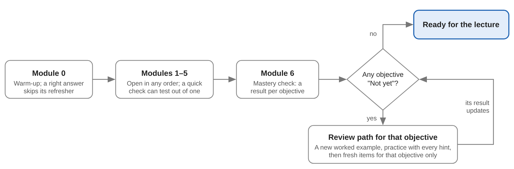

# Introduction and instructional design approach

## Purpose of the application

Ctrl Academy is a pre-lecture, tutor-style application for COS212 students. It teaches one data structure, graphs, and one algorithm, Breadth-First Search (BFS). Students use it before they attend the COS212 lecture on this topic, and it assumes no prior knowledge of graphs or BFS. The course takes about three hours, split into seven modules (0 to 6) of 5 to 55 minutes; it was planned at 75 minutes, and Section 4.4 explains the difference. Students can stop after any module and continue later.
This document describes how the application teaches: who the learners are, what they must learn, how the lessons are designed, and how we will check that the design works. The SE document describes how the application is built. Both documents describe the same prototype.

## Why we chose graphs and BFS

Graphs are a core topic in computer science. The CS2023 curriculum places graphs and graph traversal, including BFS, in its Algorithmic Foundations knowledge area [40]. BFS is also the base for later graph algorithms, such as depth-first search and shortest-path algorithms.

CS2023 numbers each topic so that it can be cited exactly [40, p. 33]. Our topic covers these CS Core entries:

- **AL-Foundational: 8**, graphs: directed or undirected, cyclic or acyclic, connected or not, weighted or not [40, p. 88]. This is the data structure the specification asks for.
- **AL-Foundational: 8.a**, graph representation: adjacency list against adjacency matrix [40, p. 88].
- **AL-Foundational: 11.c**, search algorithms, "uninformed depth/breadth-first tree search" [40, p. 89].
- **AI-Search: 2.a**, uninformed graph search for problem solving: breadth-first search [40, p. 68].
- **MSF-Discrete: 7.b**, a CS Core learning outcome: "Demonstrate different traversal methods for trees and graphs, including … breadth-first and depth-first search for graphs" [40, p. 188].

AL-Foundational 11.c speaks of *tree* search, so we do not rely on it alone. AI-Search 2.a and MSF-Discrete 7.b name BFS on graphs, and both are CS Core. CS2023 also sets a skill level for each topic [40, pp. 31–32, 320; 57, p. 16]: graphs (8) at Explain, the representation choice (8.a) at Apply, and BFS (11.c) at Apply. Table 1 in Section 3.2 maps our objectives to these levels.

Two parts of these topics are taught only briefly (#150). Module 2 compares the adjacency list with the adjacency matrix (8.a): the space each takes, and which answers "is X joined to Y?" or "which vertices are next to X?" in one step; BFS then uses the list. Module 4 explains BFS's running time, which AL-Complexity's learning outcome 4 asks for every algorithm in AL-Foundational [40, p. 92]: O(V + E) with an adjacency list, O(V²) with a matrix. Each is one short text segment, with no practice item yet.

BFS is hard for beginners. A student must track the current vertex, the queue and the found set at the same time, and one mistake changes the whole traversal. A lecture leaves little time to practise this tracking. The application gives guided practice before the lecture, so the lecture can go deeper.

## Our instructional design approach

Our design rests on the following choices. Each is explained in the section shown.
-	Process: ADDIE, used as a repeating cycle with rapid prototyping inside it [5, 23] (Sections 4.1 and 4.2). Section 4.6 compares it with the other models the module teaches, including SAM [58].
-	Lesson structure: Gagné’s nine events of instruction in every module [17] (Section 4.3), checked against Merrill’s first principles [58] (Section 4.5).
-	Alignment: objectives, learning activities and assessment all target the same skill [4] (Sections 3 and 4.4).
-	Guided active learning: worked examples first, then partly completed tasks, then tasks with most lines left blank, with a four-level hint ladder (Sections 5 and 7.5).
-	Mastery: each objective is reported on its own. A student who struggles on an objective in modules 1 to 4 gets a support segment (a new worked example and a fresh question), and a review path gives extra scaffolding after a "Not yet" in the mastery check [12] (Sections 3.2, 5.2 and 7.6).
-	Learning theories: the module’s behaviourist, cognitivist, constructivist, social cognitive and transformative views [47, 48], and the research on active learning, cognitive load, scaffolding and retrieval (Section 5).
-	Motivation: the ARCS model, flow, and Malone and Lepper’s taxonomy, supported by private points and badges [37, 41, 51] (Sections 7.1 and 7.2).
-	Inclusion: Universal Design for Learning and WCAG 2.2 level AA [31, 45], with Kolb’s learning cycle as a check on each module [50] (Section 6).
-	Evaluation: an expert review against usability heuristics so far, and a planned pilot, usage logs and surveys that feed back into the design (Section 8).

## Structure of this document

Section 2 describes the learners and what they already know. Section 3 sets the learning objectives and the criteria for success. Sections 4 and 5 explain the instructional design model and the learning theories behind the lessons. Section 6 covers learning preferences, accessibility and inclusion. Section 7 covers motivation, assessment, feedback and scaffolding. Section 8 explains how we will evaluate the application. Section 9 reflects on our instructional choices and their trade-offs. Section 10 records our use of generative AI.

# Target learners and assumed prior knowledge

## Intended learners for this application

The intended learners are students preparing for or beginning COS212 (Data Structures and Algorithms) at the University of Pretoria. The University of Pretoria 2026 Computer Science Yearbook [25] describes the programming knowledge covered in COS132, COS151 and COS110. COS132 introduces imperative programming. COS151 introduces algorithms and algorithm modelling. COS110 introduces object-oriented programming and basic data structures, including lists, stacks and queues. These modules provide a foundation for learning graphs and Breadth-First Search (BFS). Our application builds on this knowledge. It does not assume that students already know graphs or BFS, and it introduces these topics before the students attend their COS212 lectures.

## Prerequisites for using this application

### COS132: Imperative Programming

Students are expected to have basic programming knowledge. The University of Pretoria 2026 Computer Science Yearbook [25] states that COS132 covers types, control structures, arrays, functions and libraries. It also teaches students how to create, run and debug programs. The application can use these skills in its coding activities. Students can predict what a short piece of code will do. They can also complete missing lines of code in a BFS implementation. The application should not spend too much time teaching basic programming again. However, it should provide short explanations when students struggle with these concepts.

### COS151: Introduction to computer science

Students are expected to have basic knowledge of computer science and algorithms. The University of Pretoria 2026 Computer Science Yearbook [25] states that COS151 covers algorithms, complexity, Boolean logic, automata theory and algorithm modelling. The application can build on this knowledge when introducing BFS. It can explain the algorithm before showing the Python implementation. Students can first follow the steps using a graph diagram. They can then connect these steps to the code. This will help them understand the logic behind the algorithm.

### COS110: Introduction to program design

Students are expected to have experience with object-oriented programming and basic data structures. The University of Pretoria 2026 Computer Science Yearbook [25] states that COS110 covers modular program design, encapsulation, interfaces, reuse, lists, stacks and queues. The application can build on students' knowledge of queues. BFS uses a queue to determine which vertex must be processed next. However, students may need a reminder of how queues work. The application should explain this connection before students complete BFS activities.

## Distinguishing existing knowledge from new knowledge

The application should build on existing knowledge while teaching graphs and BFS from the beginning. For example, students are expected to know basic programming and queues. They are not expected to know how to represent a graph or perform BFS before using the application. They must learn what a graph is, why graphs are useful, what BFS does and how to implement it. This approach helps students connect new concepts to what they already know, and keeps the application from spending too much time reteaching prerequisite content. Students instead focus on the knowledge they need for the selected COS212 topic.

## Identifying potential differences between learners

### Programming knowledge and confidence

Students may have different levels of programming knowledge and confidence. Smith et al. [19] studied prior knowledge in introductory programming courses. Their findings showed that students' self-reported experience and confidence did not always provide the same information as a programming aptitude test. Their study also discussed differences in students' prior programming knowledge. This suggests that the application should not rely only on students' opinions of their own abilities. It should also include short practical tasks. These tasks can test whether students can apply basic programming concepts. The application can then provide suitable support where needed.

### Recall of prerequisite knowledge

Students may not remember all the concepts they learned in their prerequisite modules. A student may remember what a queue is but may have forgotten how to add or remove an item. Another student may understand loops but struggle to apply them in a BFS implementation. The application should include short refresher activities when these concepts are needed. For example, students could complete a single queue exercise before tracing BFS. This will allow them to revise the required knowledge without repeating an entire programming topic.

### Experience with the selected programming language

Students may differ in their experience with the programming language used in the application. The application uses Python to teach graph representation and BFS. Some students may be more familiar with a different programming language. The application should focus on the logic of graphs and BFS rather than treating knowledge of a specific language as proof of algorithmic understanding. A short introduction to the selected language may be useful. Students should then practise translating the algorithm into code. This will help them separate difficulties with programming syntax from difficulties with the algorithm itself.

### Learning pace and familiarity with visual representations

Students may progress through the material at different speeds. They may also differ in how familiar they are with graph diagrams and other visual representations. For example, one student may quickly identify vertices while another may need more examples before understanding how these connections are represented in code. Some students may also need more time to follow the queue during a BFS traversal. The application should allow students to pause, replay and step through the lesson. It should show the graph, queue and visited vertices during the algorithm. Students should also be able to connect the graph diagram to its code representation. These features will help them review difficult steps at their own pace.

## Common misconceptions about BFS

Beginners make predictable mistakes when they first meet BFS. We expect students to:

- confuse BFS with depth-first order and follow one branch to its end before visiting the other neighbours;
- forget to record a vertex as found (in the code, to add it to the `found` set) when it joins the queue, which causes repeated visits when a vertex can be reached along two routes, or an endless loop on a graph with a cycle;
- record a vertex as found only when it leaves the queue (when it is visited), so the same vertex is added to the queue more than once;
- not see why a queue, and not a stack, produces the level-by-level order;
- assume that BFS reaches every vertex, and miss the vertices in a disconnected part of the graph.

These misconceptions shape the design in three ways. Wrong options in prediction and multiple-choice items are built around them. Feedback names the misconception instead of only saying that an answer is wrong (Section 7.4). The two faulty BFS versions in module 5 contain bugs drawn from this list (a vertex recorded as found too late, and vertices that cannot be reached), the mastery check adds a third (a stack instead of a queue), and the test cases in learning objective 7 (a disconnected graph and a graph with a cycle) are chosen to expose them.

## How the learner profile influences the application's design

The application builds on students' existing programming knowledge while providing support when they need it. For example, students first meet graphs through a campus map and a short explanation of what graphs are for. They then label and build graphs, with their answer drawn as a graph. The application introduces BFS step by step: students predict the next vertex in the visualiser, fill in the queue in a trace table and complete small sections of code. A short queue refresher in module 0 comes before the BFS activities. The design connects new knowledge to concepts students have already met, and students practise throughout each lesson instead of only after watching a video. Immediate feedback and hints help students identify mistakes. Students who understand a concept can continue, while those who struggle can review the explanation and try again. Uhanova et al. [24] studied the relationship between prior programming knowledge, additional practice and academic performance in an introductory programming course. The authors reported better academic performance among students who attended an additional algorithm practice course. They discussed reviewing course content and solving extra problems as possible benefits of this support.

# Measurable learning objectives

## Learning objectives

By the end of the application, students should be able to achieve the following objectives. Each objective begins with an action verb, making it possible to measure their performance.

1. Define and distinguish a data structure, an algorithm, a graph and graph traversal, using an example of each.
2. Identify and explain vertices and edges in a graph and distinguish between directed and undirected graphs.
3. Map a real-world problem, such as a network of connected locations, to an appropriate graph representation, naming its vertices, edges and direction.
4. Explain the purpose of BFS and identify situations in which graph traversal is useful.
5. Trace BFS manually on a given graph, correctly identifying the next vertex to process, the queue contents, the visited vertices and the traversal order.
6. Implement BFS in Python using the selected graph representation and a queue, producing the expected traversal for a given input.
7. Test and debug a BFS implementation using suitable test cases, including a disconnected graph or a graph containing a cycle.
8. Use BFS to find the shortest route, measured in number of edges, between two vertices in an unweighted graph, and explain why BFS guarantees it.


The learning objectives move from simpler to more complex thinking. Learning objective 1, for example, asks students to define terms, while learning objective 7 asks them to test and debug code. The revised Bloom's taxonomy describes these levels as remember, understand, apply, analyse, evaluate and create [1]. Using the taxonomy helps us choose tasks that match the level of each objective. Table 1 shows the level assigned to each learning objective.

Each objective follows the form the module teaches: an action verb, a topic and a standard of mastery [52, p. 9]. There are eight, within the five to eight the lecture recommends [52, p. 10]. Objective 3 used to start with "Explain", an Understand verb, while its level was Apply. Its evidence was always modelling: the student names the vertices, edges and direction of a real situation. We therefore changed the verb, not the level. "Map" is one of CS2023's Apply verbs [40, p. 31], and MSF-Discrete outcome 7.c asks students to "model a variety of real-world problems … using appropriate forms of graphs" [40, p. 188].

The levels follow Thompson et al.'s reading of Bloom for programming [53]. Tracing code and implementing a known algorithm are processes the student applies, so objectives 5 and 6 are Apply [53, pp. 156, 158]. Judging whether code meets its requirements through a testing strategy is Evaluate [53, p. 158], which is what objective 7 asks. Table 1 also gives the CS2023 skill level for each objective. CS2023 groups Remember and Understand as Explain, and Analyse and Evaluate as Evaluate [40, pp. 31–32]. CS2023 lists "test" and "debug" as Apply verbs. We keep objective 7 at Evaluate, because the student must choose the test that tells a faulty version from a correct one, not only run a given test.

Objective 8 is Apply and Understand: the student applies BFS to find a shortest route, and explains why BFS guarantees it. CS2023 lists shortest-path algorithms among the core graph algorithms of its Algorithmic Foundations area, with Dijkstra's and Floyd's as examples [40]. BFS gives the shortest route when every edge counts the same: the simplest case, and the step before Dijkstra's algorithm. Asking for the reason, not only the route, answers Fritz's point that a working answer does not prove understanding [54]. Module 3 teaches it with a worked example on the campus graph ("found by", walked back from the goal, and why the rings guarantee the fewest edges), a practice question, support for a student who struggles, and the closing task (#70).

## What counts as successful performance?

Successful performance means meeting a clear criterion for each objective. An effective objective states what the student must do, the conditions under which the task is performed and the required standard [14]. For example, for learning objective 5, a student must trace BFS on a new graph with at most one error. Clear criteria remove guesswork and allow the application to assess every student consistently.

We judge each objective separately instead of giving one overall mark. A student may do well on learning objectives 1 to 4 but fail learning objective 6. One overall mark would hide this problem. Separate results show exactly what to review. This fits mastery learning, where students show that they have learned one step before they move on. A meta-analysis found that mastery learning programmes improved student achievement [12].

Each objective ends in one of three states. "Met independently" means the student met the criterion without needing hint level 3 or 4. "Met with support" means the student met the criterion after using one of those levels. "Not yet" means the student did not meet the criterion. For example, a student who needs the third hint, which gives most of the code, to write BFS is shown as "Met with support" for objective 6. An answer copied from the fourth hint, the worked answer, is not the student's own, so it never meets an objective: on the items that decide a result the hints stop before it (Section 7.5). This separates "can do" from "can do alone". The student sees both. This honest picture helps students decide how much more practice they need.

A student is ready for the lecture when no objective is marked "Not yet". The student does not need every objective to be "Met independently". The lecture will deepen the work. A student with a "Not yet" result is sent to a review path, which Section 7 describes. This meets the requirement that the application gives extra scaffolding to students who need it.

| No. | Level | CS2023 skill | Evidence the application collects | Criterion for success |
|---|---|---|---|---|
| 1 | Remember, understand | Explain | Matching and multiple-choice items on the key terms. | At least 4 of 5 items correct. |
| 2 | Understand | Explain | Labelling vertices and edges on 3 diagrams. Classifying 4 situations as directed or undirected from what each connection means. | At least 80% of the labels and classifications correct. |
| 3 | Apply | Apply | Choosing the graph model for 4 real-world situations. The student decides what the vertices and edges are, and works out the direction from what each connection means: the situation doesn't state it. | At least 3 of 4 situations modelled correctly. |
| 4 | Understand | Explain | Choosing when BFS is suitable in 4 short scenarios. The student picks the correct reason for each choice. | At least 3 of 4 choices and reasons correct. |
| 5 | Apply | Apply | Tracing BFS on an unseen graph of 6 to 8 vertices by filling in a table. | Correct queue, visited set and next vertex at every step, with at most one error. |
| 6 | Apply | Apply | Constructing BFS on the student's own graph class by ordering shuffled lines and filling in missing tokens. | The ordered and completed code matches the reference solution, including the expected traversal order. |
| 7 | Analyse, evaluate | Evaluate | Fixing 2 faulty versions of BFS by selecting and ordering the corrections. Choosing, for a disconnected graph and a graph with a cycle, the test cases that expose each bug. | Both faulty versions corrected to match the solution. For each bug, a chosen test case fails the faulty version and passes the correct one. |
| 8 | Apply, understand | Apply | 4 multiple-choice items on unseen graphs: the fewest edges between two vertices, the route BFS records by following "found by" back from the goal, and two items that ask why BFS guarantees the fewest edges. | At least 3 of 4 items correct. |

Table: Level, CS2023 skill level, evidence and success criterion for each learning objective.

Table 1 gives the evidence as designed. On staging, some items are simpler. Objective 2 uses four matching items instead of labelled diagrams. Objective 3 uses three multiple-choice items, in which the student recognises a model, and one matching item, in which the student builds it: each part of the situation is matched to vertices, an edge, the edge's direction or the kind of graph, with spare choices. The prompt says which way a "must be finished before" arrow points, and the item counts as one situation, right only when the whole model is, so the criterion still counts situations. Its review path practises the same kind of item first. Objective 5 has one trace item. In objective 7's fix-the-bug items, another line has as many candidate corrections as the faulty one, and hints 1 and 2 are about what the program outputs rather than about a line, so neither the choices nor the hints point at the bug and the student still has to locate it (the Analyse part of the objective). Every bug is a real BFS bug, not a break of the course's alphabetical convention.

# Instructional design model and its application

An instructional design model is a clear step-by-step guide for creating good learning materials. It helps designers identify what students need, plan lessons, develop content and evaluate its effectiveness. Using an instructional design model gives teachers and designers a structured process for planning and improving learning materials. The aim is to stay organised and ensure that each lesson supports student learning.

## Using the ADDIE instructional model

We use the ADDIE (Analyse, Design, Develop, Implement and Evaluate) model as the core framework for our group project. It guides designers through a structured process of research, planning, lesson development, implementation and evaluation. In our project, each phase creates clear work to share and review, such as a learner profile or lesson plan. Although ADDIE can be linear, we use it as a flexible, repeating cycle so we can quickly fix parts that fail student testing [5]. To save time and avoid late surprises, we also use rapid prototyping inside ADDIE by building early versions of our lessons and reviewing them on staging after each sprint [23]. Overall, this combined approach gives us a clear, proven process that lowers development costs and helps us improve our application quickly before the deadline.

## Applying ADDIE to the COS212 application

Table 2 shows how each phase applies to this project. The software engineering side of the project is described in the SE document. This document describes the learning design. Both documents describe the same prototype.

| Phase | Work in this project | Output | Dates |
|---|---|---|---|
| Analyse | Study the learners, their prior knowledge and the differences between them (Section 2). Check what CS2023 lists for graphs and BFS. | Learner profile | 22 October – 1 November 2026 (Sprint 0) |
| Design | Write the objectives, success criteria, assessments and lesson plan. Choose the motivation and gamification design. | Objectives, assessment plan and storyboards | 22 October – 12 November 2026 (Sprints 0 to 2; the storyboards came last, alongside the content: Section 4.7) |
| Develop | Build the lessons, tasks, hints and feedback messages. Write the code activities (Parsons, fill-in, fix the bug, choose tests) and their solutions. | Working prototype | 2 – 15 November 2026 (Sprints 1 and 2) |
| Implement | Release the prototype: to staging after each sprint, and to production on 13 November. A pilot with team members on staging was planned for 10–11 November and has not been run (Section 8.3). | Releases on staging and production | 2 – 13 November 2026 (Sprints 1 and 2) |
| Evaluate | Review each increment, run an expert review against usability heuristics, and audit the content. Update the design. Finish this document. | Expert review findings and fixes (Section 8.2) | 9 – 16 November 2026 (expert review and the 13 November content audit; the pilot and its survey are still to run) |

Table: The ADDIE phases applied to the COS212 application.

In the Develop phase the ID team writes the lessons, tasks, hints and feedback directly in the application's staff portal, where they go live as soon as they are saved (SE document FR-11). The portal refuses any change that breaks a rule of the design, for example a review-path practice item without all four hint levels, or an objective with no item in the mastery check. This lets each pass through the Develop phase be short.

## Lesson structure using Gagné's nine events

We use Gagné's Nine Events of Instruction as a step-by-step guide to structure all the modules in our application. This framework helps teachers plan and deliver effective lessons by organising learning into nine clear stages [17], such as opening with a short hook and ending with a real-world task. We use this model because it gives us a proven structure so we do not have to invent one under time pressure, while keeping students engaged and ensuring they can apply what they learn. Table 3 shows how the application carries out each event.

| Event | How the application does it |
|---|---|
| 1. Gain attention | Module 1 opens with a campus map and a puzzle: "What is the fewest number of walkways you need to walk along" from the Admin block to the Green? It appears before any terms are taught. |
| 2. Inform learners of the objectives | Each module starts with "By the end of this module you can …" in plain words. The words match the objectives. |
| 3. Stimulate recall of prior learning | Module 0's queue refresher, which uses COS110 knowledge: add an item, remove an item and first in, first out. From module 2, one or two retrieval questions open each module. |
| 4. Present the content | A narrated video in each of modules 1 to 5; in module 1 it turns the campus map into a graph. Each segment covers one idea. The videos are recorded (#37) and attached to their segments through the staff editor, with captions and a transcript. A segment's text is shown with it, and on its own until a video is attached, so the definitions are taught before the activities that use them (#149). |
| 5. Provide learning guidance | A worked example before practice: in module 1, how to read a graph. For code, a Parsons problem, then partly completed code, then most lines left blank. A four-level hint ladder is always available, and a student who struggles on an objective gets a support segment (Section 5.2). |
| 6. Elicit performance | Checkpoints before the lesson continues. In module 1 the student labels and builds graphs; later modules ask the student to predict, trace, complete or order code. |
| 7. Provide feedback | Instant and specific feedback that explains why an answer is wrong. In module 1 the application draws the student's answer as a graph and, after a right answer or the last hint, shows it beside the correct graph (#155). |
| 8. Assess performance | Each of modules 1 to 5 has a quick check, which a student can take to test out of the module. The course ends with the mastery check on unseen graphs, with a result for each objective. |
| 9. Enhance retention and transfer | Module 1 ends with four closing tasks that move the idea to new settings: the Gautrain, Instagram, the web and handshakes. Later modules open with retrieval questions, and a closing task at the end of module 5 that applies BFS to a study-group network: a trace from one person (objective 5), then the fewest introductions to another and why BFS guarantees it (objective 8). It is near transfer: module 3 already uses a social network, and the question has the same shape as module 3's closing task. Two optional bonus quests, after modules 3 and 4 (#87). |

Table: Gagné's nine events applied to the BFS lessons, with module 1 as the example.

## Lesson sequence

The application has seven short modules, each focused on one main idea. Each module except the mastery check fits in under half an hour. The course was planned at about 75 minutes; as written it takes about 180, and Table 4 shows both. Students can stop after any module and the application saves their progress. Table 4 shows each module, the objectives it covers and its activities.

The modules are shown in this order, and the order is the recommended path, but the student chooses where to start (SE document FR-2.1, #214). Testers said a fixed order forced every student through questions they already knew. The research on learner control does not support simply handing that choice to the student. A meta-analysis of learner control in educational technology found an overall effect near zero [70], and a meta-analysis of web-based instruction found that control over the sequence is the only kind that generally does not harm learning or learners' reactions [71], so control over what to study or skip is not safe by default. Novices are also the worst judges of what they know: the least skilled overestimate their skill the most [73], and students who judge their learning too generously stop studying early and remember less [74]. Against this, making a student who already knows the material work through guidance meant for novices has a cost, because the guidance becomes redundant load [10]; instruction should follow what the student can show now, and be adjusted as that grows [72]. And when the system and the student share control, the student's involvement rises without losing the efficiency of adapting to their performance [75].

So control is shared, and guidance stays the default, as Kirschner and colleagues argue it must for novices [11]. Modules 0 to 5 are open from the start, which gives the student control of the sequence, the kind the research finds safe [71]. The module map always marks one module "Recommended next": the first in order not done. A student skips a module only by passing its quick check (the "Cognitive load and multimedia design" section), never on their own say-so, and a failed check names what was missed and where to start. Only the mastery check (module 6) waits: it opens once modules 1 to 5 are each complete or tested out.

Open modules let a student start a module before the one it builds on. Module 4 builds BFS on module 2's `Graph` class, so a student could open module 4 first. The map recommends module 2 before module 4, and module 4 opens with two retrieval questions, one of which asks what module 2's `Graph` class stores for a vertex (`g.adjacency`); a wrong answer is explained before the student goes on. More generally, a student who starts with a later module still meets its retrieval questions first; any answer moves them on, so for them the questions are a short check of what the module builds on.

Constructive alignment means that objectives, learning activities and assessment point to the same skill [4]. For example, learning objective 6 asks students to implement BFS. So the activity is constructing BFS — ordering shuffled lines and filling in the missing tokens — and the assessment compares the result with the reference solution. Parsons problems are a validated proxy for code-writing ability (§5.3), so this keeps the objective at its level while running no student-written code. A multiple-choice question about BFS would not show that a student can build it. The alignment keeps the application honest about what it teaches and what it measures.

> **Revision (3 November 2026).** Code activities were changed from free-text code writing to ordering (Parsons) and fill-in-the-blank, checked by comparison with the solution. This was a software-security decision (the freeform code runner was removed; see SE document §15.3): it removes all execution of untrusted student code. The learning objectives and their Bloom's levels are unchanged. Objective 7 uses two activities of the same kind. In *fix the bug*, the student marks each faulty line of a BFS and chooses its correction from a given set, or moves a line that is in the wrong place. In *choose tests*, the student selects every test case (a small graph, a start vertex and the expected order) that the faulty version fails and the correct version passes.

| Module | Learning objectives | Main learning activities | Assessment evidence | Planned (minutes) | As written (minutes) |
|---|---|---|---|---|---|
| 0. Warm-up and queue refresher | Prior knowledge | Short quiz on queues and basic Python. A right first answer to a warm-up question, before hint 3, skips the refresher after it (#224). | Diagnostic answers | 5 | 5 |
| 1. What is a graph? | 1, 2, 3 | Build a campus graph by matching each walkway to the two buildings it joins (designed as adding vertices and edges by hand; not built). Classify directed and undirected graphs. Model four real situations as graphs, each with its own options: vertices and edges swapped, the wrong direction (a moving train taken for a one-way edge, a handshake taken for two arrows), the wrong things. | Labelling and matching checkpoints; the closing task's four multiple-choice modelling questions | 12 | 25 |
| 2. A graph in Python | 2, 6 | Complete `add_vertex` and `add_edge` in a `Graph` class by filling in missing tokens. Make the class handle directed and undirected edges. | Completed code checked against the solution | 10 | 20 |
| 3. Meet BFS | 4, 5, 8 | Watch BFS on the campus graph. Predict the next vertex. Fill in the queue, the visited set and the traversal order. Find the fewest walkways by walking "found by" back from the goal, and say why BFS guarantees them. | Trace checkpoints; the fewest walkways | 12 | 25 |
| 4. Build BFS | 6 | Put shuffled lines of code in order (Parsons). Fill in the missing tokens. | Line order and tokens checked against the solution | 15 | 25 |
| 5. Test and debug | 7 (closing task: 5, 8) | A worked example of finding and fixing a bug. Find and fix bugs in two faulty BFS versions by selecting and ordering the corrections. Choose the test cases (a disconnected graph, a graph with a cycle) that expose each bug. A closing task on a study-group network: a trace, then the fewest introductions. | Fixes and test choices checked against the solution; the closing task's trace and answer | 10 | 25 |
| 6. Mastery check and report | 1–8 | Unseen items on every objective. Each item is answered once, with hints up to level 2; results are shown in the report when the check is finished. A report for each objective with next steps. | Criteria in Table 1 | 10 | 55 |

Table: The lesson sequence, in which each row links objectives, activities and evidence. This follows constructive alignment [4].

The plan gave the course about 75 minutes. As written it takes about 180, and the application now shows that figure, module by module ("As written" in Table 4), on the register page and the module map. The estimate reads text and the narration scripts at 130 words a minute and adds a fixed time to answer each kind of activity: half a minute for a multiple-choice item beyond reading it, three minutes for a trace table, two for a fix-the-bug item. Support segments and bonus quests are left out, because only some students see them. A test keeps each module's minutes within a third of this estimate as the content changes (`api/tests/test_minutes.py`).

Showing the real figure is a design choice. A student told 75 minutes who is still working after two hours learns not to trust the application, and loses the sense of control that the ARCS model's confidence category asks us to support (the "Motivation" section) [37]. The course is also longer than one sitting, which the application already allows: progress is saved after every segment, and each module except the mastery check fits in under half an hour. Real students' timings will show whether the estimate is right and what to cut; module 6, with 28 items in about 55 minutes, is the first candidate.

Each checkpoint is small and focused on one key idea. Here is an example from module 2. The lesson explains that an undirected edge must be stored in both directions. The student then completes the method below.

```python
class Graph:
    def __init__(self):
        self.adjacency = {}  # vertex -> list of neighbours

    def add_vertex(self, v):
        if v not in self.adjacency:
            self.adjacency[v] = []

    def add_edge(self, a, b):
        # Connect a and b in both directions.
        ...
```

## Merrill's first principles compared with Gagné

Merrill's first principles describe when learning is most effective [58, pp. 16–17]. Learning is task-centred: students learn concepts in the context of real-world tasks. Around that task, they activate what they already know, watch a demonstration, apply the new skill, and integrate it into their own work. Table 5 checks the application against each principle.

| Principle | What it asks | How the application meets it | What is missing |
|---|---|---|---|
| 1. Task-centred | Learn in the context of a real-world task. | One task runs through the course: finding the route with the fewest walkways across the campus. The same campus graph returns in modules 1 to 4. | Each module is organised by topic (graphs, then code, then BFS), not as a series of harder whole tasks. |
| 2. Activation | Recall relevant earlier knowledge. | The module 0 diagnostic and queue refreshers. One or two retrieval questions open each module from module 2. | Module 0 recalls queues but not the Python the code tasks use: dictionaries, sets and classes. |
| 3. Demonstration | Watch the skill being done. | Narrated videos in modules 1 to 5, worked examples in modules 1 to 5, and the BFS visualiser in watch mode. | Module 3's worked trace table still comes after the visualiser practice. |
| 4. Application | Practise the new skill, with feedback. | Activities with three-part feedback and the hint ladder in modules 1 to 5, and the mastery check. Module 5 practises objective 7 with two fix-the-bug and two choose-tests items (#189). | Objective 5 has few full traces before the mastery check: module 3's trace table, a support trace for a student who struggles, and module 5's closing task. |
| 5. Integration | Use the skill in one's own work: reflect, discuss, defend. | The per-objective report, and the COS212 lecture that follows. | Nothing in the application asks the student to explain, defend or reuse what they learnt. |

Table: Merrill's first principles applied to the application [58].

The lecture asks how Merrill's principles differ from Gagné's [58, p. 38]. Gagné's nine events are a sequence a teacher follows inside one lesson [58, p. 15]. Merrill's principles are conditions for learning, seen from the learner's side. Three differences matter for us. Merrill puts a real task at the centre; Gagné starts from objectives. Gagné has explicit events for stating objectives, assessing and supporting retention, which Merrill leaves implicit. Merrill adds integration, which Gagné's event 9 (retention and transfer) only partly covers. Using both shows our weak point: the lessons follow Gagné's events closely, but integration is left to the lecture.

## Why ADDIE, and how it compares with other models

The lecture lists eight instructional design models, among others [58, p. 20]. Table 6 compares the four we considered most closely with ADDIE.

| Model | What it is | What we took from it, or why we did not choose it |
|---|---|---|
| Dick and Carey (1978) | A systems model. Goals and entry behaviours lead to performance objectives, then criterion-referenced tests, then strategy and materials, then formative and summative evaluation and revision [58, p. 21]. | We took its order: Table 1's criteria were written before the content. As a whole it has more steps than a two-week build (Sprints 1 and 2, 2–15 November) allows, and its evaluation comes after the materials are finished. |
| ASSURE (1996) | Analyse learners, state objectives, select media, use them, require learner participation, evaluate and revise. It builds in Gagné's events [58, p. 33]. | It is made for a teacher choosing existing media for a class. We have to build the media. |
| Pebble in a Pond (Merrill, 2012) | Problem-centred. Start from a problem, design a progression of problems, then the component skills, then strategy, then evaluation. Objectives are less detailed [58, pp. 34–35]. | Our campus-routing problem is its first ripple. We did not follow it because the specification and our mastery reporting need detailed, measurable objectives from the start. |
| SAM 2 (Allen, 2021) | An agile model. A preparation phase, then repeated design–prototype–review, then repeated develop–implement–evaluate, released as alpha, beta and gold [58, pp. 36–37]. | Closest to what we actually do (see below). |
| ADDIE (chosen) | Analyse, design, develop, implement, evaluate [58, pp. 23–31]. | Chosen: each phase gives a clear output for this document (Table 2), and the lecture's own example of material for COS212 uses it [58, p. 32]. |

Table: Instructional design models compared with ADDIE [58].

Section 4.1 says we use ADDIE as a repeating cycle with rapid prototyping inside it. That is close to SAM. The platform was built in one-week sprints and reviewed on staging after each one (SE document §2.1), which is SAM's iterative development. The content arrived later, in Sprint 2, and has been through one review so far: an expert review and content audit on 13 November, followed by rewrites (#214, #215). The application was released to production the same day, SAM's gold release, without the beta a pilot would have given. So our platform followed SAM, while our content has had only one design–build–review cycle before the deadline. We kept the ADDIE names because they are the lecture's main model and they structure this document. Smith and Ragan's three phases (analysis, strategy, evaluation) [58, p. 22] fold into the same steps and add nothing we need.

## Storyboards

The lecture calls the storyboard "one of the most important steps" of ADDIE's Design phase [58, p. 26]. A storyboard is a sequence of frames that shows, before anything is built, what each scene contains, so that it can guide the people who build it [58, p. 27].

Our storyboards are of two kinds:

- **Narration scripts** for modules 1 to 5, in `docs/id/module-1/` to `docs/id/module-5/`. Each row is one frame: the time, what is on screen and the narration. These are close to the three columns of the lecture's example storyboard (video, diagram, audio) [58, p. 28]. They also give each video's checkpoint questions, feedback and hints.
- **Wireframes** of the main screens in the SE document (§11.1), which storyboard the interactive screens.

This part of the Design phase was done late and is incomplete. The scripts were added to the repository between 8 and 12 November, at the same time as the content was loaded, not before it. There is no storyboard for modules 0 and 6, or for the review paths. The videos were recorded from the scripts afterwards, and the narration differs from them in places.

## Are SE and ID so different?

The lecture ends by asking this question [58, pp. 2, 38]. For this project, the processes are close and the measures of success are not.

The processes match step for step. Scrum's one-week sprints are the iterations of SAM, or of ADDIE used as a cycle. Each sprint ends with an increment on staging that the instructional designers review, which is formative evaluation (SE document §2.1). Content work is on the same backlog as code, and an ID member accepts each content item. The two documents also share artefacts: the objectives and criteria in Table 1 are stored in the application, and the mastery service applies them (SE document FR-7.1).

The difference is what counts as done. Software engineering can show that the application behaves as specified: the tests run on every change. Instructional design must show that students learn, and only learners can show that. A passing test suite says nothing about whether a novice can trace BFS. The two also constrain each other. On 3 November, a security decision removed free code writing (Section 4.4), and the ID side then had to show that Parsons problems still assess objective 6 at its level (Section 5.3). So SE and ID are one process with two kinds of evidence, and a change on either side has to be checked against both.

# Learning theories and instructional rationale

We use four groups of ideas to explain our design: active learning, cognitive load, scaffolding and retrieval practice. Motivation theories appear in Section 7. Table 7 summarises these ideas, and Section 5.5 places them in the learning theories the module teaches.

## Active learning

Students learn more when they do something with the content. The ICAP framework ranks learning activities as passive, active, constructive and interactive, and it links deeper activity to deeper learning [6]. A large review of science, engineering and mathematics courses found that active learning raised exam scores and lowered failure rates compared with lectures [8]. Our checkpoints ask students to drag, trace and complete code. These are active and constructive tasks. The application cannot offer peer discussion, so the lecture will provide the interactive part.

Active learning does not mean unguided learning. Kirschner, Sweller and Clark argue that minimal guidance works poorly for novices [11]. Our students are new to graphs. For this reason every task is guided. Each task has a worked example before it, small steps and hints. The student is active, but the student is not alone. Letting students choose which module to start (the "Lesson sequence" section) does not change this: the guided path stays the default and is always marked, and a student leaves it only by passing a check, not by deciding they know enough [73, 74].

Interactive video also supports learning. Zhang and colleagues compared video that let learners control how they moved through it with video that did not. The group with control had better learning results and higher satisfaction [29]. Another study put short tests inside an online lecture. This reduced mind wandering and improved later test results [22]. These findings support our lesson format, which stops for tasks and gives the student control.

## Cognitive load and multimedia design

Working memory is limited, so a lesson must avoid overload. BFS asks a student to track the current vertex, the queue and the found set at the same time. Sweller showed that novices who solve problems by searching for a method can struggle to build useful knowledge, and that worked examples can help [20]. Later work asks designers to cut load that does not help learning [21]. For this reason a worked example comes before practice in every module from 1 to 5. Code tasks then move from ordering lines to partly completed code, and then to code with most lines left blank. The worked examples in modules 3 and 4 also label the subgoals of BFS: initialise, take the next vertex, for each neighbour, mark and enqueue. Module 4's Parsons problem names them in its first hint. Subgoal labels improve novices' performance and transfer, and help on Parsons problems [63, 64, 65].

We also apply Mayer's multimedia principles [15]. We use signalling, which means the current vertex is highlighted in each step. We use segmenting, which means each segment covers one idea and the student controls the pace. We use pre-training, which means the key terms and the queue refresher come before BFS. We use coherence, which means we leave out decoration that does not teach from the material itself; the decoration we allow around it (a background glow and an optional companion beside feedback) is discussed under "Engagement and gamification". These choices cut extra load, so students can spend their effort on the algorithm.

Support must also fade as skill grows. Kalyuga and colleagues found that guidance that helps novices can hurt more experienced learners [10]. For example, a confident student may find a long worked example slow and boring. The application therefore offers optional bonus quests for students who want more challenge: two are built, after modules 3 and 4 (#87). A student who thinks they know a module can take its quick check instead of working through it (SE document FR-8.2, #214): four questions, one answer each, no hints, marked together at the end. Three or four right marks the module as passed ("passed the quick check") and sends the student on. Fewer names what was missed and suggests where to start: the module before, if they got nearly everything wrong and haven't done it; else the earliest module that teaches the first thing missed; else this module. Nothing is taken away or locked after a fail. It is one try per module. Passing earns the module a silver medal but no points or badge, because those mark work done in the module. Module 0 has no quick check: a right first answer to each of its warm-up questions, before hint 3, skips the refresher that follows it (#224).

The opposite case is built: extra support for a student who is struggling (SE document FR-8.4, #172). A module can give an objective a short worked example and one or two fresh practice items, placed right after its base practice on that objective. Only a student who got 2 of 3 first attempts in a row wrong on that practice, or who needed hint 3 or 4, sees them; where there is only one practice item before the support, getting it wrong first time is enough. Everyone else moves straight on. This adapts the fading to each student instead of fixing it per module. It returns a struggling student to a worked example before the next problem [20], and it spares a confident student guidance they no longer need [10]. It is also the corrective step of mastery learning, applied inside the module rather than only after the mastery check [12]. The support is shown once and never repeated, so a student can't spin on it. It costs no points, so there is no reason to avoid it. It opens with one kind line, "Let's look at this another way before you move on.", which is about the content and not about the student's mistakes (Section 7). It is never part of the mastery check or a review path. Modules 1 to 4 have 21 support segments (#173); module 5 has none.

## Scaffolding and the zone of proximal development

Students learn best at the edge of what they can do alone. Vygotsky called the gap between what a learner can do alone and what a learner can do with help the zone of proximal development [27]. A student who cannot write BFS alone may manage it with a partly completed version. Our tasks sit in this gap, and help is always available.

Scaffolding is temporary support that fades. Wood, Bruner and Ross described tutor support such as simplifying the task, keeping the learner focused on the goal and pointing out key features [28]. Van de Pol and colleagues name three features of good scaffolding: it responds to the learner, it fades and it passes responsibility to the learner [26]. Our hint ladder, our support segments and our move from worked example to code with most lines blank follow these features. Module 3 gives a lot of support. Module 5 gives much less.

Computer-based scaffolding works in practice. A meta-analysis of science, technology, engineering and mathematics education found that computer-based scaffolding had a positive effect on learning [3]. This supports the idea that an application can give useful support without a human tutor.

We also use Parsons problems as a step between reading code and writing code. A Parsons problem asks the student to put shuffled lines of code in the right order. Denny, Luxton-Reilly and Simon found that student performance on these problems was highly correlated with performance on code-writing questions [7]. This suggests that the problems test a related skill. The student can focus on the order of the steps and does not have to recall every line of syntax. They are also easy for the application to mark.

## Prior knowledge, retrieval practice and tracing

New ideas stick best when they link to what students already know. Ausubel argued that prior knowledge is the most important influence on learning [2]. Our students know queues from COS110. The warm-up recalls that knowledge, and module 3 then shows that BFS is a queue at work. This links the new idea to a familiar one.

Recalling information strengthens memory. Roediger and Karpicke found that taking memory tests led to better long-term retention than repeated study [18]. For this reason each module opens with one or two questions on earlier modules. This practice helps students remember. It also shows them which ideas are still weak.

Students need to trace code before they can write it well. Lister and colleagues found that many novice programmers could not trace short pieces of code correctly. They suggested that reading and tracing are skills students need before they write code [13]. For this reason students trace BFS by hand in module 3, before they build it in module 4. On staging they predict each step in the visualiser and read a worked trace table; then they fill in a trace table of their own, with feedback for each step. Each row is marked from the student's own previous row as well as against the true trace, as a hand trace is marked in an exam: a slip early in the table costs one step, not every step after it. Without this, objective 5's "at most one error" would be failed by one early slip.

Showing BFS on screen helps only if students take part. Hundhausen, Douglas and Stasko found that how students use a visualisation matters more than what it shows [9]. Naps and colleagues reached a similar view. They concluded that visualisations help when they make learners active [16]. For this reason students predict the next vertex before the animation shows it. The animation then confirms or corrects the prediction.

| Theory | Key idea | How the application applies it |
|---|---|---|
| Active learning [6] | Deeper activity leads to deeper learning. | Checkpoints ask students to predict, order and complete code. Students also trace BFS in a table, one row per step. |
| Cognitive load [21, 15] | Working memory is limited. | Worked examples first. One idea per segment. The graph, queue and found set shown together. |
| Scaffolding [27, 28] | Support lets students do more than they can alone. It fades over time. | A four-level hint ladder. Parsons problems. Less help in later modules. |
| Retrieval practice [18] | Recalling information strengthens memory. | Opening questions on earlier modules. A final mastery check. |
| Prior knowledge [2] | New ideas link to existing ideas. | A warm-up on queues and basic Python. |

Table: Summary of the learning theories and how the app applies them.

## The module's learning theories

The module defines learning as "an enduring change in behavior, or in the capacity to behave in a given fashion, which results from practice or other forms of experience" [48, p. 2]. The lecture names behaviourism, cognitivism, constructivism and transformative learning, and its readings add social cognitive theory and information processing [48, pp. 3, 7]. The research in Sections 5.1 to 5.4 sits inside these theories. Table 8 shows what we take from each, where the application uses it, and what we leave out.

| Theory | Key idea | Where the application uses it | What we limit or leave out |
|---|---|---|---|
| Behaviourism | A response followed by a reinforcing consequence becomes more likely (the three-term contingency). Complex behaviour is shaped by reinforcing small steps. Instruction should have measurable objectives, small steps and reinforcement; mastery learning applies this [47, pp. 114–115]. | Every practice answer gets an immediate result. Points reward correct work. Tasks go in small steps from worked example to code with most lines blank. Objectives are measurable, and mastery is judged per objective. | Reinforcement does not explain understanding. Points are private and reduced after hint level 3 or 4, so that they do not become the goal (Section 7.2). |
| Information processing (cognitivism) | Information passes from the sensory registers to a working memory of limited capacity, and is kept in long-term memory when it is organised and linked to what the learner knows. Advance organisers and reducing extraneous load apply this [47, pp. 224–226]. | The visualiser's panel keeps the current vertex, the queue and the found set on screen, so the student does not hold them in memory. One idea per segment. Each module states its goals first, as an advance organiser. The campus graph gives one familiar context. | — |
| Constructivism | Learners construct their own understanding. The teacher structures the environment and gives scaffolding in the zone of proximal development. Discovery needs carefully arranged activities [47, pp. 274–276]. | Students predict the next vertex before BFS shows it, then compare, and fill in trace tables of their own. Scaffolding fades across modules (Section 5.3). | Pure discovery, which works poorly for novices [11]. Peer discussion, which the application cannot offer; the lecture provides it. |
| Social cognitive theory | People learn by doing (enactively) and by observing models, reading and listening (vicariously). Self-efficacy and visible progress towards goals sustain learning. Worked examples apply these ideas [47, pp. 159–161]. | Worked examples and the narrated videos model the skill. Activities give enactive practice. Module goals, the module map and the per-objective report make progress visible. "Met with support" keeps self-efficacy honest. | Peer models: the student works alone. |
| Transformative learning | A "disorienting dilemma" leads to critical reflection on one's assumptions and a change of perspective. Smaller predicaments set by a teacher can also start it [49]. | On a small scale: the campus puzzle comes before any teaching, and feedback names the student's misconception, for example that adding a vertex to `found` (the set of found vertices) only when it leaves the queue lets it join the queue twice. The review path after a "Not yet" asks the student to rethink the idea that tripped them up, with a new worked example and fresh questions (Section 7.6). | A three-hour tutorial cannot transform a perspective. This theory fits the individual reflection report better than the application. |

Table: The module's learning theories applied to the application [47, 48, 49].

# Learning preferences, accessibility and inclusive design

## Learning preferences

Students differ in how they prefer to learn. A popular idea is that teaching should match each student’s “learning style”, for example visual or auditory. A major review found almost no evidence that matching teaching to a learning style improves learning [42]. We therefore do not sort students by style or build a separate version of the lessons for each style.
Instead, we follow Universal Design for Learning (UDL), which gives every student several ways to learn [31]. Every student gets every representation, so a student who prefers diagrams and a student who prefers text can both use the same lesson. The Table below shows how the application applies the three UDL principles. This also fits the multimedia principles in Section 5.2.

| UDL principle | How the application applies it |
|---|---|
| Multiple means of representation | Each idea appears as text, a worked example and, where relevant, code. BFS also appears in the visualiser, which draws the graph and shows the current vertex, the queue and the found set. Narrated videos in modules 1 to 5 (#37), with captions on by default and a transcript below each. |
| Multiple means of action and expression |	Students answer by choosing, matching, ordering lines, completing code, predicting each BFS step in the visualiser and filling in trace tables. Labelling and building graphs by hand are not built; module 1 uses matching instead. |
| Multiple means of engagement |	Students control their pace and ask for hints only when they choose. A right first answer in module 0's warm-up skips the refresher after it (FR-8.1, #224), and a module's quick check lets a student test out of the whole module (FR-8.2, #214). Two optional bonus quests, after modules 3 and 4, give extra challenge to students who want it and never hold anyone back (#87). |

Table: Universal Design for Learning applied to the application [31].

The examination specification asks which learning styles the application caters for. Because every student receives every representation, the application caters for the common style categories without sorting students into them. Fleming's VARK model names four such categories [46], and the table below shows that each one is covered. We use this list only to check that no type of representation is missing, not to label students.

| Style category | Where the application provides it |
|---|---|
| Visual | The visualiser's drawing of the graph, with each vertex's state shown by colour, a marker and a label, and the panel showing the queue, the found vertices and the visited ones. A text drawing of the campus map in module 1. |
| Aural | Narrated videos in modules 1 to 5, which stop at checkpoint questions (#37). |
| Read/write | Short definitions, worked examples, code, written feedback and hints, and the per-objective report. Transcripts come with the videos. |
| Kinesthetic | Ordering Parsons lines, completing code, matching, stepping through BFS in the visualiser and filling in trace tables. |

Table: Learning-style categories covered by the application's representations.

So every channel is covered, but the kinesthetic channel is limited to ordering and completing code, matching, and stepping through BFS. Building and labelling graphs by hand, which the design first planned for module 1, would strengthen it.

### Where VARK sits, and the lecture's other style models

Curry's onion sorts learning-style models into three layers: perceptual modality, information processing and personality [50, p. 4]. VARK belongs to the perceptual-modality layer, and Honey and Mumford's model to the information-processing layer [50, p. 24]. We cater for these two layers. We do not address personality models.

Honey and Mumford describe four styles: activists learn by doing, reflectors by observing and thinking back, theorists by understanding the theory, and pragmatists by putting learning into practice in the real world [50, p. 19]. Each finds something in every module. Activists answer a checkpoint before the explanation. Reflectors can step back through BFS in the visualiser and reread worked examples and feedback. Theorists get the rules of BFS and the reason a queue gives the level-by-level order. Pragmatists get the campus routes and real networks. The model also says learners should know their own style [50, p. 18]. We do not test students' styles, for the reason Pashler et al. give [42].

The lecture and Pashler et al. start from different positions but reach the same practical conclusion. The lecture concludes that no single style meets every learner's needs, that learning environments must be adaptable, and that several styles must be considered to keep learners engaged [50, p. 25]. Pashler et al. found no evidence for matching teaching to a style [42]. Both support offering every representation to every student, which is what UDL does. The lecture also notes that AI-based adaptive systems personalise content as the learner works [50, p. 26]. Our adaptation is simpler and rule-based: module 0's warm-up chooses which refreshers a student sees (FR-8.1), support segments respond to a student who struggles on an objective (FR-8.4), and the review path responds to each objective's result.

### Kolb's learning cycle in each module

Kolb's experiential learning theory describes a four-stage cycle: concrete experience (have an experience), reflective observation (reflect on it), abstract conceptualisation (draw a conclusion) and active experimentation (put the theory into practice) [50, pp. 12, 16]. The lecture says that an ideal learning process engages all four of Kolb's learning styles [50, p. 13], Divergers, for example, favour concrete experience and reflective observation [50, p. 14], so we check that every stage appears. Table 11 checks each stage.

| Stage | Where the application provides it | What is weak |
|---|---|---|
| Concrete experience | The campus puzzle before any terms are taught (module 1). Predicting each BFS step in the visualiser (module 3). | After their retrieval questions, modules 2 and 4 open with a video or a worked example, so they start at abstract conceptualisation. |
| Reflective observation | Feedback that gives the reason for a result. Stepping back and replaying BFS in the visualiser. A short "why" question after each worked example in modules 1 to 4 asks the student to explain a step [62] (#150). | No "why" question follows a level-4 hint yet. |
| Abstract conceptualisation | Definitions, the three rules of BFS, and worked examples in modules 1 to 5. | — |
| Active experimentation | Practice on new graphs, ordering and completing BFS in module 4, and the closing task on a new directed graph. | Testing and debugging in module 5 (#189) gives the faulty programs; the student does not yet find a bug by testing their own code. |

Table: Kolb's learning cycle in the application's modules [50].

Every stage appears somewhere, but reflective observation is the weakest. This matches Merrill's missing integration step (Section 4.5): the application asks students to do and to check, but seldom to think back.

## Accessibility

The application aims to meet WCAG 2.2 at level AA [45], the same target as the SE document (NFR-A1 to NFR-A4). WCAG 2.2 keeps every 2.1 criterion used below and adds some that matter here: a focused control must not be hidden by the sticky header (2.4.11 Focus Not Obscured), dragging must have a non-drag alternative (2.5.7 Dragging Movements) and targets must be at least 24 by 24 px (2.5.8 Target Size). The review of 13 November found 2.4.11 failing in two places (the skip link and Shift+Tab in fix-the-bug and Parsons, under the sticky header). Both are fixed: the skip link is drawn above the header, and the page's scrolling is padded by the header's height, so a control reached with Tab or Shift+Tab is scrolled clear of it. An end-to-end test checks both on a phone-sized screen. The Table below lists the main barriers in our lesson design and how each one is removed.

| Barrier in our design |	Design response	| WCAG 2.2 criterion |
|---|---|---|
| BFS animations use colour to show the current, queued and visited vertices. |	Each state also has a label and a marker, so colour is never the only signal.	| 1.4.1 Use of Colour |
| Light text or thin lines on graph diagrams.	| Text and controls meet a contrast ratio of at least 4.5:1. |	1.4.3 Contrast (Minimum) |
| Parsons problems use drag and drop.	| Lines can also be moved with the arrow keys or with buttons. Every activity works with the keyboard alone. |	2.1.1 Keyboard; 2.5.7 Dragging Movements |
| Graph diagrams cannot be read by a screen reader.	| Each graph in the content has a short text description, such as its list of vertices and edges. A drawn answer's text alternative says what the drawing shows and no more, so it never names a missed edge before a right answer or hint 4 (#155). |	1.1.1 Non-text Content |
| Drawn answers in module 1 mark wrong and missed edges. |	Wrong edges are red, dashed and labelled "✗"; missed edges green and labelled "✓", so colour is never the only signal. Each picture has a "View full size" view and a dark-mode palette (#155). |	1.4.1 Use of Colour |
| Narrated videos. |	The player shows captions by default and a transcript below each video, and the segment's text is shown with it, so a student who cannot hear or watch it gets the same teaching (#37, #149). |	1.2.2 Captions (Prerecorded); 1.2.3 Media Alternative |
| Moving BFS animations.	| Students can pause, step forward and back, reset and change the speed. |	2.2.2 Pause, Stop, Hide |
| Time pressure. |	No timers on activities, checkpoints or the mastery check. |	2.2.1 Timing Adjustable |

Table: Accessibility barriers and how the design removes them [45].

## Inclusive design for our students

-	**Language**. Many students learn in English as an additional language. The lessons use plain English, short sentences and one term for one idea (for example, always “vertex”). Each key term is defined when it is first used and comes back in the retrieval questions.
-	**Devices and data.** Laptops and desktops are the main devices, because modules 2, 4 and 5 need a keyboard for code. The other modules also work on tablets and phones (SE document, NFR-U1). Videos are short (under six minutes each), and the player shows a transcript with each one, so a student with limited data can read instead of streaming.
-	**Different preparation.** The module 0 warm-up picks the refreshers each student needs (Section 2.4): a right first answer skips the refresher after it (#224). Support segments in modules 1 to 4 add a worked example for a student who struggles. Students with weaker preparation get support without slowing down students who do not need it.
-	**Low stakes and privacy.** Results are for learning, not for marks. Points and badges are private, and there is no leaderboard (Section 7.2). A wrong answer leads to feedback and hints, not a penalty, so mistakes feel like part of learning.
-	**Familiar examples.** Examples use the University of Pretoria campus and everyday networks, not knowledge that only some students have.

## How we check accessibility and inclusion

Automated tests check every page against WCAG 2.2 A and AA with axe, in light and dark mode, in Chromium, Firefox and WebKit, and further end-to-end tests check that every activity works with the keyboard alone and that nothing is timed (SE document §14.1). The expert review of 13 November checked the rest by hand (Section 8.2). Two checks are still open: no screen-reader user has used the application, and the videos' captions were made by speech recognition from the recordings, corrected by hand, and still need a full check against the audio. Any problem found goes onto the backlog and back into the Develop phase of ADDIE.

# Motivation, engagement, assessment, feedback and scaffolding

## Motivation

We use Keller’s ARCS model to design for motivation [37, 38]. It says that students stay motivated when a lesson gains their Attention, feels Relevant, builds their Confidence and gives them Satisfaction. The Table below shows that each part of ARCS matches features already in our lesson design.

| ARCS part | What it means | How the application does it |
|---|---|---|
| Attention | Spark and hold curiosity. | A campus-map puzzle opens the lesson. Students predict the next vertex before the animation shows it. Videos pause at checkpoint questions (#37). |
| Relevance	| Show why the content matters.	| The University of Pretoria campus map. Real networks such as routes and social links. A clear link to the COS212 lecture. |
| Confidence |	Make success feel possible.	| Clear objectives at the start of each module. Small steps, worked examples, the hint ladder and no timers. |
| Satisfaction |	Make effort feel worthwhile. |	Immediate feedback, points and badges, and a report for each objective that ends in “ready for the lecture”. A right answer leads with why it is right, then a short success moment (Section 7.2). |

Table: The ARCS model applied to the application [37].

We also use Self-Determination Theory, which says that motivation grows when people feel autonomy, competence and relatedness [43]. Students get autonomy through control of their pace and hints on request, and through choosing where to start: every module but the mastery check is open, and a module's quick check lets a student test out of it (#214). They also choose what they see: points and badges, the skill profile, the progress panel, confetti, encouraging comments, the study companion and the page background can each be switched off in the profile, and several of them where they appear, because some students find them demotivating, while the mastery report and quick-check results always stay. Two optional bonus quests are built (#87), and module 0's refreshers can be skipped (#224). The lecture calls this the locus of control: whether students feel their actions are in their own hands [41, p. 10]. They feel competence through visible progress and the three mastery states, and through a skill profile that fills in objective by objective (Section 7.2). Relatedness is limited in an application that students use alone, so we leave it to the COS212 lecture and tutorials.

### Flow

Flow is the state of being fully absorbed in a task, an optimal state of intrinsic motivation [41, p. 12]. The lecture gives three conditions for it [41, p. 13]. Each is in the design:

- **Clear goals and progress.** Each module states its goals first, and the module map shows what is done and what is left.
- **Clear and immediate feedback.** Every practice answer is marked at once, and a wrong answer gets a reason and a next step (Section 7.4).
- **Challenge balanced with skill.** Worked examples come first, support fades, the hint ladder is there on request, and a "Not yet" result leads to a review path rather than a failure.

The balance is tuned for novices. For a student who already knows BFS, the design relies on choosing where to start, testing out of modules and bonus quests. All three are built (#87, #214): a strong student can test out of a module they know instead of reading its worked examples [10]. Inside a module they still read every worked example.

### Malone and Lepper's taxonomy

Malone and Lepper studied what makes learning environments intrinsically motivating. They describe four individual factors (challenge, curiosity, control and fantasy) and three interpersonal ones (cooperation, competition and recognition) [51, p. 224; 41, p. 14]. Table 14 applies each.

| Factor | What it asks [41, pp. 15–20] | How the application meets it | What is weak or left out |
|---|---|---|---|
| Challenge | Goals that are obvious, visible and both short- and long-term; outcomes that are uncertain; feedback that is clear without hurting self-esteem. | Module goals (short term) and "ready for the lecture" (long term). Predicting the next vertex has an uncertain outcome. Feedback explains, never scolds, and there are no timers. | Difficulty does not vary with the student's performance. |
| Curiosity | Sensory curiosity from sound and visual effects; cognitive curiosity from showing that the learner's knowledge is incomplete or inconsistent. | The campus puzzle comes before any teaching. It is a diagnostic item, not practice: a wrong guess costs no medal or result, so showing a gap is safe, not a loss. The visualiser animates each step. Feedback that names a misconception shows the student where their idea fails. | The narrated videos (#37), the main sensory element, use a different campus from the lessons beside them (Section 9). |
| Control | Contingency (outcomes depend on the learner's responses), choice and power. | Feedback and hints respond to each answer. The visualiser can be played, paused, stepped forward and back, reset and slowed down. Hints are by choice. The student chooses which module to start, and can test out of a module by passing its quick check. | Inside a module the steps come in a fixed order, and skipping needs a passed check, not only the student's choice: deliberately, because novices misjudge what they know [73, 74]. |
| Fantasy | Imagined situations; in educational games, an accurate simulation rather than imitation. | The campus storyline: on the first day, find the route with the fewest walkways to friends waiting at the Green. The routing problem is real, so the fantasy is a simulation. | It is a light storyline, not a game world. |
| Cooperation | Group work towards a clear goal. | None in the application. | Left to the COS212 lecture and tutorials. |
| Competition | Needs a single winner; extrinsic reward must not overshadow intrinsic motivation. | Deliberately left out: no leaderboard (Section 7.2). | — |
| Recognition | Make effort visible: the activity, its product or its result. | Badges, and the per-objective report, which shows each result and whether support was used. | Recognition is private to the student; nobody else sees it. |

Table: Malone and Lepper's motivating factors applied to the application [41, 51].

The lecture's other distinction is between students driven by the need to achieve and those driven by the need to avoid failure [41, pp. 2–4]. The design favours the second group: no timers, no public ranking, private results and low stakes. Students who need to achieve "thrive on a challenge" and "enjoy assessment" [41, p. 3]. For them the application offers the mastery check and two optional bonus quests (#87), each with its own points and badge. The lecture also advises starting with smaller, easier tasks so that repeated success builds motivation [41, p. 22]; module 0's refresher questions do this.

The lecture asks how motivation links to learning theories and learning styles [41, p. 23]. In our design, points and badges are behaviourist reinforcement (Section 5.5), while flow and Malone and Lepper's factors work on intrinsic motivation. The two can conflict: a reward can replace interest in the task, as in the lecture's story of the soccer boys [41, pp. 5–8]. That is why rewards stay private and small. For learning styles, curiosity and Kolb's concrete-experience stage do the same job: the student meets a problem before the explanation.

## Engagement and gamification

Gamification is the use of game design elements outside games [32]. A review found that it often has positive effects, but that these depend on the context and on the learners [34]. We therefore use only a few game elements, and each one is tied to learning (Table below).

| Element | Purpose |
|---|---|
| Module map with progress |	Shows how far the student has come and what is left. |
| Private points	| Reward correct work, finished modules and objectives met. Every reward follows one evidence rule: only a first attempt at a question counts, and never one after hint 4, the worked answer. So guessing until right earns nothing; fewer points are given after hint level 3. A finished module is rewarded only if at least one of its activities was answered right at the first attempt without hint 3 or 4, so clicking through hints or guessing earns nothing. Diagnostic questions don't count: they find gaps rather than teach, so module 0, which asks only diagnostic questions, earns no module points. |
| Badges for milestones |	Mark real progress, not time spent or clicks. Built: a badge per objective, in three levels (#214): Practised when the objective is secure in the modules' practice, then gold (met independently) from the mastery check, or, after a "not yet", bronze (met with support) or gold from its review path, since the mastery check stops at hint 2 and only a review path can give bronze; "ready for the lecture", one for meeting every objective independently, one for meeting an objective after its review path, and one for the first module completed that teaches (module 0's diagnostic doesn't count). A Quest badge for each bonus quest, and All Quests for every one, earned only by a right first answer given before hint 3 or 4, which give the answer away (#87). Badges already earned are never removed, even when a later rule would not give them. |
| Campus storyline |	Links the modules into one problem: finding routes across campus. |
| Optional bonus quests	| Extra challenge for strong students. They give points but never affect mastery. Two exist (#87): after module 3, a closed walkway that cuts the campus graph in two; after module 4, one-way buses BFS can't follow back to a stop. Each is labelled optional and never holds a student back. |

Table: Game elements and the learning purpose of each.

From the ID side, we confirm the default points rules in the SE document (FR-9, Table 2 there): 10 points for an activity answered right at the first attempt without hint level 3 or 4, 4 points after level 3, none after level 4 (the worked answer), none for a right answer after a wrong first attempt (since 14 November 2026: before, wrong-then-right on every item of module 1 earned more than right first time, which rewarded guessing), 25 points per module completed with at least one right first answer in it, given without hint 3 or 4 (not module 0, the diagnostic warm-up, since 13 November 2026; students who finished it before keep its 25 points), 30 or 15 points per objective met independently or with support, and 20 points per bonus quest answered right first time before hint 3 or 4 (none after them, since those hints give the answer away). All of these follow one rule, the SE document's evidence rule (FR-9.6): only a first attempt counts, a restart doesn't make a new one, and an answer after the worked answer never counts. Giving fewer points after level 3 matches the “Met with support” state, so points never tell a student they did something alone when they did not. Points and badges earned before a rule was tightened are kept: a reward a student has seen is never taken away.

Team members testing staging said the course felt "like doing a test, with no motivating boosts" (13 November, #214). We added four things, each tied to learning rather than to time or speed, and kept them grown-up for university students:

- **A skill profile** on the module map (a radar chart, one axis per objective, after Big Brain Academy's), the report and a progress panel beside each lesson: the eight objectives, each *not started*, *practising* or *secure* in practice, then gold or *not yet* from the mastery check, and bronze or gold from a review path. Each row opens to the evidence behind it, so it never rests on a percentage of a few answers. This is competence made visible (Self-Determination Theory [43]) and ARCS confidence: the student sees where they stand before the check.
- **Module medals** for mastery, with the rule shown beside them: *finished* for finishing with at least one activity right at the first attempt without hint 3 or 4, and no medal otherwise (*finished* is not called bronze, which is an objective badge's level), silver when every activity was right at the first attempt without hint 3 or 4, gold when every one was right at the first attempt without any hint. Passing a module's quick check gives silver, or better if its activities earn it. Like points, a right answer after a wrong one counts for no medal. Each is announced once in a badge note when earned ("Module 2: silver medal"). Medals are worked out from answers and stored nowhere, so which have been announced is kept per student on each device: a medal can be announced again on a second device, which we accept rather than add a table for it.
- **The evidence rule** decides "on your own" for every reward, points, Practised, the secure level and the medals alike: only a student's first attempt at a question counts, so a right answer after a wrong one is not real work; a restart starts a new round but not a new first attempt, so it can't win back what guessing lost; and an answer after hint 4, the worked answer, never counts. Practised, the secure level and silver also need that first attempt to come before hint 3 or 4, and gold before any hint. Guessing until right on two-option items therefore earns no Practised and no silver. The skill profile is meant to show where the student stands now (§7.2; ARCS confidence), and practice is where mistakes are expected, so for the secure level and Practised a restarted module's questions get a new first answer: each counts the first answer in the latest round it was answered in. Points and medals keep the first attempt ever, so a restart can't win them back.
- **Badge levels**: each objective badge is first earned as *Practised* in the modules, when the skill profile marks the objective secure, then rises to gold in the mastery check, or to bronze or gold on a review path, and never goes down. The shelf names every module holding an item that counts toward Practised, retrieval questions included, so practising there earns it. Before, a badge came only at the end of the course; now the first level comes where the practice happens, so the feedback is close to the learning it marks. In an experiment on bundles of game elements, the bundle of badges, leaderboards and performance graphs raised students' feeling of competence [78]. That bundle included leaderboards, which we leave out ([35], below), so it supports badges as competence feedback only loosely. Practised gives no points and a "not yet" keeps it, with the review path linked, so the check stays the place where an objective is met.
- **A success moment** on a right answer: the item's explanation first, a drawn tick, a short calm line and a word on progress, and the points earned. Satisfaction in ARCS terms; specific feedback rather than a bare "Correct".
- **Confetti**: a short burst for a right answer and a fuller one for a finished module or being ready for the lecture. None in the mastery check, where results are withheld, and none under reduced motion.

Both the confetti and the encouraging comments can be switched off on the profile page, and the "⋯" menu beside the success moment turns off the confetti, the encouraging comments, or points and badges, because the same reward that pleases one student patronises another (autonomy [43]). None of these counts speed, and none is shown to anyone else. Whether they change the ARCS ratings is a question for the pilot (Section 8).

A team member testing staging asked for a small helper character, so there is an optional **study companion** (#214): five original 2D characters themed on the course, Inka the octopus (whose arms are edges) by default. The characters were drawn with Claude Code as hand-written SVG paths, then reviewed in the pull request (§10). Pedagogical agents have a small positive effect on learning, g = .19, larger for school pupils than for university students and with on-screen text rather than narration [79]; 2D agents did better than 3D ones [80]; and their effect on motivation is small, g = 0.20, mostly where the agent shows facial expressions [81]. That is a modest case, so the companion is opt-in (asked once per student on each device, after the first answer; the question is read out to screen readers, and counts as "no" only after a choice or once it has been seen and ignored), off with one press, and kept small: flat, three expressions, no idle movement, text only. It plays the mentor role, information and support together, which raised learners' self-efficacy more than an expert-only agent [82]. Each line is task or process feedback that adds to the result rather than repeating it (after a right answer, how it was reached and what to try next; on a near miss, what to check; otherwise which hint helps next, saying that an answer after hint 3 or 4 counts for less), never praise of the person, and it says less to a student on a run of right answers. The companion is itself decoration, and could be a seductive detail [77]; that is why it is opt-in, sits only beside feedback the student asked for, never beside a question or in the reading, has no idle movement and never repeats the explanation. It speaks only at a feedback moment the student asked for and never interrupts a question, because interruptions raise errors and annoyance, more so under load [83], and people do best when they decide when to attend [84]. It is never in the mastery check, nor on a review path's fresh questions, which decide an objective too.

The page background is a soft glow of the brand's blue and a warm honey in the corners by default (#214): pleasant colours in learning materials improved learners' affect in a meta-analysis of emotional design [76]. That meta-analysis studied colour within the learning material, and ours is kept off the material, so we take only its finding on affect. A student who finds it distracting can choose a plain page, or a wallpaper of doodles from the course, in the profile or the header. Decoration that has nothing to do with the content is a seductive detail and can draw attention from learning [77].

This decoration sits beside the coherence principle in "Cognitive load and multimedia design", which leaves out decoration that does not teach. We read that principle as being about what is in the material: the text, graphs, code and feedback a student reads and works on. Decoration is allowed around the reading but never in it: the glows sit at the edges of the page, and the doodles are a faint, still wallpaper behind the whole page, never on top of anything, and the cards of lessons, activities and the quick check are solid, so they don't show through the reading; nothing decorative is placed in a lesson's text, a question, a graph or a hint; the companion appears only beside feedback, once the student has answered and asked for it; and each of the three can be turned off. Hints and feedback are on solid panels. Some text on the lesson, quick check and profile pages, such as headings and lines between cards, sits straight on the background rather than on a card; the glow is weakest there, and the contrast of that text is checked against the strongest part of the glow and doodles, light and dark (`web/src/styles/contrast.test.ts`). Whether a student finds the glow or the companion distracting is one of the questions for the pilot (Section 8).

We leave out a public leaderboard. A classroom study found that a course with leaderboards and badges led to lower motivation and lower exam scores than the same course without them [35]. Public ranking also discourages students who are motivated by avoiding failure [41], and these are often the students who most need the application. Points and badges are therefore private to each student.

## Assessment

The application uses six kinds of assessment (Table below). All of them use the success criteria in Table 1, so what is taught, practised and tested is the same skill [4].

| Type | Where | Purpose |
|---|---|---|
| Diagnostic	| Module 0	| Finds gaps in queue and Python knowledge, and picks the refreshers each student needs: a right first answer, before hint 3, skips the refresher after it (SE document FR-8.1, #224). |
| Placement (quick check) | Modules 1 to 5, before the module | Four questions, one answer each, no hints. Three or four right lets the student test out of the module; fewer names what was missed and where to start (SE document FR-8.2, #214). |
| Retrieval	| Start of each module from module 2 | 	One or two questions on earlier modules, to strengthen memory [18]. |
| Formative	| Activities and video checkpoints in modules 1 to 5 |	Practice with feedback and hints. Not used for the final result. |
| Summative |	Module 6 mastery check |	Unseen items on every objective. Decides each objective’s state (Section 3.2). |
| Review	| Review path	| Fresh items for an objective marked “Not yet” (Section 7.6). |

Table: Types of assessment in the application.

Assessment in the application is low stakes. The lecture calls formative assessment low stakes and summative assessment high stakes, because it counts towards a final mark [52, p. 19]. Our mastery check is summative inside the application, since it decides each objective's state, but it carries no course marks.

### Assessment plan

The lecture plans assessment in a table with five columns: the learning activity, its learning outcomes, the assessment criteria, the assessment strategy, and the learning and teaching strategy [52, pp. 8, 22]. Table 17 is our plan in those columns. It restates Table 4 and Table 1 in the lecturer's format, and it shows what is built on staging.

| Learning activity name | Learning outcomes | Assessment criteria | Assessment strategy | Learning and teaching strategy |
|---|---|---|---|---|
| Module 0: warm-up and queue refresher | Prior knowledge: queues (COS110), Python lists and loops | Answers three diagnostic questions: one on a queue, two on Python lists and loops. | Diagnostic and formative. A right first answer, before hint 3, skips the refresher after it (SE document FR-8.1, #224). | Activate prior knowledge; refreshers with short examples. |
| Module 1: what is a graph? | 1, 2, 3 | Table 1, objectives 1 to 3 | Formative: multiple-choice and matching practice with three-part feedback and the hint ladder. | Problem first (the campus puzzle), then two narrated videos with checkpoint questions (#37), a worked example and practice. A quick check lets a student test out (FR-8.2). |
| Module 2: a graph in Python | 2, 6 | The completed `Graph` methods match the solution. | Formative: fill-in-the-blank code checked blank by blank; retrieval questions at the start. | A narrated video with checkpoint questions, a worked example, then four fill-in tasks (two, four, three and four blanks). |
| Module 3: meet BFS | 4, 5, 8 | Table 1, objectives 4, 5 and 8 | Formative: matching, multiple choice, and predicting each step in the visualiser. Filling in a trace table, with feedback for each step. | Demonstration (two narrated videos with checkpoint questions, #37, and a worked trace table), then prediction with immediate feedback. |
| Module 4: build BFS | 6 | Table 1, objective 6 | Formative: Parsons problem and fill-in code checked against the solution. | Worked example, then Parsons, then three blanks, then nine blanks (fading). |
| Module 5: test and debug | 7 (closing task: 5, 8) | Table 1, objective 7 | Formative: two retrieval questions, then two fix-the-bug and two choose-tests items with three-part feedback and the hint ladder (#189), and a closing task: a BFS trace and the fewest introductions on a study-group network. | A narrated video with checkpoint questions (#37) and a worked debugging example on a graph with a cycle, then practice. |
| Module 6: mastery check | 1 to 8 | Table 1, all criteria. Only the first attempt at each item counts. | Summative within the application and criterion-referenced: one state per objective. | Unseen items; a report with the next step for each objective. |
| Review path | The objective marked "Not yet" | The same criterion as in Table 1, on fresh items | Formative practice, then re-assessment of that objective only. | Teach again with a new worked example, practice of the same kind as the assessed items with the full hint ladder, then fresh items (Section 7.6). |

Table: Assessment plan in the lecturer's format [52].

### Pass and differentiated descriptors

The lecture divides each assessment criterion into a pass descriptor and differentiated descriptors: Limited, Satisfactory, Good and Excellent [52, pp. 22–23]. Table 18 gives them for the three objectives where the skill is a process: tracing, implementing and debugging.

| Objective and criterion | Pass descriptor | Limited | Satisfactory | Good | Excellent |
|---|---|---|---|---|---|
| 5. Traces BFS on an unseen graph | Correct queue, visited set and next vertex at every step, with at most one error. | Errors from the first steps, such as stack order or adding a vertex twice. | Meets the pass descriptor after hint level 3 or 4. | Meets it without hint level 3 or 4. | Meets it with no error, and can explain why the queue gives the level-by-level order. |
| 6. Implements BFS | The ordered and completed code matches the solution. | Lines in the wrong structure, such as adding a vertex to `found` (the set of found vertices) only when it leaves the queue. | Matches the solution after hint level 3 or 4. | Matches it without hint level 3 or 4. | Matches it at the first check, and rejects every distractor line. |
| 7. Tests and debugs BFS | Both faulty versions corrected, and a test chosen that exposes each bug. | Fixes one bug, or chooses tests that both versions pass. | Meets the pass descriptor after hint level 3 or 4. | Meets it without hint level 3 or 4. | Meets it, and can name the misconception behind each bug. |

Table: Pass and differentiated descriptors for objectives 5 to 7 [52].

The application reports three states, not four descriptors. "Not yet" matches Limited, "Met with support" matches Satisfactory, and "Met independently" matches Good. For objectives 5 and 7, Excellent asks for an explanation, which no item collects; for objective 6 it asks for a first-time match, which the application does not report. The descriptors are therefore a design for the report and for the lecturer, not yet something the application shows.

### Criterion-referenced, not norm-referenced

The lecture names three ways to judge assessed work: against other students (norm-referenced), against set criteria (criterion-referenced), and against the student's own earlier result (ipsative) [52, p. 21]. The mastery check is criterion-referenced: each objective is judged against its criterion in Table 1, whatever other students do. Two comparisons are ipsative: the pre-test to post-test gain in Section 8.5, and an objective's result after its review path compared with its first result. Nothing is norm-referenced, by design. There is no leaderboard and no ranking (Section 7.2).

### Assessment in the age of AI

The lecture shows Oregon State University's revision of Bloom's taxonomy for generative AI [52, p. 27; 56]. For each level, it separates the skills that stay distinctly human from what AI can do. At Apply, AI can "make use of a process, model, or method" and help "students in determining where they went wrong". At Remember, the human skill is recall "in situations where technology is not readily accessible".

This affects our assessment in three ways:

- **AI can answer most of our items.** A student could paste a Parsons problem or a trace into a chatbot. The application cannot tell. Our defence is that the stakes are low: the result only tells the student whether they are ready for the lecture, so outsourcing it gains nothing.
- **The process is logged.** The event and attempt export records time, hint levels and every answer (SE document FR-10). An answer that arrives too quickly, with no hints or earlier attempts, could be flagged. We do not do this yet.
- **The final check is human.** The lecture that follows uses the same skills without the application.

Fritz makes a related point: a working program does not prove mastery, because it can be copied or bought. She replaces some programming assignments with work where the student explains their solution, such as short videos, posters and essay questions [54]. Objective 8 is where our application asks for the reason: two of its four mastery items ask the student why BFS guarantees the fewest edges, not only what the route is (#70). These are multiple choice, so they test recognising a correct explanation rather than producing one; a free-text explanation would need human marking.

### Formative assessment as elicit, interpret, respond

Stanja et al. describe formative assessment as three practices: eliciting evidence, interpreting it, and responding [55, p. 61]. The application does all three for each answer. It elicits with items, many of whose wrong options are built from the misconceptions in Section 2.5, so a wrong answer can say something about the student's thinking. Module 4 has two items whose neighbour lists are not in alphabetical order, because students over-generalise alphabetical order into a rule of graph algorithms [67]. Their distractors are the orders that buggy BFS programs give (alphabetical order, DFS, a stack instead of a queue, marking a vertex only when it leaves the queue), and the feedback for each names that misconception, as Seppälä et al. did when they matched wrong answers to buggy algorithm variants [66] (#150). Not every item does this yet. It interprets by linking each wrong option to its own feedback. It responds with that feedback, the hint ladder and, for a "Not yet" objective, the review path.

Stanja et al. also warn against two things. Reducing understanding to right or wrong hides what the student needs [55, p. 61], and closed formats such as multiple choice capture students' conceptions only partly [55, p. 67]. Our per-objective states are close to right or wrong. The attempt export keeps every answer, so wrong options could be counted per misconception, but the planned analysis (Section 8.5) does not do this yet.

## Feedback

Good feedback answers three questions: Where am I going? How am I going? Where to next? [36]. Feedback should also be specific, explain why an answer is wrong, and avoid comparing a learner with other learners [44]. Every feedback message in the application therefore has three parts:

1. Result: whether the answer is correct.
2. Reason: why it is correct or wrong, linked to the concept.
3. Next step: what to check, try or review.

Content authors write each message in this form; the authoring guide (`api/app/seed/README.md`) and its templates show it for every activity kind (#64).

Example for a trace error: “Not quite. You added C to the queue, but C has already been found: it is still waiting in the queue. BFS adds only vertices it has not found yet. Check the neighbours of B again.”

Feedback on code is given line by line. The student sees which lines or blanks are wrong and a message for each one, for example: “Vertex B was visited twice. Is it added to the `found` set, which holds every vertex found so far, when it joins the queue?” A wrong answer at a video checkpoint can be tried again with hints, and the video continues once the answer is correct.

Feedback on a graph question in module 1 is also drawn (#155). Each practice item shows a picture of its situation: the campus map, the bus map, the worked example's graph, the P, Q, R, S graph and the four directed-or-undirected panels; the closing task has none, because a picture would hint at the answer. After a wrong answer the student's own answer is drawn as a graph beside the map, and an edge that is not on the map is marked "✗ no such walkway". After a right answer, or once hint 4 is open, it is drawn beside the correct graph, with the walkways the student missed marked "✓ walkway on the map". Placing the student's graph beside the situation follows Mayer's spatial contiguity principle [15]. The drawing is made in the browser from the student's own answer and the per-row results, so the correct answer is not sent before it is earned.

## Scaffolding: the four-level hint ladder

Every activity offers a four-level hint ladder. Hints are shown one level at a time and only when the student asks:

1. Nudge: reminds the student of the key idea. Example: “Which vertex has been in the queue the longest?”
2. Targeted hint: points to the exact step or line. Example: “Look at where a vertex is added to the found set.”
3. Partial solution: shows part of the answer, such as the next state of the queue or one key line of code.
4. Worked solution: shows the full answer with an explanation of each step. On a graph question in module 1 it also offers the correct graph (#155). Mastery items never show a correct graph.

Before level 3, the application warns the student what it costs. On a question that decides an objective it says that an answer after it counts as “Met with support”; on practice, which decides nothing, it says that the question then earns fewer points. This keeps the student in control and keeps the result honest (Section 3.2). In the mastery check (module 6) hints stop at level 2, because levels 3 and 4 give the answer away. A student who needs more help there goes to the objective's review path, where the practice has every hint and "Met with support" can still be earned on its fresh items (#144). Those fresh items stop at level 3: level 4 is the worked answer, and a reviewer showed that a student who answered nothing in module 6 could reach "ready for the lecture" by opening level 4 on every fresh item and typing in what it printed (review of 13 November).

Support also fades through the lesson [26]. Modules 1 to 3 teach with worked examples before practice. Module 4 moves from a Parsons problem, to filling in missing lines, to a version with most of the lines left blank. Module 5 starts with a worked debugging example, then gives faulty code to fix with less help (#189). Because guidance that helps beginners can slow down stronger students [10], a student who passes a module's quick check can skip the whole module (SE document FR-8.2, #214), rather than one worked example at a time.

## The review path for “Not yet” results

The examination specification requires an assessment that gives struggling students extra scaffolding. The review path meets this requirement. When the mastery check marks an objective “Not yet”, the report names that objective and opens its review path. The path has three parts:

1. A worked example, different from the module's, that teaches the objective again step by step.
2. Practice activities on that objective, of the same kinds as its mastery items (a trace for objective 5, a Parsons problem and a fill-in for objective 6, fix-the-bug and choose-tests for objective 7), with the full hint ladder (#148).
3. Fresh mastery items for that objective only. They open once the practice is done (each practice item answered right, answered after its last hint, or answered twice, as in a module), so the path teaches before it tests, and they give hints 1 to 3 only.

The objective’s result updates when the student finishes the path. The student does not repeat the whole application, and objectives already met are not tested again. Figure 1 shows the path.



Figure: The learner path. Modules 0 to 5 are open, and a quick check can test a student out of any of modules 1 to 5. A "Not yet" result leads to that objective's review path, and its result updates when the path is finished; objectives already met are not tested again.

# Evaluation of learning effectiveness

## What we want to find out

We use the first two levels of Kirkpatrick’s model: reaction (did students find the application useful and easy to use?) and learning (did they learn?) [39]. Levels 3 and 4, behaviour in later work and long-term results, need a full semester, so they are outside this project. Our evaluation questions are:

1. Do students meet the learning objectives?
2. Is the application easy to use?
3. Does the application keep students motivated?
4. Which parts cause the most trouble?

The same data serves the lecturer before the lecture. Just-in-Time Teaching has students work on short web exercises before class, and the lecturer reads their answers to decide where the class starts [68]. The staff portal's "Before the lecture" page does this from the mastery check: how many students are ready, each objective's results across the class, and on each mastery question the wrong option most students chose first, with the content's explanation of why it is wrong. A lecture that opens with the misconception most of the class holds builds on where the students are, which is the reason the application exists.

The lecture divides ADDIE's Evaluate phase into formative evaluation, done while the material is being built so that it can still change, and summative evaluation, done at the end to improve the next presentation [58, p. 31]. The expert review (Section 8.2) and the planned team pilot (Section 8.3) are formative evaluation. A study with real COS212 students, with a separate post-test (Section 8.5), would be summative evaluation. Table 20 gives the Kirkpatrick level of each measure.

## Formative evaluation so far

Three kinds of formative evaluation have run while the application was built, and each changed it.

**Accessibility, automatically.** The end-to-end tests run axe-core on every page and on every activity kind (unanswered, with hints, wrong and right), in the light and the dark theme, in Chromium, Firefox and WebKit, and check the keyboard path and visible focus through a module. They check the WCAG 2.2 A and AA rules axe-core has, and report no violations; the failures they found while being written (focus rings, contrast in dark mode, a page caught mid-fade) were fixed before they merged (SE document §14.1).

**The content, automatically.** Every answer in the content is checked by running it: traces through the BFS engine, code through the checkers. The mastery items are also checked for cues a student could use without the skill: dozens of surface strategies (always the longest option, the option that repeats the question's words, the one that echoes the hints, and combinations of them) must not meet any objective. Several items were rewritten when one did.

**An expert review of the interface (12 November).** One member, with an AI assistant (Section 10), walked every page on staging as a visitor, as each demo student and as staff, at five screen widths from a phone to a 4K monitor, in both themes. Each finding is classed below by the usability heuristic it breaks [69]. Of 33 findings, 23 are fixed in pull requests opened the same night; the other ten stay open: most are in the staff portal or cosmetic, and two (a standalone activity page that sizes badly, and a finished module that reopens on its last question) affect students.

| Heuristic | Findings | Examples, and what changed |
|---|---|---|
| Visibility of system status | 4 | Progress on the module map disagreed with the module page; every tab was titled "Ctrl Academy". Both fixed. |
| Match with the real world | 2 | A review path showed raw Markdown (code fences, table pipes) to students. Fixed. |
| User control and freedom | 3 | Badges could only be turned off deep in the profile; now from the badge note itself. After logging in, a student lost the page they had asked for. Fixed. |
| Consistency and standards | 6 | A 404 page outside the app's frame: fixed. Two button kits and mixed fonts: not fixed. The review of 13 November found primary buttons at four heights (28 to 44 px) from two kits, sometimes on one screen, and the code font (JetBrains Mono) never loading, so code shows in the system's monospace font. Moving the student screens to one kit is open work (SE document §15.5). |
| Recognition rather than recall | 3 | The report's verdict was small grey text, with no next step; it now has a tally and one button to the next step. |
| Flexibility and efficiency | 5 | On a large monitor the page filled a third of the screen; it now scales and uses two columns. Staff content lists have no search (open). |
| Aesthetic and minimalist design | 8 | A header of outlined buttons; the module goals repeated on every segment; a public visitor met a bare login form instead of a landing page. Fixed. |
| Help users recover from errors | 1 | The hint button looked as important as "Check answer"; it is now quieter. |
| Help and documentation | 1 | Locked badges' "how to earn" lines looked like links. Fixed. |

Table: The expert review's findings by heuristic.

An expert review finds problems a designer can see; it cannot show whether a novice learns, which is what the pilot and, later, a study with real students are for. The pilot planned for 10 and 11 November has not been run (#38).

## Pilot

The pilot belongs to the Implement phase of ADDIE (Table 2). It was planned for 10 and 11 November, with team members on staging (SE document §14.7), and it has not been run (#38): the team's time in the last week went into the content, the 13 November release and the videos. So this section is a plan, and no pilot results are reported. When it runs, each member works through the modules they did not build, from a new account, and thinks aloud while another member takes notes. Afterwards each member completes a short survey with:

- The System Usability Scale (SUS), ten standard questions that give a usability score from 0 to 100 [30].
- Questions on the clarity of the feedback and hints, and the time each module took.
- A short set of ARCS questions based on Keller’s Instructional Materials Motivation Survey [38]: eight statements, two for each part of the model, adapted from the IMMS. They are reported as ratings per part, not as an IMMS score, because a short adaptation is not the validated 36-item survey.
- Two open questions: “What helped you most?” and “What confused you?”

The survey, the note-taker's think-aloud sheet and the pilot schedule are in the repository, in `docs/pilot/`.

The pilot is a usability walkthrough, not a test of learning. Its participants are at most the seven team members. All of them already know graphs and BFS, and they know the design, so their results cannot show whether a novice learns (Section 8.7). Seven SUS responses are also too few for a stable score. We report each participant's SUS score and the mean as a rough signal of usability problems, and we do not compare it with published SUS norms. What the pilot can give is a list of usability problems, defects, unclear feedback and timing, which is what formative evaluation needs.

## Instruments

| Question | Instrument | What it tells us | Kirkpatrick level |
|---|---|---|---|
| 1. Learning | Mastery results for each objective (module 6 and the review path) | How many students reach each state for each objective. | 2, learning (performance with help available, straight after instruction) |
| 1. Learning | Pre-test and separate, delayed post-test without hints, with real COS212 students (planned after the pilot) | The learning gain for each objective (Section 8.5). | 2, learning |
| 1. Learning | Spaced retrieval quiz one to three days later (planned, Section 8.8) | What students still know before the lecture. | 2, learning |
| 2. Usability | SUS score and think-aloud notes | How easy the application is to use, and where students get stuck. | 1, reaction |
| 3. Motivation | ARCS survey questions | Ratings for attention, relevance, confidence and satisfaction. | 1, reaction |
| 4. Trouble spots | Event and attempt export (SE document, FR-10) | Time per module, hint level used per activity, wrong answers per step, and where students stop. | None: behaviour inside the application, used to improve it, not to judge it |
| 4. Trouble spots | Open survey questions | Students’ own words on what helped and what confused them. | 1, reaction |

Table: Evaluation questions and the instruments that answer them.

## Analysis

For each activity we count how often hint level 3 or 4 was used and how many attempts were wrong. For each module we compare the real time with the planned time in Table 4 and with our estimate of the content as written (Section 4.4). We report the SUS score and the ARCS ratings, and group the open answers and think-aloud notes by theme.

When the application is tested with real COS212 students, we will use a pre-test and a separate post-test. Both have items parallel to the mastery check, one or more per objective, with no hints. The pre-test is given before module 0. The post-test is given at least a day after the student finishes, and ideally one to seven days later, so that it measures what was retained, not what was just practised [18]. The mastery check is not the post-test: it comes straight after instruction and allows hint levels 1 and 2 (#144), and a "Not yet" leads to a review path with the full hint ladder, so its results measure performance with some help, minutes after teaching. It stays the application's own check of readiness (Section 7.3).

We will report two measures of gain. Hake's normalised gain [33] shows how much of the possible improvement a student achieved:

*g* = (post-test % − pre-test %) / (100 − pre-test %)

Hake used *g* on validated concept tests taken by thousands of students [33]. It is biased in favour of groups with high pre-test scores [59], and with between one and five items per objective (the mastery check has one trace item for objective 5 and two code items for objective 6), one item changes it a great deal. We therefore also report Cohen's *d*, the change in means divided by the pooled standard deviation, which takes the spread of scores into account [59]:

*d* = (*M*<sub>post</sub> − *M*<sub>pre</sub>) / *s*<sub>pooled</sub>, where *s*<sub>pooled</sub> = √((*s*<sub>pre</sub>² + *s*<sub>post</sub>²) / 2)

We report both for the whole group, and per objective with the number of items stated, so we can see which objective improved least. Without a comparison group, a gain shows that students improved after using the application, not that the application caused it.

## Using the results

The results feed back into the Design and Develop phases, which makes ADDIE a repeating cycle (Section 4.1). A change to wording, hints, feedback or the order of a module is made directly in the staff portal, so it can be fixed the same day; a larger change, such as a new activity type, goes onto the backlog. For example:

- An objective with many “Not yet” results: revise the module that teaches it.
- An activity where many students use hint level 4: add a worked example or split the step.
- A module that takes much longer than planned, or where students stop: shorten it or move content.
- A low SUS score or ARCS rating: fix the interface or the related motivation feature.

## Limitations and ethics

Team members are not the target learners. They already know graphs and BFS, and they know the design. The pilot can therefore show usability problems, unclear feedback, defects and timing, but not whether the application teaches a student who starts with no knowledge. The SE document reports the same limitation (§14.7). A study with real COS212 students, using the pre-test and post-test above, is needed to measure learning.

Taking part is voluntary, and a participant can stop at any time. The data export identifies students by a pseudonym only, not by name, email or account ID (SE document, FR-10.3). A study with real COS212 students would first need the faculty’s research ethics approval.

## Planned extension: a spaced retrieval quiz

All the retrieval practice in the application happens in one sitting: one or two questions at the start of each module, minutes after the content was learnt (Section 7.3). Testing improves long-term retention more than restudying, but the effect shows on delayed tests [18], and spacing practice over time adds a further benefit. The best gap grows with how long the learning must last [60]. A review of learning techniques rated only two of them as of high utility: practice testing and distributed practice [61]. The application has the first but not the second.

As future work, we plan a short quiz that opens one to three days after a student finishes module 6, or on the morning of the COS212 lecture. It would hold six to eight items that mix all the objectives, drawn from the same item bank as the review paths. Its result would be reported per objective, like the mastery check, and a weak objective would point the student back to its review path. This quiz is not built. It would also give the delayed post-test of Section 8.5 a natural place in the application.

# Reflection on our instructional choices

The examination specification asks the ID document to reflect on its instructional choices. Our central choice is that, for students who meet graphs for the first time before a lecture, guided practice and mastery matter more than covering a lot of content. That is why the application teaches one data structure and one algorithm in depth, shows each idea in several linked ways, and answers a "Not yet" result with a review path rather than just a score. Each choice below has a cost that we accepted on purpose.

| Choice | What we gain | What it costs | How we limit the cost |
|---|---|---|---|
| Strong guidance: worked examples first, a recommended module order | Novices are not left to discover BFS alone, which works poorly for them [11]. | Stronger students may find it slow [10]. | Open modules with a recommended next one, a quick check to test out of each module, a diagnostic in module 0, and optional bonus quests. All four exist (#87, #214, #224). |
| Mastery reporting per objective with three states | Students and lecturers see exactly what is weak; results stay honest about support used. | More items to write and more logic to build than a single score. | Item bank shared between the mastery check and the review path. |
| Points and badges | Visible progress and satisfaction (ARCS). | Rewards can crowd out interest in the topic [35]. | Points are private, tied to learning, reduced after hint level 3 or 4, and there is no leaderboard. |
| UDL instead of learning-style matching | Every student gets every representation; no reliance on a disputed theory [42]. | Each idea needs several representations, which takes more production time. | Short videos with transcripts, and reuse of the same campus graph across modules. |
| Python for code tasks | Light syntax, so effort goes to the algorithm, not the language. | The COS212 lectures and practicals may use another language. | The logic is taught on diagrams and traces first, before any code. |
| An expert review, and a team-member pilot that has not run | Fast feedback on usability and defects before the deadline. | Cannot show whether a true beginner learns, and no one outside the team has timed the course (Section 8.7). | A planned pre-test and post-test study with real COS212 students. |

Table: Our main instructional choices and their trade-offs.

Applying the module's frameworks to the design (Sections 4.5 to 4.8, 5.5, 6.1, 7.1 and 7.3) showed gaps that we had not seen when we used our own research alone:

- **Reflection and integration are thin.** Kolb's reflective-observation stage and Merrill's integration principle are the weakest parts of every module. The application asks students to do and to check, but seldom to explain or think back.
- **What is built lagged what is designed.** Trace tables reached staging on 11 November (SE document FR-6.6), module 5 on 12 November (#189) and the narrated videos on 15 November (#37). The videos were recorded after the content was written, from the recording member's own slides rather than the narration scripts, so they use a five-building campus (Gate, Library, IT Building, Cafeteria and Hall) while the lessons around them use the seven-building map, and some of their wording differs from the lessons.
- **Two CS2023 topics are only half covered.** The adjacency matrix (AL-Foundational 8.a) and BFS's running time are taught only briefly: one short text segment each, with no practice item yet (Section 1.2).
- **Results are close to right or wrong.** Three states per objective are better than one mark, but they do not yet use the lecture's differentiated descriptors or report which misconception a student holds (Section 7.3).
- **The evaluation can show less than we first claimed.** The team pilot has not run, and even when it does it is a usability walkthrough, and learning needs a separate, delayed post-test with real students (Section 8).
- **Our process is close to SAM.** We named ADDIE, but the platform was built in short design–build–review cycles. The content has had only one such cycle so far (Section 4.6).

If the pilot or a study with students shows that our choices do not work as intended, the first thing we would change is the review path: if students still score "Not yet" after it, the review segment needs a different representation of the idea, not only a new worked example.

## Left out, and future work

The research-grounded review of staging on 13 November found that the application leaves out some things the research behind it calls for. Each is listed with the reason it matters, so that the gap is stated rather than hidden. The visualiser's missing "found" state was fixed after that review: it now shows **Found (has joined the queue)** and **Visited (has left the queue)** as two rows, and the code in modules 4 to 6 calls its set `found`, so the picture and the program name the same state the same way [85].

- **Generative prediction in the visualiser.** It asks only which vertex comes next, which the queue panel already shows; asking which vertices join the queue now would make the student construct the next state, the engagement that makes a visualisation teach [6, 9, 16].
- **Stepped worked examples.** Each worked example appears whole on one page; revealing it one labelled step at a time, and fading the steps, is how worked examples are meant to lower load [62].
- **Review paths that adapt to the error.** A "not yet" objective gets the same review path whatever the mistake; feedback works best when it addresses the student's own error and its cause [36, 44].
- **A reflection step.** Nothing asks the student how sure they are, or what was least clear (a "muddiest point"), so they can't check their confidence against their result, and novices tend to overrate what they know [73, 74]; Kolb's reflective observation stays the weakest stage (Section 6.1).
- **A spaced, hint-free post-test.** All retrieval happens in one sitting; only a delayed test without hints shows what lasts [18, 60, 61] (Section 8).
- **A lecturer view of each student's results beyond multiple choice.** The readiness page counts wrong options for multiple-choice items only, so the lecturer can't see, for example, how many students put a vertex in the queue twice in a trace; that is the fact the lecture most needs to build on [36].
- **Videos that match the lessons.** The recorded videos use a different campus from the lessons beside them (Section 9), so a student meets two maps for the same idea, which adds load the multimedia principles warn against [15]. Re-recording them on the seven-building map, or redrawing the lessons' map, would make them one.


# Generative AI acknowledgement and prompt record

## Software engineering

Each software engineer records their own use, in the same format.

### Matthew Els

**Tools:**

- **Claude** (Anthropic), through Claude Code, its coding assistant: the engineering work and the documents.
- **Gemini** (Google): images, namely the team's brand pack and some of the images in the course content.
- **ChatGPT** (OpenAI): finding research papers.

**What they were used for:** with Claude, drafting and revising the SE document; proposing options for engineering decisions, which the team then made; writing the project's tooling and infrastructure (CI checks, the database layer, deployment on Coolify, the staging login page, the document builder and its PDF format); splitting the work into items on the project board; and checking his own pull requests and his reviews of other members' pull requests. With Gemini, designing the brand pack (logo, colours and fonts) and drawing images for questions in the course content. With ChatGPT, finding research papers on features that the lecture slides and module content did not cover, as a starting point for deciding whether to add them.

**How the output was checked:** every change went through a pull request that a team member reviewed, and all code passes the project's automated checks (formatting, linting, type checks, tests and builds). Each decision Claude proposed was accepted, changed or rejected by the team; the decisions are recorded in the SE document (§2, §15.3). The brand pack and the images were reviewed by the team before use. Papers that ChatGPT suggested were found and read before anything was taken from them, and only papers that were read are cited.

**Main prompts.** Examples of the prompts used with each tool.

| Tool | Prompt | Used for |
|---|---|---|
| Claude | "I've opened a PR for this feature. Review it and tell me what I should change before the team reviews it." | Checking his own pull requests before review |
| Claude | "Help me break this assignment into tasks on our GitHub Project board, so the team can assign work to themselves." | The backlog on the project board |
| Claude | "I've reviewed this PR and didn't find any issues. Go through it again and tell me if I missed anything." | A second check on his reviews of other members' pull requests |
| Gemini | "Help us design a media pack for our team, with a logo, a colour palette and fonts." | The brand pack (`assets/`) (GUI) |
| Gemini | "Create a map for this question, based on the scenario we've described, that the student can use to answer it." | Images for questions in the course content (content) |
| ChatGPT | "We want to add this feature, but it isn't covered in the lecture slides or the module content. Find research papers on it, so I can start investigating whether it's a good feature for an educational software application." | Research for features beyond the course material |
| Claude | "Go over the whole app again. Spawn reviewers to look at different things on different sized devices." | The 13 November audit of the app: rewards, the learning flow, devices, accessibility and every activity's content (#214) |
| Claude | "Begin research on this using papers and the lecture documentation. Has this user picked up real issues that align with what the research shows?" | Checking testers' feedback against the research; the learner-control research in "Lesson sequence" [70–75] |
| Claude | "Create a single issue for all of them and begin working on a fix, merged into a single branch with one PR to staging." | The audit fixes, learner choice (open modules and the quick check), the skill profile, medals and the success moment (#214, #215) |
| Claude Code | "A tester asked for a small helper character. Research whether pedagogical agents help, then draw five flat 2D characters themed on graphs and BFS, as hand-written SVG with three expressions each, and write their lines: task feedback only, never praise of the person." | The study companion's five characters (`web/src/features/companion/characters/`, hand-written SVG paths), their poses and their lines (`companion.ts`) (GUI and content, #214) |
| Claude Code | "Make the background less plain: a soft glow in the brand colours, and a wallpaper of doodles from the course (graphs, queues, arrows), without hurting contrast or distracting from the lesson." | The background glow and the doodle wallpaper (`web/src/assets/doodles.svg`, `web/src/styles/backgrounds.css`) (GUI, #214) |
| Claude Code | "Find the research on emotional design, seductive details, pedagogical agents and interruptions that bears on a background and an opt-in companion, and say what each paper found." | The research behind [76]–[84]; each paper was then looked up, and the claims checked against its abstract or text (#214, #222 review) |
| Claude Code | "The videos are not live but I have provided all of them to you, so you need to add them to staging with their captions, transcripts and checkpoint questions based on the videos." | The narrated videos on staging: captions, transcripts, the cut of modules 1 and 3, and the checkpoints' feedback and hints (#37) |
| Claude Code | "Make a list of what still hasn't been completed in the ID doc and what is now incorrect based on the latest version of our app (staging) and the presentation." | Checking this document against the application before submission |

Table: Generative AI prompts, Matthew Els.

**Course content made with these tools.** Some of what students see was drafted with Claude, then checked by the automated content tests (`api/tests/`: every answer is run through the BFS engine or the checker, mastery items are checked for answer cues, support items for overlap with assessed items) and reviewed in pull requests: module 1's drawn graph answers and their images (#155), the evidence-based edits and support items (#150, #173), the review paths' worked examples and practice (#148), the narration as text (#149), objective 8's items (#70), and, on 13 November, the items rewritten after the audit, the quick check items and the explanations of right answers (#214, #215). The study companion's five characters were drawn with Claude Code as hand-written SVG, and their lines and the quick check tips written with it; the doodle wallpaper was drawn the same way (#214). Each was reviewed in its pull request (#222) in the running app, light and dark, at phone and desktop widths. Every BFS order, trace, edge count and test verdict in those items is worked out by code in the tests, not taken from Claude's text. Some images in the questions were drawn with Gemini. On 14 and 15 November Claude Code made the videos' captions and transcripts by speech recognition of the recordings, corrected against the slides by hand; cut the module 1 and module 3 recordings in two, one part per video segment; and drafted each checkpoint's feedback and hints. The checkpoint questions and their options were copied from the videos' own slides, with the answer the narrator gives, and each pause was checked against a frame of the video.

### Ayanda Juqu

**Tool:** Kiro, an AI coding assistant.

**What it was used for:**

- **Designing features before building them:** she had the assistant question her on scope, count and placement ("grill-me") before designing the module map with resume (FR-2, #115) and the retrieval questions that open modules 2 to 6 (#68, #125).
- **Fixing bugs:** module cards that did not open and a "Finish module" button that did nothing (#115).
- **Tests:** a test that retrieval questions are never placed in a module's segment list (#125).
- **Course content:** choosing which two BFS bugs module 5's fix-the-bug items use (#189).

**How its output was checked:** the design decisions were hers; the assistant's questions were used to settle scope before any code was written. Every change went through a pull request reviewed by a team member and passed the project's automated checks.

**Main prompts**, as typed:

| Prompt | Used for |
|---|---|
| "grill-me so we can design this feature: As a student, I want to see the modules and pick up where I left off, so that I can work through the course in short sittings." | The module map, module page and progress tracking (FR-2, #115) |
| "finish module does nothing and clicking a module card doesn't open it, only Continue does. fix it" | Fixing the module map and module page (#115) |
| "grill-me so we can design the retrieval-questions feature: As a student, I want a quick recall question when I start a module… question me on scope, count, and placement before designing." | Retrieval questions for modules 2 to 6 (#68, #125) |
| "add a test that asserts none are in the segments array" | A test that retrieval questions stay out of a module's segments (#125) |
| "help me choose between the visited-too-late bug and the appends-unreachable bug (vs the pop()/popleft() or missing-{start} ones)" | The two faulty BFS versions in module 5 (#189) |

Table: Generative AI prompts, Ayanda Juqu.

### Reece Schmidt

**Tool:** Kiro, an AI coding assistant, using the Claude Opus 5.5 model.

**What it was used for:** checking his own work rather than writing it: reviewing the BFS engine for bugs and vulnerabilities and its step emission against the misconceptions in Section 2.5 (#91); looking for edge cases in the trace-table checker (#104); checking the configuration of the 90% coverage gate on the code that decides results (#103); checking that module 0's diagnostic questions match the objectives (#134); and a git command.

**How its output was checked:** the code was his; the assistant was asked to find problems in it. Every change went through a pull request reviewed by a team member and passed the project's automated checks, including the coverage gate itself.

**Main prompts**, as typed:

| Prompt | Used for |
|---|---|
| "I wrote a bfs engine can you check it for any bugs or vulnerabilities I may have missed" | The BFS engine and its steps endpoint (#91) |
| "Check how I did the step emission, does the logic hold up against the bfs misconceptions in the id doc or did I miss something or leave out something" | The engine's steps, against the misconceptions in Section 2.5 (#91) |
| "my trace table checker compares the students rows to the engine, see if there are any edge cases I'm not handling" | The trace-table checker (#104) |
| "I added a 90% coverage gate on the result code, is the config right" | The coverage gate on the result-deciding code (#103) |
| "Please check these module 0 diagnostic questions, do they actually match the objectives or is anything unclear" | Module 0's diagnostic warm-up and refreshers (#134) |
| "what git command do I use to revert a branch" | Git |

Table: Generative AI prompts, Reece Schmidt.

## Instructional design

Each instructional designer records their own use, in the same format as above. This covers this document and everything made for the app: questions, hints, feedback, narration scripts, images and the pilot instruments.

### Jacobus Hoogenboezem

**Tool:** Claude Code, Anthropic's coding assistant, using the Claude Opus 5.5 model.

**What it was used for:**

- **Course content:** a sentence for each right answer saying why it is right (#158, #167); the optional bonus quests after modules 3 and 4, and module 5's closing transfer task (#87, #196); and a reason for each wrong token in fill-in activities (#119).
- **The learning flow, from problems he found while testing the app:** activities shown inside their segments, with a way to move on (#129); a segment must be done before a student moves past it (FR-2.7, #130, #143); course progress shown in minutes (#131); and a student's last answer shown again when they come back (#171, #195).
- **Presentation and evaluation:** the demo script, with each step named by its instructional decision (#82, #197), and the pilot kit (`docs/pilot/`): the plan and schedule, the survey and the think-aloud note sheet (#75).
- **Engineering items he took on:** the seeded demo accounts (#34, #121); module locks, concurrent answers, and module completion rewards (#137, #138, #141); and drafting reviews of team members' pull requests, which he read, edited and posted.

**How its output was checked:** the design decisions were his; the assistant set out the options and drafted what he chose. For example, he decided that a practice item is done once it is answered correctly or answered after its last hint (#143), that module points need at least one right answer (#166), that the module 1 badge keeps its 25 points (#141), and that there are two bonus quests, after modules 3 and 4, with the transfer task at the end of module 5 (#87). Every change went through a pull request reviewed by a software engineer, and passed the automated content tests and `python -m app.seed --check`. He also tried each change on staging with the demo accounts before review.

**Main prompts.** Examples, with spelling corrected:

| Date | Prompt | Used for |
|---|---|---|
| 5 Nov 2026 | "While we wait for that PR, can I test this properly to see if it works?" | Testing the demo accounts locally before review (#34) |
| 10 Nov 2026 | "I found a bug when doing an activity: when it's completed, there's no 'continue' or 'next' button, so it just sits in the activity until you go to the previous page." | Activities inside their segments, with Next (#129) |
| 10 Nov 2026 | "I found another bug where if you don't complete the activities, you can still complete the module. Is it the same with the videos?" | A segment must be done before moving past it (FR-2.7, #130) |
| 10 Nov 2026 | "I also want to know if it's possible to add a progression status … the program is about 74 minutes long, so progression would then say 27 of 74 minutes completed." | Course progress in minutes (#131) |
| 10 Nov 2026 | "#87: Bonus quest and closing transfer task. … What's needed for you to do it?" | The bonus quests and the transfer task (#196) |
| 11 Nov 2026 | "I also noticed that the student's answer isn't saved when he goes back to the questions." | Showing the last answer on return (#171, #195) |
| 11 Nov 2026 | "Go through the website and tell me what you see." | A walkthrough of the app as a student, filed as new issues |
| 12 Nov 2026 | "Remember, this module is COS750 … It is about educational software development, not software engineering. So we should cover everything related to educational development and theories around it, not technical engineering points." | The demo script (#197) |

Table: Generative AI prompts, Jacobus Hoogenboezem.

### Mohtashim Hussain

**Tool:** Claude, using the Claude Opus 5.5 model.

**What it was used for:** checking the content he designed for modules 1, 2 and 3 (#118, #126, #127) for flaws and for results that didn't come out as expected, and asking how a page looks in light mode while he worked in dark mode.

**How its output was checked:** the module design and its content were his; the assistant was asked to find problems in them. Each module went through a pull request reviewed by a team member and passed the automated content tests, which work out every answer by code.

**Main prompts**, as typed:

| Prompt | Used for |
|---|---|
| "I have designed Module 3 (Meet BFS), have a look and identify any flaws in my results." | Module 3, Meet BFS (#118) |
| "I have made Module 1 and Module 2, look at it and check for any abnormalities in outcome." | Module 1, What is a graph? (#126) and module 2, A graph in Python (#127) |
| "I just the suggestion from you that how it looks in light mode currently its in dark mode?" | Checking how a page looks in light mode |

Table: Generative AI prompts, Mohtashim Hussain.

### Simphiwe Nhlapo

To be added by Simphiwe Nhlapo (#74).

### Joshua Wereley

**Tool:** Claude (Anthropic).

**What it was used for:**

- **Course content:** the slide presentations for modules 0 to 6, made to follow this document and the SE document. The narrated videos are recorded from them (#37).
- **This document:** finding academic articles to support the instructional design, and formatting its LaTeX.
- **His code:** making his files more readable (shallow nesting, mostly single-argument functions), writing their tests, and summarising his commit messages.
- **Planning:** checking which files were already implemented for the demo and which still needed work.

**How its output was checked:** he checks each presentation against this document and the SE document before he records its video. His code changes went through pull requests reviewed by a software engineer.

**Main prompts**, as typed:

| Prompt | Used for |
|---|---|
| "Can you please provide a list of academic articles that would assist in building the instructional design." | Articles for this document |
| "Can you please assist in formatting the latex for the instructional design." | Formatting this document |
| "Can you please update my files such that the code is readable, functions are not deeply nested and functions are mainly unary (unless otherwise stated)." | Refactoring his code |
| "Can you please provide the test code." | Tests for his code |
| "Can you please summarise the git commands `-m "" -m ""` for what I will be pushing to the branch." | Commit messages |
| "Can you please generate the powerpoint presentation for module 0 such that it follows along with what is mentioned in the instructional design document and software engineering document." The same prompt was used for each of modules 1 to 6. | The slides behind each module's narrated video (#37) |
| "Which files have already been implemented for demo 0." and "Which files still require work to be implemented for demo 0." | Planning the remaining work |

Table: Generative AI prompts, Joshua Wereley.

# References and supporting evidence

Lecture slides are cited by PDF page number, which can differ from the number printed on the slide.

<div class="references">

[1] Lorin W. Anderson and David R. Krathwohl, editors. *A Taxonomy for Learning, Teaching, and Assessing: A Revision of Bloom's Taxonomy of Educational Objectives.* Longman, New York, NY, 2001. Accessed: 2026-10-28.

[2] David P. Ausubel. *Educational Psychology: A Cognitive View.* Holt, Rinehart and Winston, New York, NY, 1968.

[3] Brian R. Belland, Andrew E. Walker, Nam Ju Kim, and Mason Lefler. Synthesizing results from empirical research on computer-based scaffolding in STEM education: A meta-analysis. *Review of Educational Research*, 87(2):309–344, 2017.

[4] John Biggs. Enhancing teaching through constructive alignment. *Higher Education*, 32(3):347–364, 1996. Accessed: 2026-10-28.

[5] Robert Maribe Branch. *Instructional Design: The ADDIE Approach.* Springer, New York, NY, 2009. Accessed: 2026-10-28.

[6] Michelene T. H. Chi and Ruth Wylie. The ICAP framework: Linking cognitive engagement to active learning outcomes. *Educational Psychologist*, 49(4):219–243, 2014.

[7] Paul Denny, Andrew Luxton-Reilly, and Beth Simon. Evaluating a new exam question: Parsons problems. In *Proceedings of the Fourth International Workshop on Computing Education Research (ICER '08)*, pages 113–124, New York, NY, USA, 2008. ACM.

[8] Scott Freeman, Sarah L. Eddy, Miles McDonough, Michelle K. Smith, Nnadozie Okoroafor, Hannah Jordt, and Mary Pat Wenderoth. Active learning increases student performance in science, engineering, and mathematics. *Proceedings of the National Academy of Sciences*, 111(23):8410–8415, 2014.

[9] Christopher D. Hundhausen, Sarah A. Douglas, and John T. Stasko. A meta-study of algorithm visualization effectiveness. *Journal of Visual Languages & Computing*, 13(3):259–290, 2002.

[10] Slava Kalyuga, Paul Ayres, Paul Chandler, and John Sweller. The expertise reversal effect. *Educational Psychologist*, 38(1):23–31, 2003.

[11] Paul A. Kirschner, John Sweller, and Richard E. Clark. Why minimal guidance during instruction does not work: An analysis of the failure of constructivist, discovery, problem-based, experiential, and inquiry-based teaching. *Educational Psychologist*, 41(2):75–86, 2006.

[12] Chen-Lin C. Kulik, James A. Kulik, and Robert L. Bangert-Drowns. Effectiveness of mastery learning programs: A meta-analysis. *Review of Educational Research*, 60(2):265–299, 1990.

[13] Raymond Lister, Elizabeth S. Adams, Sue Fitzgerald, William Fone, John Hamer, Morten Lindholm, Robert McCartney, Jan Erik Moström, Kate Sanders, Otto Seppälä, Beth Simon, and Lynda Thomas. A multi-national study of reading and tracing skills in novice programmers. *ACM SIGCSE Bulletin*, 36(4):119–150, 2004.

[14] Robert F. Mager. *Preparing Instructional Objectives: A Critical Tool in the Development of Effective Instruction.* CEP Press, Atlanta, GA, 3rd edition, 1997.

[15] Richard E. Mayer. *Multimedia Learning.* Cambridge University Press, Cambridge, UK, 2nd edition, 2009.

[16] Thomas L. Naps, Guido Rößling, Vicki Almstrum, Wanda Dann, Rudolf Fleischer, Chris Hundhausen, Ari Korhonen, Lauri Malmi, Myles McNally, Susan Rodger, and J. Ángel Velázquez-Iturbide. Exploring the role of visualization and engagement in computer science education. *ACM SIGCSE Bulletin*, 35(2):131–152, 2003. Report of the ITiCSE 2002 working group.

[17] Northern Illinois University Center for Innovative Teaching and Learning. Gagné's nine events of instruction. <https://www.niu.edu/citl/resources/guides/instructional-guide/gagnes-nine-events-of-instruction.shtml>, 2020. Accessed: 2026-10-28.

[18] Henry L. Roediger and Jeffrey D. Karpicke. Test-enhanced learning: Taking memory tests improves long-term retention. *Psychological Science*, 17(3):249–255, 2006.

[19] David H. Smith IV, Qiang Hao, Filip Jagodzinski, Yan Liu, and Vishal Gupta. Quantifying the effects of prior knowledge in entry-level programming courses. In *Proceedings of the ACM Global Computing Education Conference 2019 (CompEd '19)*, pages 30–36, New York, NY, USA, 2019. ACM. Accessed: 2026-10-28.

[20] John Sweller. Cognitive load during problem solving: Effects on learning. *Cognitive Science*, 12(2):257–285, 1988.

[21] John Sweller, Jeroen J. G. van Merriënboer, and Fred G. W. C. Paas. Cognitive architecture and instructional design. *Educational Psychology Review*, 10(3):251–296, 1998.

[22] Karl K. Szpunar, Novall Y. Khan, and Daniel L. Schacter. Interpolated memory tests reduce mind wandering and improve learning of online lectures. *Proceedings of the National Academy of Sciences*, 110(16):6313–6317, 2013.

[23] Steven D. Tripp and Barbara Bichelmeyer. Rapid prototyping: An alternative instructional design strategy. *Educational Technology Research and Development*, 38(1):31–44, 1990. Accessed: 2026-10-28.

[24] Marina Uhanova, Natalya Prokofyeva, Sabina Katalnikova, Oksana Zavjalova, and Viktorija Ziborova. The influence of prior knowledge and additional courses on the academic performance of students in the introductory programming course CS1. *Procedia Computer Science*, 225:1397–1406, 2023. Accessed: 2026-10-28.

[25] University of Pretoria. *University of Pretoria Yearbook 2026: BSc in Computer Science*, 2026. Accessed: 2026-10-28.

[26] Janneke van de Pol, Monique Volman, and Jos Beishuizen. Scaffolding in teacher–student interaction: A decade of research. *Educational Psychology Review*, 22(3):271–296, 2010.

[27] Lev S. Vygotsky. *Mind in Society: The Development of Higher Psychological Processes.* Harvard University Press, Cambridge, MA, 1978.

[28] David Wood, Jerome S. Bruner, and Gail Ross. The role of tutoring in problem solving. *Journal of Child Psychology and Psychiatry*, 17(2):89–100, 1976.

[29] Dongsong Zhang, Lina Zhou, Robert O. Briggs, and Jay F. Nunamaker. Instructional video in e-learning: Assessing the impact of interactive video on learning effectiveness. *Information & Management*, 43(1):15–27, 2006.

[30]	John Brooke. SUS: A “quick and dirty” usability scale. In Patrick W. Jordan, Bruce Thomas, Bernard A. Weerdmeester, and Ian L. McClelland, editors, *Usability Evaluation in Industry*, pages 189–194. Taylor & Francis, London, UK, 1996.

[31]	CAST. Universal Design for Learning Guidelines version 3.0. https://udlguidelines.cast.org, 2024.

[32]	Sebastian Deterding, Dan Dixon, Rilla Khaled, and Lennart Nacke. From game design elements to gamefulness: Defining “gamification”. *In Proceedings of the 15th International Academic MindTrek Conference*, pages 9–15, New York, NY, USA, 2011. ACM.

[33]	Richard R. Hake. Interactive-engagement versus traditional methods: A six-thousand-student survey of mechanics test data for introductory physics courses. *American Journal of Physics*, 66(1):64–74, 1998.

[34]	Juho Hamari, Jonna Koivisto, and Harri Sarsa. *Does gamification work? A literature review of empirical studies on gamification.* In Proceedings of the 47th Hawaii International Conference on System Sciences, 
pages 3025–3034. IEEE, 2014.

[35]	Michael D. Hanus and Jesse Fox. Assessing the effects of gamification in the classroom: A longitudinal study on intrinsic motivation, social comparison, satisfaction, effort, and academic performance. 
Computers & Education, 80:152–161, 2015.

[36]	John Hattie and Helen Timperley. The power of feedback. *Review of Educational Research*, 77(1):81–112, 2007.

[37]	John M. Keller. Development and use of the ARCS model of instructional design. *Journal of Instructional Development*, 10(3):2–10, 1987.

[38]	John M. Keller. *Motivational Design for Learning and Performance: The ARCS Model Approach*. Springer, New York, NY, 2010.

[39]	Donald L. Kirkpatrick and James D. Kirkpatrick. *Evaluating Training Programs: The Four Levels.* Berrett-Koehler, San Francisco, CA, 3rd edition, 2006.

[40]	Amruth N. Kumar, Rajendra K. Raj, Sherif G. Aly, Monica D. Anderson, Brett A. Becker, Richard L. Blumenthal, Eric Eaton, Susan L. Epstein, Michael Goldweber, Pankaj Jalote, Douglas Lea, Michael Oudshoorn, 
Marcelo Pias, Susan Reiser, Christian Servin, Rahul Simha, Titus Winters, and Qiao Xiang. *Computer Science Curricula 2023. Association for Computing Machinery*, New York, NY, USA, 2024. https://doi.org/10.1145/3664191

[41]	L. Marshall. L05: Motivation (based on slides by K. Malan). *COS750 lecture slides, University of Pretoria*, 2026.

[42]	Harold Pashler, Mark McDaniel, Doug Rohrer, and Robert Bjork. Learning styles: Concepts and evidence. *Psychological Science in the Public Interest*, 9(3):105–119, 2008.

[43]	Richard M. Ryan and Edward L. Deci. Self-determination theory and the facilitation of intrinsic motivation, social development, and well-being. *American Psychologist*, 55(1):68–78, 2000.

[44]	Valerie J. Shute. Focus on formative feedback. *Review of Educational Research*, 78(1):153–189, 2008.

[45]	World Wide Web Consortium. *Web Content Accessibility Guidelines* (WCAG) 2.2. W3C Recommendation, 2023. https://www.w3.org/TR/WCAG22/

[46]	Neil D. Fleming. *Teaching and Learning Styles: VARK Strategies.* N. D. Fleming, Christchurch, New Zealand, 2001.

[47]	Dale H. Schunk. *Learning Theories: An Educational Perspective.* Pearson, 6th edition, 2012. COS750 L01 readings: pp. 114–115 (behaviourism), 159–161 (social cognitive theory), 224–226 (information processing) and 274–276 (constructivism).

[48]	L. Marshall. L01: Educational concepts: (teaching and) learning theories. *COS750 lecture slides, University of Pretoria*, 2026.

[49]	Wikipedia contributors. Transformative learning. <https://en.wikipedia.org/wiki/Transformative_learning>, retrieved 13 August 2020. COS750 L01 reading 6.

[50]	L. Marshall. L04: Learning styles. *COS750 lecture slides, University of Pretoria*, 13 August 2026.

[51]	Thomas W. Malone and Mark R. Lepper. Making learning fun: A taxonomy of intrinsic motivations for learning. In Richard E. Snow and Marshall J. Farr, editors, *Aptitude, Learning, and Instruction, Volume 3: Conative and Affective Process Analyses*, pages 223–253. Lawrence Erlbaum Associates, Hillsdale, NJ, 1987.

[52]	L. Marshall. L07: Assessment of learning. *COS750 lecture slides, University of Pretoria*, 3 September 2026.

[53]	Errol Thompson, Andrew Luxton-Reilly, Jacqueline L. Whalley, Minjie Hu, and Phil Robbins. Bloom's taxonomy for CS assessment. In *Proceedings of the Tenth Australasian Computing Education Conference (ACE 2008)*, CRPIT volume 78, pages 155–162. Australian Computer Society, 2008.

[54]	Lydia Fritz. Effective assessment for early courses in computer science: Instruments other than out-of-class programming assignments. *Journal of Instructional Research*, 8(2):118–121, 2019.

[55]	Judith Stanja, Wolfgang Gritz, Johannes Krugel, Anett Hoppe, and Sarah Dannemann. Formative assessment strategies for students' conceptions—the potential of learning analytics. *British Journal of Educational Technology*, 54(1):58–75, 2023. https://doi.org/10.1111/bjet.13288

[56]	Oregon State University Ecampus. Bloom's taxonomy revisited, version 2.0. <https://ecampus.oregonstate.edu/news/advancing-meaningful-learning-in-the-age-of-ai/>, 2024. Shown in COS750 L07, p. 27.

[57]	L. Marshall. L08: Computing curricula. *COS750 lecture slides, University of Pretoria*, 2026.

[58]	L. Marshall. L11: Educational software development (lifecycles and instructional design). *COS750 lecture slides, University of Pretoria*, 2026.

[59]	J. M. Nissen, R. M. Talbot, A. Nasim Thompson, and B. Van Dusen. Comparison of normalized gain and Cohen's d for analyzing gains on concept inventories. *Physical Review Physics Education Research*, 14:010115, 2018. https://doi.org/10.1103/PhysRevPhysEducRes.14.010115

[60]	N. J. Cepeda, H. Pashler, E. Vul, J. T. Wixted, and D. Rohrer. Distributed practice in verbal recall tasks: A review and quantitative synthesis. *Psychological Bulletin*, 132(3):354–380, 2006. https://doi.org/10.1037/0033-2909.132.3.354

[61]	J. Dunlosky, K. A. Rawson, E. J. Marsh, M. J. Nathan, and D. T. Willingham. Improving students' learning with effective learning techniques. *Psychological Science in the Public Interest*, 14(1):4–58, 2013. https://doi.org/10.1177/1529100612453266

[62]	R. K. Atkinson, S. J. Derry, A. Renkl, and D. Wortham. Learning from examples: Instructional principles from the worked examples research. *Review of Educational Research*, 70(2):181–214, 2000.

[63]	L. E. Margulieux, M. Guzdial, and R. Catrambone. Subgoal-labeled instructional material improves performance and transfer in learning to develop mobile applications. In *Proceedings of the 9th International Computing Education Research Conference (ICER '12)*. ACM, 2012. https://doi.org/10.1145/2361276.2361291

[64]	B. B. Morrison, L. E. Margulieux, and M. Guzdial. Subgoals, context, and worked examples in learning computing problem solving. In *Proceedings of the 11th International Computing Education Research Conference (ICER '15)*, pages 21–29. ACM, 2015. https://doi.org/10.1145/2787622.2787733

[65]	B. B. Morrison, L. E. Margulieux, B. Ericson, and M. Guzdial. Subgoals help students solve Parsons problems. In *Proceedings of the 47th ACM Technical Symposium on Computing Science Education (SIGCSE '16)*, pages 42–47. ACM, 2016.

[66]	O. Seppälä, L. Malmi, and A. Korhonen. Observations on student misconceptions: A case study of the Build-Heap algorithm. *Computer Science Education*, 16(3):241–255, 2006. https://doi.org/10.1080/08993400600913523

[67]	A. Tilanterä et al. Investigating students' misconceptions of Dijkstra's algorithm: Exploration of algorithm simulation traces. 2025. https://doi.org/10.1145/3724363.3729081 (venue and full author list not verified)

[68]	G. M. Novak, E. T. Patterson, A. D. Gavrin, and W. Christian. *Just-in-Time Teaching: Blending Active Learning with Web Technology*. Prentice Hall, Upper Saddle River, NJ, 1999.

[69]	J. Nielsen. Enhancing the explanatory power of usability heuristics. In *Proceedings of the SIGCHI Conference on Human Factors in Computing Systems (CHI '94)*, pages 152–158. ACM, 1994.

[70]	A. C. Karich, M. K. Burns, and K. E. Maki. Updated meta-analysis of learner control within educational technology. *Review of Educational Research*, 84, 2014.

[71]	R. N. Landers and C. M. Reddock. A meta-analytic investigation of objective learner control in web-based instruction. *Journal of Business and Psychology*, 32, 2017. https://doi.org/10.1007/s10869-016-9452-y

[72]	S. Kalyuga. Expertise reversal effect and its implications for learner-tailored instruction. *Educational Psychology Review*, 19(4):509–539, 2007. https://doi.org/10.1007/s10648-007-9054-3

[73]	J. Kruger and D. Dunning. Unskilled and unaware of it: How difficulties in recognizing one's own incompetence lead to inflated self-assessments. *Journal of Personality and Social Psychology*, 77(6):1121–1134, 1999. https://doi.org/10.1037/0022-3514.77.6.1121

[74]	J. Dunlosky and K. A. Rawson. Overconfidence produces underachievement: Inaccurate self evaluations undermine students' learning and retention. *Learning and Instruction*, 22:271–280, 2012.

[75]	G. Corbalan, L. Kester, and J. J. G. van Merriënboer. Selecting learning tasks: Effects of adaptation and shared control on learning efficiency and task involvement. *Contemporary Educational Psychology*, 33(4):733–756, 2008. https://doi.org/10.1016/j.cedpsych.2008.02.003

[76]	C. Brom, T. Stárková, and S. K. D'Mello. How effective is emotional design? A meta-analysis on facial anthropomorphisms and pleasant colors during multimedia learning. *Educational Research Review*, 25:100–119, 2018. https://doi.org/10.1016/j.edurev.2018.09.004

[77]	G. D. Rey. A review of research and a meta-analysis of the seductive detail effect. *Educational Research Review*, 7(3):216–237, 2012. https://doi.org/10.1016/j.edurev.2012.05.003

[78]	M. Sailer, J. U. Hense, S. K. Mayr, and H. Mandl. How gamification motivates: An experimental study of the effects of specific game design elements on psychological need satisfaction. *Computers in Human Behavior*, 69:371–380, 2017. https://doi.org/10.1016/j.chb.2016.12.033

[79]	N. L. Schroeder, O. O. Adesope, and R. B. Gilbert. How effective are pedagogical agents for learning? A meta-analytic review. *Journal of Educational Computing Research*, 49(1):1–39, 2013. https://doi.org/10.2190/EC.49.1.a

[80]	J. C. Castro-Alonso, R. M. Wong, O. O. Adesope, and F. Paas. Effectiveness of multimedia pedagogical agents predicted by diverse theories: A meta-analysis. *Educational Psychology Review*, 33(3):989–1015, 2021. https://doi.org/10.1007/s10648-020-09587-1

[81]	J. R. Gladstone, N. L. Schroeder, S. Heidig, S. Zhang, C. Palaguachi, and M. Pitera. Do pedagogical agents enhance student motivation? Unraveling the evidence through meta-analysis. *Educational Psychology Review*, 37(3):72, 2025. https://doi.org/10.1007/s10648-025-10050-2
<!-- CHECK BY HAND before submission (#222 review, C6): the title, DOI, 37:72, g = 0.20 and the facial-expression moderator were confirmed from the publisher's abstract; the author list and its order come from a citing paper, as the article page could not be opened. Open the DOI and confirm the authors. -->

[82]	A. L. Baylor and Y. Kim. Simulating instructional roles through pedagogical agents. *International Journal of Artificial Intelligence in Education*, 15:95–115, 2005.

[83]	B. P. Bailey and J. A. Konstan. On the need for attention-aware systems: Measuring effects of interruption on task performance, error rate, and affective state. *Computers in Human Behavior*, 22(4):685–708, 2006. https://doi.org/10.1016/j.chb.2005.12.009

[84]	D. C. McFarlane. Comparison of four primary methods for coordinating the interruption of people in human-computer interaction. *Human-Computer Interaction*, 17(1):63–139, 2002.

[85]	J. Sorva. Notional machines and introductory programming education. *ACM Transactions on Computing Education*, 13(2):8:1–8:31, 2013. https://doi.org/10.1145/2483710.2483713

</div>
