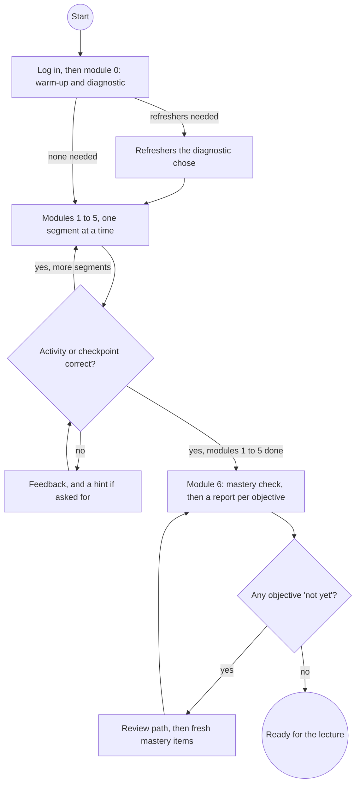
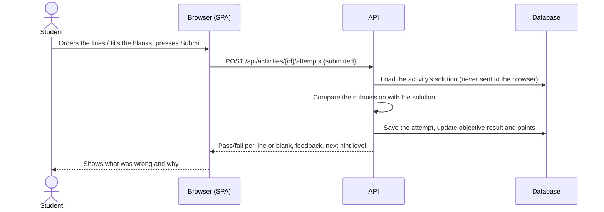
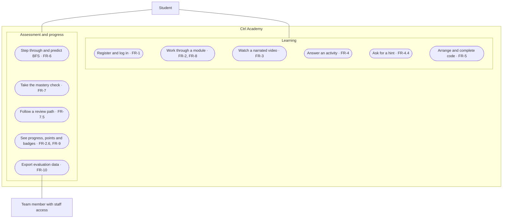
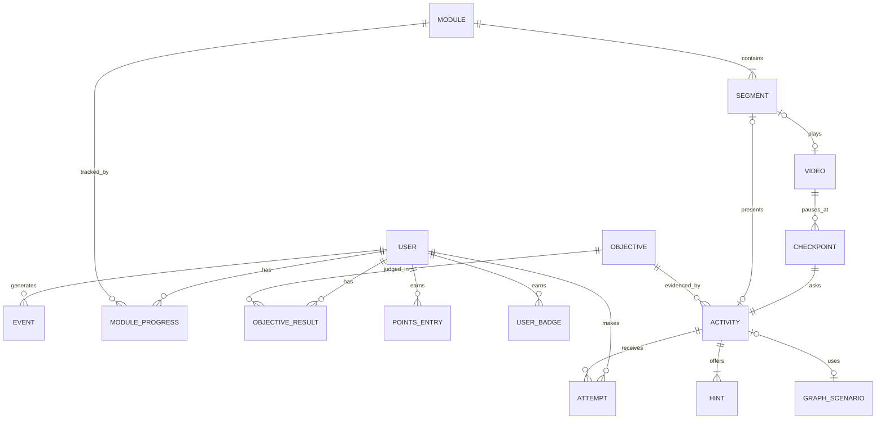

# Overview & Purpose

> **Scope of this document:** Software engineering only. Instructional-design content (learning theories, learning styles, motivation, pedagogy) is deliberately excluded and lives in the separate ID document.

> **DRAFT 2.** Sections or decisions that are still provisional are tagged **[PROVISIONAL]**. Decisions, risks and future work are collected in §15.

> **Use of generative AI.** Generative AI was used to help draft and revise parts of this document and to build the project's tooling and infrastructure. Every decision in it was made by the team. As the specification requires [1], the tool and the prompts are recorded in the ID document [5], §9.

## Purpose
The COS212 app, Ctrl Academy, is a pre-lecture, tutor-style learning application that teaches **one data structure (Graphs)** and **one algorithm (Breadth-First Search)**. It is used by a student **before** attending the corresponding lecture and assumes **zero prior knowledge** of the topic. The specification asks for one core data structure and one core algorithm from CS2023 [1]; graphs and breadth-first search are both in CS2023's Algorithmic Foundations knowledge area [2].

What the app teaches, in what order, and how it assesses the student is designed in the ID document [5]: seven short modules (0 to 6), seven learning objectives, a four-level hint ladder, and a mastery check that reports each objective separately. This document specifies the software that delivers that design.

From an engineering standpoint, the system is a web application composed of:
- a **TypeScript + React frontend** that plays narrated videos, renders interactive activities (including drag-and-drop and fill-in-the-blank code) and the BFS visualiser, and shows each student their progress, points and mastery report;
- a **Python backend** that serves content, manages accounts, checks answers, computes BFS traversals, records every attempt, and decides mastery and scaffolding;
- a **PostgreSQL database** holding users, content, attempts, progress and results.

## Engineering goals
- Every activity type in the ID document can be expressed as **data**, so the ID team adds or changes content without code changes.
- Answers, mastery and points are decided **on the server**; the browser only reports what the student did.
- Code activities are checked by **comparing the student's answer with the solution**, so no student-written code is ever executed on the server (decision §15.3).
- Deterministic, inspectable BFS step generation, so animations, predictions and trace tables all agree with what the lessons teach.
- Every attempt and hint is **logged**, so the ID team's pilot and evaluation have the data they need.

## Primary user & session shape
The primary role is **Student**. Team members also have a **staff** flag, used only to export evaluation data (FR-10); there is no authoring interface.

A typical session: register or log in → module 0 (warm-up and diagnostic, which picks the refreshers this student needs) → modules 1 to 5 (narrated segments, activities and code tasks, with hints on demand) → module 6 (mastery check) → mastery report per objective → review path for any objective marked "not yet". Progress is saved after every module, so the student can stop and return.



Figure: A student's path through the app.

# Software engineering approach

## Choice: Scrum with one-week sprints

We follow **Scrum** [6], an Agile methodology, with one-week sprints. Each sprint ends with a working
increment deployed to staging, where the whole team, including the instructional designers, reviews it.

The COS750 lifecycle lecture (L11) [3] lists the methodologies we considered. We chose Scrum because of
four properties of this project:

1. **The requirements arrive while we build.** The ID team designs the content, the assessment and
   the scaffolding at the same time as we build the platform. A plan-driven model (Waterfall,
   V-model) needs stable requirements before design starts; Scrum expects them to change and
   reprioritises every sprint.
2. **The deadline is fixed and the scope is not.** The prototype must be demonstrated on
   16/17 November. Time-boxed sprints with a prioritised backlog mean that the most important
   features are finished first, and that something complete and working exists at the end of every
   week.
3. **An educational app has to be tried by learners.** Each sprint ends with a deployed increment
   we can put in front of students and the ID team, so feedback shapes the next sprint instead of
   arriving after the build.
4. **It fits the ID process.** The ID document uses ADDIE as a repeating cycle with rapid
   prototyping inside it, testing early versions of lessons with peers (ID document §4.1). Scrum
   gives those prototypes a fixed rhythm: each sprint's increment on staging is the version the ID
   team tests, and its sprint review is where their formative evaluation feeds back into our
   backlog. ADDIE's Develop and Implement phases run inside Sprints 1 and 2, and the pilot session
   with peers is a backlog item like any other.

**Methodologies we did not choose:**

| Methodology | Why not |
|---|---|
| Waterfall and V-model | They need fixed requirements up front, but ours depend on ID work still in progress. Testing comes last, which leaves no time to recover from what it finds before a fixed demo date. |
| Spiral | Its risk analysis each cycle is designed for large, long, high-risk projects. Too heavy for a two-week build. |
| Incremental (plan-driven) | We do deliver in increments, but planned per sprint, not all fixed at the start. |
| Prototyping | Each sprint review works like a prototype review, but on its own prototyping gives no roles, cadence or backlog to coordinate seven people. |
| XP | We use several XP practices: continuous integration, small releases, collective code ownership through PR review, and coding standards enforced by linters. We don't follow its full discipline of pair programming and test-first development with three engineers across different schedules. |

## Roles

| Role | Who | Responsibilities |
|---|---|---|
| Scrum Master | Matthew Els, chosen by the team on 1 November 2026 | Runs the events, removes blockers, keeps the board and the process honest, and facilitates backlog ordering. |
| Development team | Matthew Els, Ayanda Juqu, Reece Schmidt (software engineering); Joshua Wereley, Simphiwe Nhlapo, Mohtashim Hussain, Jacobus Hoogenboezem (content, assessment and scaffolding design) | Build the increment. ID members own content items on the same backlog. |

**No Product Owner.** Standard Scrum has a Product Owner who owns the backlog and accepts work. We
deliberately don't appoint one, because the product's requirements are fixed by sources outside the
team: the examination specification (from the COS212 lecturer, our client) and the ID document's
learning outcomes. The Product Owner's duties are shared instead:

- **Backlog order** is agreed by the whole team at sprint planning, facilitated by the Scrum Master.
  Items that cover the specification's hard requirement (an assessment that gives struggling
  students extra scaffolding) always come first.
- **Acceptance** is checked against each item's acceptance criteria at the sprint review. Content
  items are accepted by the ID members; platform items by an engineer other than the author.

## Timeline

| Sprint | Dates | Goal |
|---|---|---|
| Sprint 0 | 22 Oct – 1 Nov | Foundation. Spec issued 22 Oct, group registered 23 Oct, topic chosen (graphs + BFS), repository and branch flow, CI, hosting on staging and production, database layer with migrations, backups, staging login. |
| Sprint 1 | 2 – 8 Nov | **A complete path through the app.** A student can register, open a lesson, answer a checkpoint question in a video, step through BFS on a predefined graph, arrange and complete BFS in a code activity, take the mastery check, and be sent to the review path for any objective marked "not yet", all with placeholder content, deployed to staging. |
| Sprint 2 | 9 – 15 Nov | **Real content and the full feature set.** The ID team's content, questions and scaffolds loaded; all activity kinds, hints, points and badges; narrated videos; pilot by team members on 10–11 Nov (§14.5); end-to-end tests; accessibility pass. |
| Release | 12 – 16 Nov | Feature freeze **Thu 12 Nov**. `staging` → `master` (production) **Fri 13 Nov**. Demo rehearsals on production 14–15 Nov. SE and ID documents submitted before **08:00 on Mon 16 Nov**. Presentation and demo on 16 or 17 Nov. |

## Artefacts

- **Product backlog:** the GitHub Project board of the `ctrl-group-cos750` organisation, linked to the repository. Every group member is in the organisation's Ctrl Group team, which can edit the board. Each item is an issue
  written as a user story ("As a student with no graph knowledge, I want …, so that …"), with
  acceptance criteria and the requirement IDs it covers (FR-x.y, §6). ID work (videos, question
  banks, scaffold content) is on the same board with a `content` label, so dependencies between the
  two teams are visible.
- **Sprint backlog:** the items assigned to the current sprint's iteration on the board, with a
  sprint goal.
- **Increment:** whatever is deployed to staging.ctrlacademy.co.za at the end of the sprint.
- **Definition of Done.** An item is done only when:
  1. its acceptance criteria are met;
  2. it has tests (unit or API tests; an end-to-end test for user-facing flows);
  3. its PR is reviewed and approved by another engineer;
  4. CI passes (format, lint, types, tests, builds);
  5. it is merged into `staging`, deployed, and checked on staging.
- **Estimates:** story points on the Fibonacci scale (1, 2, 3, 5, 8), so the board's burn-up
  chart shows progress against each sprint's commitment.

## Events

| Event | When and how | Output |
|---|---|---|
| Daily stand-up | Asynchronous, a short message in the team's Discord #general channel every day: done since last time, doing next, blocked by. | Dated record of progress and blockers. |
| Weekly check-in | Thursday team call at 19:00, mid-sprint. What is done so far is shown on staging; progress against the sprint goal, blockers, and dependencies between the ID and SE work; the sprint backlog is adjusted if the goal is at risk. | Updated sprint backlog; decisions noted in Discord. |
| Sprint review | Sunday, asynchronous. Each engineer posts what they merged with its staging link; team members, including the ID members, check each item on staging and accept or reject it against its acceptance criteria on the board by Monday morning. | Accepted items; feedback added to the backlog. |
| Retrospective | Sunday to Monday, a Discord thread: what went well, what to change, one concrete action for the next sprint. | Retro notes kept with the sprint (`docs/se/sprints/`). |
| Sprint planning | Monday morning. The Scrum Master proposes the sprint goal and the items from the top of the backlog that fit; the team confirms or changes them in Discord before work starts. | Sprint goal and sprint backlog on the board. |

Sprints run from Monday to Sunday. The only meeting is the Thursday call; the events at the sprint boundary are asynchronous, because seven students with different timetables can't meet twice a week during exams. Discord keeps a dated record of all of them.


## Engineering practices that support the process

These are what make a working increment at the end of every week possible. Details are in §13.

- **Branching:** each backlog item gets a feature branch and a PR into `staging`; `staging` is
  promoted to `master` by PR. A CI check rejects PRs into `master` that don't come from `staging`.
- **Code review:** every PR is reviewed by another engineer before it is merged.
- **Continuous integration:** every PR runs formatting, linting, type checks, tests and builds
  for both apps and the Docker images.
- **Continuous delivery:** a merge into `staging` deploys to staging automatically; `master`
  deploys to production. Database migrations run on deploy.
- **Separate environments:** local, staging (behind a team password) and production, each with its
  own database.

## Evidence

| Claim | Where to see it |
|---|---|
| Backlog, sprints, estimates, burn-up | GitHub Project board: <https://github.com/orgs/ctrl-group-cos750/projects/1> |
| Daily stand-ups | Discord #general channel (exported for the appendix) |
| Reviews, retros and planning | `docs/se/sprints/` in the repository |
| Code review and Definition of Done | Merged PRs and their reviews on GitHub |
| CI and continuous delivery | GitHub Actions history; Coolify deployment log |

# Scope

## In scope
1. Accounts: register and log in with email and password.
2. The seven modules of the ID document (0 to 6), in order, with progress saved after each one.
3. Narrated videos (screen recordings with voice-over, no presenter) that pause at checkpoints for an activity.
4. Every activity type in the ID document, with immediate feedback and a four-level hint ladder.
5. Code activities — ordering shuffled lines (Parsons problems) and filling in missing tokens — checked on the server by comparison, running no student-written code.
6. The BFS visualiser, with step controls, next-vertex prediction and trace tables.
7. The mastery check, a per-objective report, and a review path for objectives marked "not yet".
8. The module 0 diagnostic that picks refreshers, skippable worked examples, and optional bonus quests.
9. Private points and badges.
10. An event log and CSV export for the ID team's pilot and evaluation.
11. Seed content: the ID team's modules, activities and graph scenarios, loaded from version-controlled fixtures.

## Out of scope
- An authoring interface: content is edited as fixture files in the repository and loaded by a seed command.
- A public leaderboard (see FR-9 for why).
- Topics beyond graphs and BFS (DFS, Dijkstra, trees), and programming languages other than Python.
- Password reset, refresh tokens, and sign-in with the university account (future work, §15).
- Native mobile apps and offline use.

## Success criteria (engineering)
- A new student can complete all seven modules and receive a mastery report on the deployed production site.
- A student with a "not yet" objective is sent to that objective's review path, and can reach "ready for the lecture" after it.
- Every code activity is checked on the server by comparison with the solution, so no student-written code runs anywhere and a malformed answer can at worst be marked wrong.
- The ID team can export the pilot's attempts and results as CSV without help from an engineer.

## Stakeholders

| Stakeholder | Interest | How they shape the system |
|---|---|---|
| COS212 lecturer (the client) | An app that prepares students for the graphs and BFS lecture | Commissioned the app through the examination specification [1], which fixes the topic area, the zero-prior-knowledge assumption and the requirement for an assessment with extra scaffolding |
| COS212 students (the users) | Arrive at the lecture understanding graphs and BFS; know what to revise | Described by the learner profile in the ID document [5] (§2); represented in testing by the pilot (§14.5) |
| Instructional designers (Joshua Wereley, Simphiwe Nhlapo, Mohtashim Hussain, Jacobus Hoogenboezem) | Their learning design is delivered faithfully | Own the ID document, the content fixtures and the content items on the backlog; accept content work at sprint review |
| Software engineers (Matthew Els, Ayanda Juqu, Reece Schmidt) | A system that can be built, tested and demonstrated by 16 November | Own this document and the platform items on the backlog |
| COS750 examination panel and peer groups | A working prototype and documents that justify it | Assess the documents, the presentation and the live demo |

Table: Stakeholders.

## Where the requirements come from

The requirements were not written in one sitting; they were gathered from four sources and refined sprint by sprint:

1. **The examination specification** [1]: the topic constraints, the target learner, and the one hard functional requirement, an assessment that gives struggling students extra scaffolding (FR-7).
2. **The ID document** [5]: the seven modules, the learning objectives and their success criteria, the activity types, the hint ladder and the three mastery results. The traceability table in §6 maps each functional requirement to the part of the ID document it delivers.
3. **Team decisions**, made at meetings and on the team's Discord server: the topic, languages, roles and the Thursday call at the initial meeting on 25 October; the methodology, the tech stack, the code runner, video format, gamification and accounts on 1 November. They are recorded in §15.3 and in the sprint records (`docs/se/sprints/`).
4. **The COS750 lectures**: L11 for the lifecycle [3], L05 for motivation [4], and the course's treatment of assessment and accessibility.

Each requirement becomes one or more user stories on the board, with acceptance criteria and the requirement IDs they cover (§2.4). When a requirement changes, the change is made in this document through a reviewed PR, so its history is in the repository.

# System Architecture

## High-level architecture

```
Browser
  │  HTTPS, one origin: ctrlacademy.co.za (production), staging.ctrlacademy.co.za (staging)
  ▼
Coolify's Traefik proxy (on our server; Let's Encrypt certificates, Cloudflare DNS)
  ▼
web container: nginx
  ├─ /            React + TypeScript SPA (Vite build)
  ├─ /media/      narrated videos and captions (static files, served with range requests)
  └─ /api/*  ──►  api container: FastAPI on Uvicorn
                    routers → services → SQLAlchemy models
                    BfsEngine, answer checkers, mastery rules
                      │
                      ▼
                  db container:
                  PostgreSQL 18
                  (persistent volume,
                  nightly pg_dump)
```

The three containers are defined in `docker-compose.yml`, and Coolify deploys that file as it is.
nginx serves the SPA and forwards `/api` to the API, so the browser only ever talks to one origin.
That removes the need for CORS and for an API base URL in the frontend. Code activities are checked
in the API by comparing the student's answer with the stored solution, so no student-written code is
executed anywhere; the separate, network-isolated code runner that earlier executed student Python
was removed when the team dropped freeform code writing (§15.3).



Figure: Submitting a code activity. The browser never sees the solution, and the check is a comparison in the API — no code is executed.

## Tier responsibilities
- **Frontend (client tier):** presentation, interaction, animation and video playback. It holds no authority over answers, mastery or points: it reports what the student did, and the backend decides and persists.
- **Backend (application tier):** authentication, content delivery, answer checking (code activities included, by comparison with the solution), BFS computation, hint and attempt logging, mastery and review-path rules, points and badges, and the evaluation export.
- **Data tier:** durable storage of structured data. Media is served by nginx from a volume, not stored in the database.

## Key architectural decisions
- **Thin client for authority-bearing logic.** Answers, mastery and points are decided server-side, so the rules live in one place and the browser can't award itself a result.
- **Code activities checked by comparison, never executed.** Students order shuffled lines (Parsons) or fill in missing tokens; the server compares the submission with the solution. No student-written code runs on the server, which removes the whole untrusted-code-execution attack surface (decision §15.3, superseding the earlier sandboxed runner).
- **BFS computed server-side.** One tested implementation produces the animation steps and checks predictions and trace tables, so they can never disagree.
- **Stateless API with token auth.** The token travels in an httpOnly cookie (§5).
- **Content as data.** Modules, activities, hints, tests and graph scenarios are fixture files the ID team can edit; adding content needs no frontend or API change.

# Technology stack

| Layer | Choice | Rationale |
|---|---|---|
| Backend language | **Python 3.12** | Team decision. Good for algorithm code and fast API development. |
| Web framework | **FastAPI** | Pydantic validation, typed request/response models, OpenAPI docs generated at `/api/docs`, which serve as the frontend contract. |
| ASGI server | **Uvicorn** | Runs directly as the API container's process. Docker restarts it if it crashes, so it needs no separate process manager. |
| Validation | **Pydantic v2** | Comes with FastAPI. Validates every request at the API boundary. |
| ORM and migrations | **SQLAlchemy 2.1** + **Alembic** | Typed models. Migrations are applied automatically when the API container starts (`alembic upgrade head`), so a migration that fails stops the deploy instead of running against the wrong schema. Baseline revision `0001` is in place. |
| Database | **PostgreSQL 18** in every environment | Local development runs the same Postgres in Docker. Tests use in-memory SQLite, so they run without a database server. Using one database engine everywhere avoids JSON and enum behaviour differing between dev and production. |
| Auth | **JWT** (PyJWT) in an **httpOnly, Secure, SameSite=Lax cookie**; passwords hashed with **Argon2** (pwdlib) | Because the SPA and API share one origin, a cookie is simpler than an `Authorization: Bearer` header, and JavaScript can't read it, so an XSS bug can't steal the token. pwdlib replaces passlib: passlib is no longer maintained and breaks with current bcrypt releases, and FastAPI's own documentation now uses pwdlib. Email is required. Password reset and refresh tokens are future work. |
| Frontend language | **TypeScript 7** | Team decision. Type safety across the UI and the API client. |
| Frontend framework | **React 19** | Team decision, and what the scaffold already uses. |
| Build tool | **Vite 8** | Fast dev server with hot reload; the dev server proxies `/api` to the local API, so dev also uses one origin. |
| Routing | **React Router** | Client-side routing for the multi-view SPA. nginx already serves `index.html` for unknown paths. |
| Server state | **TanStack Query** | Data fetching and caching against the REST API. |
| Graph rendering | **SVG via D3** | For graphs of up to about 50 vertices, SVG is simpler than Canvas (one DOM element per node and edge, easy per-element transitions, highlighting and click handling). |
| Video | **HTML5 `<video>`**, self-hosted MP4 (H.264) with WebVTT captions; narrated screen recordings, no presenter | The player needs full control to pause at checkpoints and block seeking past them. An embedded YouTube player would add adverts, recommendations and a dependency outside our control during the demo. Captions also provide the `text` mode for each video. |
| Code display | **CodeMirror 6** (read-only) with the Python language package | Syntax-highlighted, accessible rendering of code snippets for Parsons and fill-in-the-blank activities. Not an editor: students never type free Python. |
| Drag and drop | **dnd-kit** | Parsons problems and token placement; supports keyboard dragging, which NFR-A1 requires. The main input for code activities. |
| Testing (backend) | **pytest** with FastAPI `TestClient`, warnings treated as errors | Unit tests for the BfsEngine and services, plus API tests against a fresh SQLite database that every migration has been applied to. |
| Testing (frontend) | **Vitest** + **React Testing Library** | Native fit with Vite; component and logic tests, with coverage reported in CI. |
| End-to-end testing | **Playwright** | Walks through the full student flow (register, a module, a video checkpoint, a code submission, the mastery report, a review path) in a real browser against a running stack. |
| Lint and format (Python) | **ruff** (format + lint, including the bandit security rules and the FastAPI rules) and **mypy --strict** | Enforced in CI. |
| Lint and format (TypeScript) | **oxlint** (correctness, suspicious and perf rules plus the React, import, jsx-a11y and Vitest plugins; warnings fail the build) and **Prettier** | oxlint replaces ESLint: it is already configured and runs in under a second. The `jsx-a11y` plugin enforces part of the accessibility requirements (NFR-A). |
| CI | **GitHub Actions** | On every PR into `staging` or `master`, for the parts it touches: format, lint, types, tests and builds for the apps, and the Docker images for the whole stack (a docs-only PR builds only the PDFs). Not again on the merge itself, which the PR already tested; `push-guard` checks every push instead. A `branch-flow` check rejects PRs into `master` that don't come from `staging`. Dependabot opens monthly update PRs into `staging`; security fixes come at once. |
| Hosting | **Coolify** on the team's server, **Docker Compose** build pack | Coolify builds and deploys on every push: `staging` → staging.ctrlacademy.co.za, `master` → ctrlacademy.co.za. Its Traefik proxy terminates HTTPS. Staging sits behind a team-password page so the public can't see unfinished work. |

# Functional Requirements

Each feature is broken into concrete, testable capabilities with IDs (FR-x.y) for traceability. The table at the end of this section links each requirement to the part of the ID document it delivers.



Figure: Use cases. The student takes part in every use case in both groups except the export, which is staff-only.

## Accounts (FR-1)
- **FR-1.1** Register with an email address, a password and a display name. The display name is shown only to the student.
- **FR-1.2** Log in and out. A session lasts until logout or 14 days, whichever is first.
- **FR-1.3** A student sees and changes only their own progress, attempts and results.
- **FR-1.4** Seeded demo accounts exist at different points in the course (new, mid-course, finished with a "not yet" objective, ready for the lecture), so the demo can show any stage without working through 75 minutes of content.
- **FR-1.5** A student can change their password: they give the current one, the new one must meet the password rules (NFR-S1), and every other session is logged out.
- **FR-1.6** A student can choose a profile picture from a set the team provides (graph shapes, never an uploaded photo), shown only to them, like the display name.
- **FR-1.7** A profile page, reached from the account menu in the header, shows the student their own objectives met and, unless hidden (FR-9.5), points and badges.

## Modules and progress (FR-2)
- **FR-2.1** Present the seven modules of the ID document (0 to 6) in order. A module opens once the one before it is complete; module 0 is always open. A module with no segments yet (its content not written) is passed over, so it never locks the modules after it.
- **FR-2.2** Each module is an ordered sequence of segments: narrated video, text, worked example, activity, or code activity.
- **FR-2.3** Each module starts by stating its objectives in plain words ("By the end of this module you can …"), taken from the content.
- **FR-2.4** Each module from module 2 onwards opens with one or two retrieval questions on earlier modules.
- **FR-2.5** Save progress after every segment. A student who returns resumes at the segment they left.
- **FR-2.6** Show a module map with each module's state (locked, open, in progress, complete) and estimated duration.
- **FR-2.7** A student moves past a segment only once it is done: an activity segment once its activity has been answered at least once (a wrong answer counts), a video segment once every checkpoint in the video is passed. Other segments are done when shown. An activity whose kind has no student UI yet (today `trace`, `fix_the_bug` and `choose_tests`) counts as done until its UI exists, so it never strands a student. A module is complete once its last segment is done. A complete module can be reread freely.

## Narrated video with checkpoints (FR-3)
- **FR-3.1** Play narrated videos (screen recordings with a voice-over, no presenter) with play, pause and seek.
- **FR-3.2** Show captions, on by default, and a transcript below the video. The transcript is the text version of the segment.
- **FR-3.3** Pause automatically at each configured checkpoint and show its activity.
- **FR-3.4** At a checkpoint, give immediate feedback. A wrong answer can be retried, with the hint ladder available (FR-4.4). Playback resumes once the activity is answered correctly.
- **FR-3.5** Prevent seeking past a checkpoint that has not been answered correctly. Seeking backwards is always allowed.

## Activities, feedback and hints (FR-4)
- **FR-4.1** Support these activity kinds, each defined entirely by content data:
  multiple choice; matching; labelling vertices and edges on a diagram; classifying graphs (directed or undirected); building a graph by adding vertices and edges; predicting the next BFS vertex; filling in a BFS trace table (current vertex, queue, visited set, order); Parsons problems (ordering shuffled lines of code); completing code by choosing a token for each blank; fixing a faulty BFS; choosing the test cases that expose a bug.
- **FR-4.2** Check every answer on the server and return feedback straight away. Feedback says why an answer is wrong, not only that it is wrong.
- **FR-4.3** Tag every activity with the learning objective it gives evidence for (1 to 7) and its purpose: practice, diagnostic, retrieval, mastery, review or bonus.
- **FR-4.4** Offer a four-level hint ladder on every activity, one level at a time. Level 4 is the worked solution.
- **FR-4.5** Record every attempt with the answer, the result and the highest hint level used. Hint levels 3 and 4 make a later correct answer count as "with support" (FR-7.2).

## Code activities (FR-5)

Code activities never execute student-written code. The student constructs code by **ordering shuffled lines (Parsons problems)** or **filling in missing tokens/lines from a given set**, and the server checks the result by comparison with the stored solution. This runs no untrusted code at all (decision §15.3; the earlier sandboxed code runner was removed).

- **FR-5.1** Render the activity's code with Python syntax highlighting and line numbers (read-only display), and present the lines to reorder or the blanks to fill. Blanks are filled by choosing from a given set of tokens, not by free typing.
- **FR-5.2** **Check** compares the student's arrangement against the solution and shows which lines or blanks are wrong, with a message for each. There is no code execution, so there are no run-time limits or output to show. A check is practice: it is not graded and not recorded as an attempt.
- **FR-5.3** **Submit** records a graded attempt: the server compares the submission with the solution (which the browser never receives) and returns which lines or blanks were wrong and a message for each, without revealing the full solution.
- **FR-5.4** Parsons problems are checked by the order of the lines, and every order the content accepts passes: a solution lists one order, in which a group of lines may go in any order among themselves (the BFS starting values; `visited.add(n)` and `queue.append(n)`), plus any alternative orders, and the seed refuses one that uses an unknown line, a line twice, a group of one or an alternative the others already accept. The BFS items accept every order that runs as BFS except two kept as conventions: the import after the function, and `order.append(v)` anywhere but straight after `popleft()`. A wrong order is compared with the closest accepted order by relative order (longest common subsequence), so only the lines that must move are marked, not every line after one misplaced line; fill-in activities are checked token by token against the expected tokens, and a wrong token gets the content's reason for that blank and token where it gives one (FR-4.2).
- **FR-5.5** Objective 7 uses two more kinds, also checked by comparison. **Fix the bug** shows a faulty BFS: the student marks each faulty line and chooses its correction from a given set of lines, or moves a line that is in the wrong place, as in a Parsons problem, and it is graded as Parsons is (FR-5.4: groups, alternatives, only the lines that must move marked). **Choose tests** shows a faulty BFS and four to six test cases, each a small graph, a start vertex and the expected order: the student selects every test case that the faulty version fails and the correct version passes. No student code or student-written test runs.
- **FR-5.6** Because nothing is executed, a code activity always returns promptly with per-line or per-blank feedback, never a run-time error page.

## BFS visualiser (FR-6)
- **FR-6.1** Load a graph scenario (vertices, edges, directed or not, start vertex) and its BFS steps from the backend.
- **FR-6.2** Draw the graph and animate BFS step by step, showing the current vertex, the queue, the visited set and the traversal order side by side.
- **FR-6.3** Provide controls: step forward, step back, play and pause, reset, and speed.
- **FR-6.4** In prediction mode, pause before each step and ask the student to pick the next vertex; the animation then confirms or corrects the prediction.
- **FR-6.5** Neighbours are visited in alphabetical order of their labels, the convention the lessons teach, so a correct prediction is always marked correct.
- **FR-6.6** Trace-table activities are checked step by step against the engine's steps.

## Mastery check and scaffolding (FR-7)
- **FR-7.1** Module 6 is a mastery check: unseen activities on every objective, checked against the success criteria in the ID document's Table 1.
- **FR-7.2** Give each objective one of three results: **met independently** (criterion met without hint level 3 or 4), **met with support** (met after using level 3 or 4), or **not yet** (criterion not met).
- **FR-7.3** Show a mastery report: each objective's result in plain words, with next steps.
- **FR-7.4** A student is **ready for the lecture** when no objective is "not yet". An objective whose mastery items are not all answered yet isn't met either, so in practice every objective must be met, with or without support.
- **FR-7.5** For each "not yet" objective, open a review path: that objective's review segments and activities, followed by fresh mastery items for it. The objective's result updates when they are completed. The path opens only once the mastery check marks the objective "not yet", so its fresh items are still unseen, and there is one path per objective: a student still "not yet" after it is told to bring that objective to the lecture.
- **FR-7.6** Results are computed on the server from recorded attempts, and recomputed if the rules change.

## Diagnostic, fading and challenge (FR-8)
- **FR-8.1** Module 0's diagnostic quiz (queues and basic Python) selects which refreshers the student sees; refreshers the student doesn't need are skipped.
- **FR-8.2** A worked example can be skipped after the student passes a short check, as the ID document's fading design requires.
- **FR-8.3** Offer optional bonus quests after modules for students who want more challenge. They give points but never affect mastery.

## Points and badges (FR-9)
- **FR-9.1** Award points for completed modules, correct activities and objectives met, from a server-side rules table.
- **FR-9.2** Award fewer points for a correct answer reached after hint level 3 or 4, matching "met with support".
- **FR-9.3** Award badges for milestones (first module, every objective met, all bonus quests).
- **FR-9.4** Points and badges are **private**: each student sees only their own. There is no public leaderboard, because public ranking discourages the students who most need the app (those motivated by avoiding failure, L05 [4]).
- **FR-9.5** A student can hide points and badges. They are still earned while hidden, and the per-objective mastery report is never hidden. About a third of students in a data-structures course found badges demotivating [9], so opting out is the student's choice.
- **FR-9.6** Points are never taken away and each thing is rewarded once; a badge, once earned, is never removed. Recomputing results (FR-7.6) may add badges but never removes them, and an objective badge only goes up, from bronze (met with support) to gold (met independently). No badge counts hints, attempts, days or speed, so none can be earned by clicking through hints or guessing.

The rules, as confirmed by the ID document (§7.2):

| Event | Points |
|---|---|
| Activity correct without hint level 3 or 4 | 10 |
| Activity correct after hint level 3 or 4 | 4 |
| Module completed | 25 |
| Objective met independently / with support | 30 / 15 |
| Bonus quest completed | 20 |

Table: Points rules, stored on the server and tunable without a code change.

## Evaluation data (FR-10)
- **FR-10.1** Log every event (segment viewed, video checkpoint reached, attempt, hint requested, module completed, result changed) with the user and time.
- **FR-10.2** Staff can download the log, attempts and objective results as CSV, for the ID team's pilot and evaluation.
- **FR-10.3** The export identifies students by an internal ID, not by email or display name.

## Traceability to the ID document

Section and table numbers refer to the ID document [5].

| Requirement | Delivers (ID document) |
|---|---|
| FR-2 Modules and progress | Lesson sequence, modules 0–6 (§4.4, Table 4); Gagné events 2 and 9 (Table 3); retrieval practice (§5.4) |
| FR-3 Narrated video | Gagné event 4, present the content (Table 3); interactive video (§5.1) |
| FR-4 Activities, feedback, hints | Gagné events 5–7 (Table 3); active learning (§5.1); hint ladder and scaffolding (§5.3) |
| FR-5 Code activities | Objectives 6 and 7 (§3.1, Table 1); Parsons problems (§5.3) |
| FR-6 BFS visualiser | Objectives 4 and 5; signalling and segmenting (§5.2); prediction before animation (§5.4) |
| FR-7 Mastery and scaffolding | Three result states and readiness rule (§3.2); review path (§7); the specification's requirement for extra scaffolding |
| FR-8 Diagnostic and fading | Warm-up and refreshers (module 0); fading support and bonus quests (§5.2) |
| FR-9 Points and badges | Motivation and gamification (§7.1, §7.2) |
| FR-10 Evaluation data | ADDIE Implement and Evaluate phases (§4.2, Table 2); evaluation (§8) |

Table: Which part of the ID document each functional requirement delivers.

# Non-Functional Requirements

## Performance
- **NFR-P1** BFS computation for scenario sizes up to about 50 vertices returns in well under 200 ms server-side.
- **NFR-P2** Answer checks for non-code activities return in under 300 ms under light load. **[PROVISIONAL target]**
- **NFR-P3** A code activity is checked and returns its result within 1 second: the check is a comparison in the API, with no code execution.
- **NFR-P4** The BFS animation runs from precomputed steps, with no server calls per frame.
- **NFR-P6** Under more load than it can serve, the API stays up and answers every request, at worst with a quick "busy" (503 within 5 seconds), and recovers as soon as the load drops. It never stalls (see §14, "Load testing").
- **NFR-P5** Videos are served by nginx from a volume with range requests, so seeking doesn't download the whole file and video never passes through the API.

## Usability
- **NFR-U1** Laptop and desktop are the primary devices, because modules 2, 4 and 5 need a keyboard for code. Every other module also works on a tablet and a phone (from 360 px wide).
- **NFR-U2** Clear, consistent controls for video, BFS stepping, activities and hints across all modules.
- **NFR-U3** Every answer gets visible feedback within the activity; errors from the system are written for students, never as stack traces.
- **NFR-U4** Before the feature freeze, team members pilot every module they did not build, and the defects they find are fixed or recorded (§14.5).

## Security & Authentication
- **NFR-S1** Passwords stored only as salted hashes (Argon2, via pwdlib). A new password has at least 8 characters, a lowercase and an uppercase letter, a number and a symbol (a space counts), and doesn't contain the student's name or the first part of their email. The register page lists these rules and ticks each one off as the student types; the API checks the same rules (`api/app/passwords.py`, `web/src/auth/passwordRules.ts`).
- **NFR-S2** Authenticated endpoints require a valid **JWT in the session cookie**; every query is scoped to the logged-in user, so one student can never read another's data. Each token carries the user's session version; logging out increases it, so every earlier token, including a copied cookie, stops working on every device. Password reset and refresh tokens are future work (§15).
- **NFR-S3** All traffic over HTTPS in deployed environments.
- **NFR-S4** Server-side validation of all inputs (Pydantic schemas); answers, results and points are never accepted from the client.
- **NFR-S5** No secrets in the repository; configuration via environment variables.
- **NFR-S6** Standard protections: the session cookie is httpOnly, Secure and SameSite=Lax; state-changing requests require JSON bodies (blocking cross-site form posts); parameterised queries via the ORM; rate limiting on login (per address and account, and per address), registration and answer submission, keyed on the student's real address (Cloudflare's `CF-Connecting-IP`, believed only from Cloudflare's own servers); security headers on every page (a Content Security Policy allowing only our own scripts, styles and fonts, no framing, HSTS, `nosniff`). The app and the API share one origin, so no CORS is configured.
- **NFR-S7** **No untrusted code execution.** Code activities run no student-written code anywhere in the system. The student constructs code by ordering shuffled lines (Parsons) or filling in tokens from a given set, and the server checks the submission by comparison with the solution (FR-5). This removes the untrusted-code-execution attack surface entirely, rather than trying to contain it.

  An isolated code runner was built and hardened earlier (a network-less container running each submission as a separate seccomp-confined process) and was pentested on staging across several rounds (see the security review under §14). Those rounds confirmed the escape defences held but also found that the in-process grading channel could be forged to fake a pass, and — because staging shares a personal server with unrelated personal data — the residual risk of executing arbitrary student code was judged not worth the marks a freeform editor earned. The team therefore dropped freeform code writing and removed the runner (decision §15.3, 3 November). The runner's code is preserved in git history (tag `archive/code-runner`) should the decision be revisited with a stronger sandbox (gVisor or a per-submission microVM — §15.4).
- **NFR-S8** **Privacy (POPIA [8]).** The app stores only what it needs: email (to log in), a display name, and learning data. It shows no student's data to another student, and exports only internal IDs (FR-10.3). Test and demo data never uses real students' details.

## Maintainability
- **NFR-M1** Layered backend (routers → services → data) with the BfsEngine, the answer checkers and the mastery rules isolated from web concerns and unit-testable in isolation.
- **NFR-M2** Typed boundaries on both sides (Pydantic + TypeScript); the TypeScript API types in `web/src/api/` are generated from the OpenAPI schema by `scripts/gen-api.sh`, and CI fails if they are out of date.
- **NFR-M3** ruff, mypy --strict, oxlint and Prettier enforced in CI on every PR.
- **NFR-M4** Database migrations tracked with Alembic.
- **NFR-M5** Content (modules, activities, hints, tests, scenarios) lives in fixture files validated by a schema in CI, so a broken content edit fails its PR instead of the app.

## Accessibility
- **NFR-A1** Every activity, the video player and the BFS controls can be operated with the keyboard alone, including Parsons problems (move lines with arrow keys as well as by dragging).
- **NFR-A2** Text and controls meet WCAG 2.1 AA contrast [7]; BFS state is never shown by colour alone (vertices also carry labels and a marker for current, queued and visited).
- **NFR-A3** Semantic HTML and ARIA roles for custom controls; oxlint's jsx-a11y rules enforce part of this in CI.
- **NFR-A4** Every video has captions and a transcript.

# Data Model



Figure: Entities and relationships.

## Entities

**User**: `id`, `email` (unique, required), `display_name`, `password_hash`, `is_staff` (team members; may export evaluation data), `created_at`.

**Objective**: `id` (1 to 7, as numbered in the ID document), `text`, `bloom_level`, `criterion` (the success criterion from the ID document's Table 1, in words), and the same criterion as the rule the mastery service evaluates: `pass_fraction` (at least this fraction of the parts right: "at least 4 of 5" is 0.8) or `max_wrong` (at most this many wrong: "with at most one error" is 1), exactly one of the two. Parts are what the checker grades: an option, a trace step, a matching pair, a line or blank of code. Only the student's first attempt at each module 6 item counts, and the result stays `not_attempted` until every item on the objective is answered. An answer given after hint 3 or 4 counts as wrong for "met independently" and as right for "met with support" (`app/services/mastery.py`).

**Module**: `id` (the module number, 0 to 6), `slug`, `title`, `goals` (the "By the end of this module you can …" sentences), `estimated_minutes`, `position`.

**Segment**: `id`, `module_id` or `review_objective_id` (exactly one: a segment is a step of a module, or of an objective's review path, FR-7.5), `position`, `kind` (`video` | `text` | `worked_example` | `activity` | `refresher`), `title`, `body` (Markdown for text and worked examples), `activity_id` (for an `activity` segment), `skip_check_activity_id` (optional: passing this activity lets the student skip the segment: a worked example after a short check, FR-8.2, or a refresher after its diagnostic item, FR-8.1), `refresher_for` (a refresher's diagnostic topic, e.g. `queues`).

**Video**: `id`, `segment_id` (the `video` segment that plays it, at most one; empty until staff place it), `media_path`, `captions_path`, `transcript` (Markdown), `duration_seconds`.

**Checkpoint**: `id`, `video_id`, `at_seconds`, `activity_id`.

**Activity**: `id`, `module_id` (empty for an activity on a review path, which belongs to an objective rather than a module, and for one made in the video editor), `objective_id` (nullable for diagnostic items), `purpose` (`practice` | `diagnostic` | `retrieval` | `mastery` | `review` | `bonus`), `kind` (one of the kinds in FR-4.1), `prompt` (Markdown), `config` (JSON, shape depends on the kind: options, diagram, starter code, line order, scenario ID …), `answer` (JSON, never sent to the browser: correct options, expected line order or tokens, the faulty lines and their corrections, or the test cases that expose a bug), `feedback` (JSON: messages for common wrong answers).

**Hint**: `activity_id`, `level` (1 to 4), `body` (Markdown). Level 4 is the worked solution.

**GraphScenario**: `id`, `name`, `directed`, `vertices` (JSON), `edges` (JSON), `start_vertex`. Neighbours are always taken in alphabetical order of their labels (FR-6.5).

**Attempt** (append-only): `id`, `user_id`, `activity_id`, `submitted` (JSON: the answer — for a code activity, the chosen line order or filled-in tokens), `correct`, `score` (0 to 1, for partial results such as trace tables), `hint_level` (highest level shown before this attempt), `detail` (JSON: per-line or per-blank results for a code activity), `created_at`.

**Event** (append-only): `id`, `user_id`, `type`, `ref` (what it was about: `video:3`, `checkpoint:12`, `segment:301`, `activity:301`, `objective:5`), `payload` (JSON: a hint's level, a result's old and new state), `created_at`. The server logs `hint_shown` and `result_changed` itself; the browser reports `video_started`, `video_completed`, `checkpoint_reached` and `segment_viewed` through `POST /api/events`, which takes only those types, each about a video, checkpoint or segment that exists, and no free text (`app/services/events.py`). `module_completed` is added with modules (#15). Answers and hints shown also have their own tables, `Attempt` and `HintView`.

**ModuleProgress**: `user_id`, `module_id`, `status` (`open` | `in_progress` | `complete`), `current_segment_id`, `completed_at`.

**ObjectiveResult**: `user_id`, `objective_id`, `state` (`not_attempted` | `met_independently` | `met_with_support` | `not_yet`), `evidence` (IDs of the attempts the decision was based on), `updated_at`.

**PointsRule**: `event`, `points`; the points table above, editable without a code change.

**PointsEntry** (append-only, never negative): `user_id`, `event`, `ref`, `points`, `created_at`. `ref` names what was rewarded (`activity:12`, `objective:5`) and is unique per student, so nothing is rewarded twice. A student's total is the sum.

**UserBadge** (never deleted): `user_id`, `badge`, `ref`, `tier`, `awarded_at`, `upgraded_at`, `seen_at`. `badge` is an id from the badge catalogue: the rules that award it are in `app/services/rewards.py`, and its name, wording and picture in `web/src/components/achievements.ts`. `ref` tells apart badges earned more than once (one per bonus quest). `tier` is bronze or gold for objective badges. `seen_at` stays empty until the app has announced the badge. **User** also has `hide_rewards` (FR-9.5) and `avatar` (FR-1.6: the picture chosen from the set, empty for the student's initial).

## Notes
- **Attempts and events are the source of truth.** Module progress, objective results, points and badges are derived from them by the services, and can be recomputed if a rule changes (FR-7.6).
- **Answers never leave the server.** The API strips `answer` from every activity it sends; a code activity's solution (the correct line order and the expected tokens) stays on the server and is only ever compared against, never returned.
- **JSON columns** hold the parts that differ by activity kind (`config`, `answer`, `feedback`, `submitted`, `detail`). Each kind has a Pydantic schema, so the JSON is still validated when fixtures load and when attempts arrive.
- **Content is loaded from fixtures** (`api/app/seed/`), versioned in the repository and validated in CI (NFR-M5). Each module has its own file (`module-3.json`) holding the module, its segments in order and its activities; the objectives are in `objectives.json`; each objective's review path (a worked example, practice of purpose `review` with the full hint ladder, then fresh items of purpose `mastery`, none of them in a module) is in `review.json`. Re-running the seed updates content without touching users' attempts.

# API Design (REST)

Base path: `/api`. JSON over HTTPS. Auth via the session cookie set by `/api/auth/login`, except where noted. Request and response bodies are validated by Pydantic, and the OpenAPI schema at `/api/docs` is the contract the frontend is built against. The endpoint list is **[PROVISIONAL]** until it is implemented.

## Auth
| Method | Path | Auth | Purpose |
|---|---|---|---|
| POST | `/api/auth/register` | public | Create an account (email, password, display name). |
| POST | `/api/auth/login` | public | Check credentials and set the session cookie. |
| POST | `/api/auth/logout` | public | Clear the session cookie. Succeeds without a valid session, so logging out never fails. |
| GET | `/api/auth/me` | user | The logged-in user. |
| PUT | `/api/me/avatar` | user | Choose a profile picture from the set, or none (FR-1.6). |
| POST | `/api/me/password` | user | Change the password: the current one, then a new one that meets the rules; every other session ends (FR-1.5). |

## Modules and content
| Method | Path | Auth | Purpose |
|---|---|---|---|
| GET | `/api/modules` | user | All modules with this student's state (locked, open, in progress, complete). |
| GET | `/api/modules/{moduleId}` | user | The module's segments, in order, with this student's position. Refreshers the diagnostic ruled out are left out. Activities come without answers. |
| POST | `/api/modules/{moduleId}/position` | user | Save the segment the student is on (FR-2.5). Refuses (409) to move past a segment that isn't done (FR-2.7). |
| GET | `/api/videos/{videoId}` | user | Video metadata, captions and transcript paths, and checkpoints. The media itself comes from `/media/`. |

## Activities, hints and code
| Method | Path | Auth | Purpose |
|---|---|---|---|
| POST | `/api/activities/{activityId}/hints` | user | Reveal the next hint level and record it. Returns the hint. |
| POST | `/api/activities/{activityId}/check` | user | Practice: compare the submission with the solution and report which parts are wrong. Not graded or recorded (FR-5.2). |
| POST | `/api/activities/{activityId}/attempts` | user | Submit an answer. The server checks it (a code activity is compared against its stored solution), records the attempt, updates progress, results and points, and returns the outcome. |

Example `POST /api/activities/{activityId}/attempts` for a code activity (lines ordered as a Parsons problem):
```json
// request
{ "submitted": { "order": [0, 2, 1, 3, 4] } }

// response
{
  "correct": false,
  "score": 0.6,
  "lines": [
    { "position": 0, "correct": true },
    { "position": 1, "correct": false,
      "message": "This line marks the vertex visited before it is dequeued. Should it come later?" }
  ],
  "feedback": "3 of 5 lines are in the right place.",
  "nextHintLevel": 2,
  "pointsAwarded": 0
}
```

## BFS
| Method | Path | Auth | Purpose |
|---|---|---|---|
| GET | `/api/graphs/{scenarioId}` | user | Scenario detail (vertices, edges, start). |
| GET | `/api/graphs/{scenarioId}/bfs` | user | BFS steps from the scenario's start vertex, for animation. |

Example `GET /api/graphs/{scenarioId}/bfs` response:
```json
{
  "scenarioId": 1,
  "startNode": "A",
  "order": ["A", "B", "C", "D"],
  "steps": [
    {
      "index": 0,
      "action": "visit",
      "node": "A",
      "queueBefore": [],
      "queueAfter": ["B", "C"],
      "visited": ["A"],
      "discovered": ["B", "C"],
      "frontierEdges": [["A","B"], ["A","C"]]
    }
    // ...one entry per BFS step
  ]
}
```

In practice segments the browser receives the steps to animate them. In mastery and review activities it does not: predictions and trace tables are submitted as attempts and checked against the engine on the server.

## Progress and results
| Method | Path | Auth | Purpose |
|---|---|---|---|
| GET | `/api/me/progress` | user | Module states, points total and badges. |
| GET | `/api/me/report` | user | The mastery report: each objective's result, whether the student is ready for the lecture, and the review path's progress for each "not yet" objective. |
| GET | `/api/me/review/{objective_id}` | user | That objective's review path: its steps in order and which the student has answered. 403 until the mastery check marks the objective "not yet"; the activities on it are 403 until then too. |

Progress, results and points change only as a side effect of attempts and segment completion. There is no endpoint for a client to set them.

## Evaluation export (staff only)
| Method | Path | Auth | Purpose |
|---|---|---|---|
| GET | `/api/staff/export/{table}.csv` | staff | `events`, `attempts`, `hints` or `objective_results` as CSV, students identified by internal ID only, staff and demo accounts left out (FR-10). |
| POST | `/api/events` | user | Report something only the browser sees (`video_started`, `video_completed`, `checkpoint_reached`, `segment_viewed`) for the event log (FR-10.1); 120 a minute per student. |

## Conventions **[PROVISIONAL]**
- Standard HTTP status codes; error bodies `{ "detail": "..." }`. `429` with a retry hint when a rate limit is reached.
- OpenAPI/Swagger auto-published at `/api/docs` (FastAPI) and used as the frontend contract.

## Code activity checking (internal)
Code activities are checked inside the API, with no separate service and no code execution. A **Parsons** submission is a permutation of the activity's line IDs; the checker compares it with the closest order the solution accepts (groups of interchangeable lines, alternative orders) and marks only the lines outside the longest run already in order, plus a missing part for each line left out, which the summary names. A **fill-in** submission is a map from each blank to a chosen token; the checker compares each against the expected token, and a wrong token gets the message the content gives for that blank and token, or a generic one. The solution (the correct order, the expected tokens) lives only on the server and is never sent to the browser, so the student cannot read it or fake a pass. There is nothing to run, so there are no run-time limits.

An earlier design executed student Python in a sandboxed code runner (`POST /run`); it was removed when the team dropped freeform code writing (§15.3).

# BFS Engine Design

## Responsibilities
A self-contained `BfsEngine` module in the backend, independent of web/HTTP concerns, that:
1. Accepts a graph scenario (nodes, edges, directedness) and a start node.
2. Produces the BFS traversal **order** and a list of **steps** rich enough for the frontend to animate without re-deriving algorithm logic.
3. Checks next-vertex predictions and trace-table attempts against those steps (FR-6.6).

## Graph representation
- Input (from `GraphScenario`): `nodes` as a list of ids/labels; `edges` as `{source, target, weight?}`; `directed` flag.
- Internal: an **adjacency list** `dict[node, list[node]]`. For undirected graphs, each edge is inserted in both directions. Neighbours are visited in **alphabetical order of their labels**, the convention the lessons teach (FR-6.5), so animations, predictions and trace tables are reproducible and testable.

## Algorithm & step emission
Standard BFS using a FIFO queue (`collections.deque`) and a `visited` set. On each loop iteration the engine emits a **step record** capturing observable state:

```
dequeue current node
emit step: { index, action: "visit", node: current,
             queueBefore, visited(after marking),
             discovered: [newly enqueued neighbours this step],
             queueAfter, frontierEdges: [(current, neighbour) ...] }
for each neighbour of current (deterministic order):
    if neighbour not visited and not already queued:
        mark discovered, enqueue
```

The returned payload (see §9.4) contains:
- `order`: the final visitation order (teaching the core result),
- `steps`: per-step snapshots (queue before/after, visited set, newly discovered nodes, edges explored) so the frontend can highlight nodes/edges and show queue state at each step.

## Design properties
- **Deterministic** output for a given scenario + start node (reproducible animations, easy snapshot tests).
- **Pure/stateless** computation (no DB access inside the engine; scenario data passed in).
- **Validated inputs** (start node exists, edges reference known nodes) — malformed scenarios rejected with a clear error.
- **Precomputed, not streamed:** the entire step list is returned in one response; the frontend controls playback locally (supports step-back and scrubbing without extra calls). This suits graphs of up to about 50 vertices.

## Testing
- Unit tests over known graphs with asserted `order` and `steps` (directed and undirected; disconnected graph handling; single-node; start-node validation).
- The test cases in choose-tests activities (FR-5.5) are checked against the engine in CI, so the engine and the stored answers can't disagree.

# Frontend Component Breakdown (React + TypeScript)

**[PROVISIONAL]**: the component tree will evolve. Organised by feature, matching `web/src/features/`.

- **App shell**
  - `AppRouter`: route definitions.
  - `useCurrentUser`, `useLogin`, `useRegister`, `useLogout`: the session, held in the TanStack Query cache (no separate context); logging out clears the cache.
  - `ApiClient`: typed REST client generated from the OpenAPI schema, used through TanStack Query.
- **Auth**
  - `LoginPage`, `RegisterPage` (with the password checklist, NFR-S1), `RequireAuth` (sends visitors to log in, then back), `GuestOnly` (sends logged-in students past the log-in page).
- **Modules**
  - `ModuleMap`: the seven modules with their state and duration (FR-2.6), points and badges.
  - `ModulePage`: plays a module's segments in order, saves position, shows the module's goals.
  - `SegmentView`: picks the right view for a segment: `TextSegment`, `WorkedExample` (with "skip after a check", FR-8.2), `VideoSegment` or `ActivitySegment`.
- **Narrated video**
  - `NarratedVideoPlayer`: wraps the HTML5 video element with captions, enforces checkpoint pauses and the seek limit (FR-3).
  - `CheckpointOverlay`: shows the checkpoint's activity and resumes playback once it is correct.
  - `Transcript`: the text version below the video.
- **Activities**
  - `ActivityRenderer`: chooses the component for the activity's kind, and wraps every activity with `HintLadder` and `FeedbackPanel`.
  - One component per kind: `MultipleChoice`, `Matching`, `LabelGraph`, `ClassifyGraphs`, `BuildGraph`, `PredictNextVertex`, `TraceTable`, `ParsonsProblem` (reorder lines, drag or arrow keys), `FillInCode` (drop tokens from a given set into blanks in a read-only, syntax-highlighted snippet; per-blank results), `FixTheBug` and `ChooseTests` (both built on ordering/selection, checked by comparison — no code execution).
  - `HintLadder`: reveals hints one level at a time and warns before levels 3 and 4 that the result will count as "with support".
  - `FeedbackPanel`: shows why an answer is wrong, and the points awarded.
- **BFS visualiser**
  - `GraphCanvas`: draws vertices and edges as **SVG via D3**; marks current, queued and visited vertices with labels as well as colour (NFR-A2).
  - `BfsAnimator`: plays the engine's steps and drives the highlighting; in prediction mode it pauses for `PredictNextVertex`.
  - `StepControls`: forward, back, play, pause, reset, speed.
  - `BfsStatePanel`: the queue, the visited set and the traversal order.
- **Mastery**
  - `MasteryReport`: each objective's result in plain words, "ready for the lecture" or not, and next steps.
  - `ReviewPath`: the review segments and fresh mastery items for each "not yet" objective.
- **Points and badges**
  - `PointsIndicator`, `BadgeShelf`. Private to the student; there is no leaderboard.
- **Shared**
  - The UI kit in `web/src/components/` (`AppShell`, `Button`, `TextField`, `Card`, `Alert`, `Tag`, `MasteryStatus`, `ProgressBar`, `Spinner`), built on the design tokens in `web/src/styles/tokens.css`. Every screen is built from these; the live reference is `/ui-kit` and the rules are in `docs/brand/README.md`.
  - `Markdown` (renders prompts, hints and text segments), `ErrorBoundary`, `Toast`.

## Main screens

Low-fidelity wireframes of the main screens, drawn from the requirements and the ID document's lesson design [5]. The instructional designers review them before Sprint 1 builds the screens; screenshots of the built app replace them in Sprint 2.

```
+----------------------------------------------------------------------------------------+
| Ctrl Academy    Modules · Report                       * 240 points   Account v        |
+----------------------------------------------------------------------------------------+
| Graphs and breadth-first search                            About 75 minutes in total   |
|                                                                                        |
|   + 0  Warm-up and queue refresher            5 min    complete                        |
|   + 1  What is a graph?                      12 min    complete                        |
|   % 2  A graph in Python                     10 min    in progress · segment 3 of 6    |
|   - 3  Meet BFS                              12 min    opens after module 2            |
|   - 4  Write BFS                             15 min                                    |
|   - 5  Test and debug                        10 min                                    |
|   - 6  Mastery check and report              10 min                                    |
|                                                                                        |
| Badges  * First module   * Queue master   o (2 more to earn)                           |
|                                                                                        |
| [ Continue module 2 > ]                                                                |
+----------------------------------------------------------------------------------------+
```

Figure: The module map: the seven modules, their state and duration, and badges (FR-2.6, FR-9).

```
+----------------------------------------------------------------------------------------+
| Ctrl Academy    Modules · Report                       * 240 points   Account v        |
+----------------------------------------------------------------------------------------+
| Module 3 · Meet BFS                               Segment 4 of 9   ########....        |
| By the end of this module you can trace BFS on a graph by hand.                        |
|                                                                                        |
| +--------------------------------------------+  +------------------------------------+ |
| |                                            |  | Checkpoint                         | |
| |         narrated walkthrough               |  | The queue holds B, C.              | |
| |         (paused at a checkpoint)           |  | Which vertex comes next?           | |
| |                                            |  |                                    | |
| |                                            |  | (o) B   ( ) C   ( ) D              | |
| | > 02:14 / 06:30  ====@====|====|===  CC    |  | [ Check ]   [ Hint 1 of 4 ]        | |
| +--------------------------------------------+  +------------------------------------+ |
|                                                                                        |
| Transcript v  ".B was added first, so it leaves the queue first."                      |
|                                                                                        |
| [ < Previous ]                                     [ Next > ]  (after the check)       |
+----------------------------------------------------------------------------------------+
```

Figure: A module page with a narrated video paused at a checkpoint (FR-2, FR-3, FR-4.4).

```
+----------------------------------------------------------------------------------------+
| Ctrl Academy    Modules · Report                       * 240 points   Account v        |
+----------------------------------------------------------------------------------------+
| Module 3 · Meet BFS · The campus graph                 Prediction mode   Step 3 of 7   |
|                                                                                        |
| +----------------------------------------+  +----------------------------------------+ |
| |                                        |  | Current vertex:  A                     | |
| |       (A)-------(B)                    |  | Queue:           B, C, D               | |
| |        | \       |                     |  | Visited:         A                     | |
| |        |  \      |                     |  | Order so far:    A                     | |
| |       (C)  (D)--(E)                    |  |                                        | |
| |               \                        |  | Which vertex comes next?               | |
| |               (F)                      |  | [ B ] [ C ] [ D ] [ E ] [ F ]          | |
| |                                        |  |                                        | |
| |   @ current  % queued  o visited       |  |                                        | |
| |   (labels shown as well as colour)     |  |                                        | |
| +----------------------------------------+  +----------------------------------------+ |
|                                                                                        |
| [ | Reset ]  [ < Back ]  [ > Play ]  [ Step > ]     Speed  ==@==     [ Hint 1 of 4 ]   |
+----------------------------------------------------------------------------------------+
```

Figure: The BFS visualiser in prediction mode (FR-6).

```
+----------------------------------------------------------------------------------------+
| Ctrl Academy    Modules · Report                       * 240 points   Account v        |
+----------------------------------------------------------------------------------------+
| Module 4 · Build BFS                                 Task 2 of 3: fill in the blanks   |
| Complete bfs(graph, start) by choosing a token for each blank.                         |
|                                                                                        |
| +----------------------------------------------+  +----------------------------------+ |
| |   1  from collections import deque           |  | Results (submitted)              | |
| |   2                                          |  |                                  | |
| |   3  def bfs(graph, start):                  |  | + blank 1  deque                 | |
| |   4      visited = {start}                   |  | + blank 2  popleft               | |
| |   5      queue = [1 deque  ]([start])        |  | x blank 3  visited.add(v)        | |
| |   6      order = []                          |  |   v is already visited. Mark n   | |
| |   7      while queue:                        |  |   as visited when it is queued,  | |
| |   8          v = queue.[2 popleft]()         |  |   not when it leaves the queue.  | |
| |   9          order.append(v)                 |  |                                  | |
| |  10          for n in sorted(graph[v]):      |  | 2 of 3 blanks correct            | |
| |  11              if n not in visited:        |  |                                  | |
| |  12                  [3 visited.add(v) ]     |  |                                  | |
| |  13                  queue.append(n)         |  |                                  | |
| |                                              |  |                                  | |
| | Tokens: deque  popleft  pop  visited.add(n)  |  |                                  | |
| | [ Check ]   [ Submit ]                       |  |                                  | |
| +----------------------------------------------+  +----------------------------------+ |
|                                                                                        |
| [ Hint 2 of 4 ]   Hints 3 and 4 mark this objective as "met with support".             |
+----------------------------------------------------------------------------------------+
```

Figure: A fill-in code activity after a submission, with per-blank results and the hint ladder (FR-5, FR-4.4).

```
+----------------------------------------------------------------------------------------+
| Ctrl Academy    Modules · Report                       * 240 points   Account v        |
+----------------------------------------------------------------------------------------+
| Your mastery report                                       Not ready yet: 1 objective   |
|                                                                                        |
|   Objective                                        Result                              |
|   1  Define a data structure, algorithm, graph      + Met independently                |
|   2  Vertices, edges, directed or undirected        + Met independently                |
|   3  Model a real problem as a graph                + Met with support                 |
|   4  When to use BFS, and why                       + Met independently                |
|   5  Trace BFS by hand                              x Not yet  > [ Review path ]       |
|   6  Implement BFS in Python                        + Met with support                 |
|   7  Test and debug BFS                             + Met independently                |
|                                                                                        |
| Next step: the review path for objective 5 (about 10 minutes), then 3 fresh items.     |
| "Met with support" means you used hint 3 or 4. That's fine for the lecture.            |
|                                                                                        |
| [ Start review path ]                                         [ Back to modules ]      |
+----------------------------------------------------------------------------------------+
```

Figure: The mastery report with one objective not yet met (FR-7).

# Repository structure

Repository: `ctrl-group-cos750/cos750-project`. Folders marked *(planned)* don't exist yet.

```
cos750-project/
├─ README.md                    run it, checks, database, branches and deploys
├─ docker-compose.yml           web + api + db, deployed by Coolify as it is
├─ docker-compose.local.yml     publishes ports for local use
├─ .env.example
├─ .github/
│  ├─ workflows/ci.yml          web, api and compose jobs
│  ├─ workflows/branch-flow.yml
│  ├─ dependabot.yml
│  └─ pull_request_template.md
├─ scripts/
│  ├─ check.sh                  every CI check locally; --fix formats first
│  └─ gen-api.sh                regenerates the frontend's API types (NFR-M2)
├─ api/
│  ├─ Dockerfile                runs migrations, then Uvicorn
│  ├─ requirements.txt          runtime dependencies (pinned)
│  ├─ requirements-dev.txt      + pytest, ruff, mypy
│  ├─ pyproject.toml            ruff, mypy and pytest settings
│  ├─ alembic.ini
│  ├─ migrations/versions/      one file per schema change
│  ├─ app/
│  │  ├─ main.py                FastAPI app, router registration
│  │  ├─ db.py                  engine, Base, DbSession dependency
│  │  ├─ models/                SQLAlchemy models
│  │  ├─ schemas/               Pydantic request/response models, camelCase in JSON
│  │  ├─ routers/               auth; modules, activities, graphs, progress, staff (planned)
│  │  ├─ auth.py                CurrentUser: the logged-in user, for any route that needs one
│  │  ├─ security.py            Argon2 hashing, session JWTs, the session cookie
│  │  ├─ rate_limit.py          per-client limits on login and registration
│  │  ├─ services/              content, checking (one checker per activity kind), mastery, points (planned)
│  │  ├─ bfs/engine.py          BfsEngine: pure, tested in isolation (planned)
│  │  └─ seed/                  modules, activities, hints, tests, scenarios, demo accounts
│  └─ tests/
├─ web/
│  ├─ Dockerfile                Vite build, then nginx
│  ├─ nginx.conf                SPA, /api proxy, /media, /healthz
│  ├─ staging-gate.sh, gate/    staging team-password page
│  ├─ package.json, vite.config.ts, .oxlintrc.json, .prettierrc.json, .nvmrc
│  └─ src/
│     ├─ main.tsx, App.tsx
│     ├─ api/                   API client: JSON, errors as ApiError; generated types (schema.d.ts)
│     ├─ auth/                  log-in and register pages, session hooks, route guards
│     ├─ pages/                 signed-in layout, home, not found
│     ├─ components/            the shared UI kit: AppShell, Button, TextField, Card, Alert, Tag, ...
│     ├─ styles/                tokens.css (design tokens, light and dark), base.css
│     ├─ ui-kit/                the /ui-kit reference page
│     ├─ features/              modules, video, activities, bfs, mastery, points (planned)
│     └─ test/setup.ts
├─ e2e/                         Playwright tests (planned)
├─ assets/                      Ctrl Group logo pack
└─ docs/
   ├─ se/se-document.md         this document
   ├─ id/id-document.md         the ID document
   ├─ build/                    builds both into PDFs (npm run pdf)
   ├─ brand/README.md           brand and UI guide: logo, colour, type, components, writing
   ├─ spec/, references/, course-material/
   └─ deploy/coolify.md
```

# Build, run and deploy

## Local development

The whole stack, built the same way Coolify builds it:

```bash
cp .env.example .env
docker compose -f docker-compose.yml -f docker-compose.local.yml up --build
# http://localhost:8080
```

With hot reload, Postgres in Docker and the rest on your machine:

```bash
docker compose -f docker-compose.yml -f docker-compose.local.yml up -d db

cd api && python3 -m venv .venv && .venv/bin/pip install -r requirements-dev.txt
.venv/bin/alembic upgrade head
DEMO_PASSWORD=... .venv/bin/python -m app.seed   # content fixtures, then the demo accounts (FR-1.4)
.venv/bin/uvicorn app.main:app --reload            # http://localhost:8000/api/docs

cd web && npm install && npm run dev               # http://localhost:5173, proxies /api to :8000
```

## Checks

`scripts/check.sh` runs everything CI runs except the Docker build: Prettier, oxlint, Vitest and
the production build for `web`; ruff, mypy and pytest for `api`. `scripts/check.sh --fix` formats
and auto-fixes first.

## Branches, CI and review

- Work happens on a feature branch, which goes into `staging` through a reviewed PR. `staging` goes into `master` through another PR.
- CI must pass before merging. A PR into `master` from any branch other than `staging` fails the `branch-flow` check.
- Branch rules (`.github/rulesets/`): `staging` and `master` change only through a PR with one approval from someone other than the last person to push and a green `checks` job (`master` also `source-is-staging`); no force-pushes or deletion. They take effect once the organisation is on GitHub Team (free for students through GitHub Education). Until then the `push-guard` workflow flags any push to either branch that isn't a PR merge, and production deploys only when started deliberately.
- A merge into `staging` deploys to staging.ctrlacademy.co.za, where the team checks it behind the team password before it is promoted.

## Deployment

- Coolify watches the repository and deploys on push using the Docker Compose build pack: `staging` → staging.ctrlacademy.co.za and `master` → ctrlacademy.co.za. Each environment has its own database and its own `POSTGRES_PASSWORD`.
- The API container applies pending migrations before serving, so schema changes reach each environment with its deploy.
- Postgres is backed up nightly by a Coolify scheduled task (`pg_dump`, kept for 14 days).
- Videos are stored in a `media` volume mounted into the web container and served by nginx at `/media/`, outside git and outside the image *(planned)*.
- Secrets are environment variables set in Coolify (database password, JWT secret, `STAGING_PASSWORD`). None are committed (`.env` is gitignored; only `.env.example` is in the repo).

# Testing strategy

Testing follows the Definition of Done (§2.4): no item is done until it has tests and they pass in CI. The levels below go from the fastest and most numerous to the slowest and fewest.

## Test levels

| Level | What it covers | Tools | When it runs |
|---|---|---|---|
| Unit | The BFS engine, one answer checker per activity kind, the mastery rules, the points rules; React components and hooks, including every activity component | pytest; Vitest + React Testing Library | Every PR (CI) |
| API | Every endpoint against a freshly migrated database: correct and wrong answers, hint recording, progress and result updates; that one student can never read another's data; that no response ever contains an activity's `answer` | pytest + FastAPI `TestClient`, SQLite | Every PR (CI) |
| Migrations | Every migration applies to an empty database, the models match the migrations, and there is one head | pytest + Alembic | Every PR (CI) |
| Content | Every fixture file matches its schema; every code activity's solution is consistent with its own checker (every accepted order and the expected tokens are marked correct; for the BFS items, the accepted orders are exactly the orders that run as BFS, minus two conventions), and each choose-tests answer is confirmed by running the team's own reference and faulty BFS on its test cases, in CI only and never in the app (NFR-M5) | pytest | Every PR that touches content (CI) |
| End-to-end | The student's path in a real browser against the full stack: register, module 0 and its diagnostic, a video checkpoint, a code activity (ordering and completing code), the mastery report and a review path; plus logging in as each demo account | Playwright, in Chromium, Firefox and WebKit | Every PR into `staging` (CI); on staging before each sprint review |
| Accessibility | Automated checks on every page (no WCAG 2.1 AA violations); one module completed with the keyboard only | oxlint jsx-a11y; axe-core in Playwright; a manual pass | Every PR (automated); once per sprint (manual) |
| Exploratory | The item's acceptance criteria tried by hand on staging, by someone other than its author | Staging | Every item, before it is accepted (DoD) |
| Pilot | Usability and defects across modules 0 to 6 (§14.5) | Staging, the event export, a short survey | 10–11 Nov |

Table: Test levels.

## Coverage

CI enforces **at least 90% line and branch coverage** on the code that decides results: the BFS engine, the answer checkers (code activities included), the mastery rules and the points rules. Everywhere else, coverage is reported on every PR but not enforced, so effort goes into tests that protect results rather than into covering UI wiring. The threshold is enforced from the PR that first adds each of these modules.

## Acceptance testing

Every backlog item carries acceptance criteria taken from its requirements (FR-x.y). At the sprint review, each item is checked against them on staging and accepted or sent back (§2.2). Automated tests name the requirement they check (for example `test_fr_7_2_hint_level_3_counts_as_with_support`), so searching for a requirement ID finds its tests.

## Defects

Defects found in review, exploratory testing or the pilot are filed as issues labelled `bug`, with steps to reproduce and a severity:

- **Blocker:** breaks the demo path or loses a student's data. Fixed before anything else.
- **Major:** wrong result, feedback or mastery decision. Fixed in the current sprint.
- **Minor:** cosmetic or rare. Fixed if time allows before the freeze on 12 Nov.

Every fix comes with a test that fails without it, so the defect can't return.

## Load testing

`scripts/load-test.py` loads a deployed copy with simulated users, each sending requests back to back over one connection: a ramp (more users every 15 seconds), a burst (requests released at one instant), sustained load, and a burst of logins. Staging shares its server with other applications, so load tests run only when nobody is testing or presenting, never during the pilot or the demo.

**First run, 2 November (staging, before the fix).** Most of the time a request takes is the trip to the server: Cloudflare answers from Johannesburg in 5 ms, and a request through to our API takes about 190 ms.

| Users | Requests per second | Median | 95th percentile | Over 0.5 s | Failed |
|---|---|---|---|---|---|
| 1 | 5 | 188 ms | 211 ms | 1.3% | 0 |
| 20 | 99 | 190 ms | 214 ms | 0.1% | 0 |
| 80 | 307 | 222 ms | 327 ms | 0% | 0 |
| 120 | 316 | 355 ms | 457 ms | 1.1% | 0 |
| 160 | 299 | 510 ms | 636 ms | 53.5% | 0 |
| 240 | 38 | 545 ms | 30 s | 59.6% | **all connections timed out** |

Table: Ramp on staging before the fix.

At 240 users, and again for a single burst of 300 requests, **the API stalled for four to six minutes**, though nginx and the server stayed up. Reproduced locally: a request takes its database connection in one thread job and runs its handler in another, so it can hold a connection while waiting for a thread. Under a burst, requests held all 15 connections while all 40 threads waited for one. Nothing moved until 30-second timeouts failed requests, and the queue then drained slowly.

**The fix.** At most 30 API requests run at once, fewer than the 40 threads and the 50 database connections, so the deadlock can't form. Further requests wait in a queue that holds neither, and one that waits 5 seconds gets a quick 503 ("busy, try again"). The health check is exempt, so Docker's check still gets an answer when the API is busy.

| Test (one local API process) | Before | After |
|---|---|---|
| 150 requests at once | Stalled: 30 s, then 500s | All answered in 0.2 s |
| 1,000 requests at once | Stalled | All answered in 1.6 s |
| 500 users for 15 s | — | 688 requests per second, none failed, median 546 ms |
| 50 logins at once (four hashed at a time) | — | All answered, slowest 1.4 s |

Table: The stall and the fix, measured locally.

## Security review

On 2 November the team attacked the deployed accounts feature on staging, as an outsider would, and simulated a stolen copy of the database.

| Attack | Result | Action |
|---|---|---|
| Forge a session: `alg: none`, a swapped user ID, guessed signing keys | Refused | None needed |
| Make yourself staff by sending `isStaff` when registering | Refused | None needed |
| Cross-site request from another website (form post, `text/plain`, CORS) | Refused | None needed |
| Script in the display name (stored XSS) | Shown as text | None needed |
| Learn which emails have accounts from login responses or timing | Same message and time | None needed |
| Replay a copied session cookie after its owner logs out | **Still worked** | Fixed: session version (NFR-S2) |
| Get round the login rate limit | Limits were counted per Cloudflare server, shared by many students, not per student | Fixed: real client address, per-account limit (NFR-S6) |
| Frame the app in another site; check security headers | **Headers missing** | Fixed: CSP, `X-Frame-Options`, HSTS (NFR-S6) |
| Learn which emails have accounts from registering | A taken email is reported (409) | Accepted: needed for a clear message; would need email verification to avoid |

Table: Security review of the accounts feature, round one.

A second round on the same day, after the fixes were deployed, kept every attack as a test: `api/tests/test_attacks.py` runs in CI, and `scripts/security-probe.py` attacks a deployed copy (`STAGING_PASSWORD=… python3 scripts/security-probe.py --base https://staging.ctrlacademy.co.za`) and fails if any attack works. It adds:

| Attack | Result | Action |
|---|---|---|
| Fourteen kinds of forged token, including `kid`, `jku` and embedded-key headers, HS512, an RS256 header, and editing a real token's user, version or expiry | Refused | None needed |
| Replay a cookie after logout, also from a second device | Refused | None needed (round one fix) |
| Fake `X-Forwarded-For`, `X-Real-IP`, `Forwarded`, `CF-Connecting-IP` or `True-Client-IP` to reset the login limit | Limit held; Cloudflare refuses a forged `CF-Connecting-IP` outright | None needed |
| Get past the staging gate with path tricks (`//api`, `/API`, `%61pi`, `/__gate/../api`, `%00` …) | Refused | None needed |
| SQL and NoSQL-style values, null bytes, wrong types, a 200 kB password, a 2 MB body | Refused (401, 413 or 422) | None needed |
| JSON nested 5,000 deep | **Server error (500)** on Python 3.12: the standard error response echoed the input and its encoder ran out of stack | Fixed: validation errors no longer repeat the input, which also stops them echoing a rejected password |
| Read `.env`, `.git/config`, the nginx config or `/etc/passwd` | Nothing revealed | None needed |
| From another site, while the victim is logged in: log them out with a form, read their account with `fetch`, send a JSON login | Refused by SameSite cookies and the absence of CORS | None needed |
| Script in the display name or the URL; an injected inline script | Not run; the CSP blocks inline scripts | None needed |
| Frame the site from another site | The app refuses; **the staging gate page could be framed** (the gate cookie isn't sent in a cross-site frame) | Fixed: the gate page refuses framing too |

Table: Security review, round two.

A third round on the same day reran both rounds against the deployed fixes (all passed, including in a browser from another site) and added:

| Check | Result | Action |
|---|---|---|
| Known vulnerabilities in dependencies (`pip-audit`, `npm audit`) | None in the API, the web app or the document builder | None needed |
| Secrets in the repository's history (`gitleaks`, every commit) | None | None needed |
| Session cookie attributes | `HttpOnly`, `Secure`, `SameSite=Lax`, `Path=/`, no `Domain`, 14 days; a failed login sets none; logout deletes it | None needed |
| Five registrations of one email at the same moment | Exactly one account | None needed |
| Login time for a wrong password and for an unknown email | The same (379 ms and 387 ms) | None needed |
| Look-alike emails (full-width or Cyrillic letters) | Become separate accounts; none opens the real one | None needed |
| `TRACE` and `CONNECT` | Refused | None needed |
| Caching of API responses | **No `Cache-Control`**: a shared computer's browser could keep a student's account details | Fixed: every API response is `no-store` |
| The API container's user | **Ran as root** | Fixed: runs as an unprivileged user |

Table: Security review, round three.

The team keeps repeating the review: each round reruns every earlier attack against staging, then adds new ones. Round four:

| Check | Result | Action |
|---|---|---|
| Every earlier attack, the browser attacks, dependency audits and the secrets scan | All passed | None needed |
| A NUL character in a display name | **Server error (500)**: Postgres refuses NUL in text, SQLite accepts it, so the tests (on SQLite) never saw it | Fixed: names refuse control and invisible characters (`NoHiddenCharacters`, `api/app/schemas/text.py`), and CI now also runs every API test on Postgres |
| Newlines, right-to-left overrides, zero-width spaces and byte-order marks in names | Accepted, so one name could be made to look like another | Fixed: refused by the same rule, in the API and the register page |
| A session cookie planted by another `*.ctrlacademy.co.za` site | Possible: the cookie was called `session` | Fixed: `__Host-session`, which browsers only accept from this exact host |
| Which nginx version runs | **Shown** on error pages | Fixed: `server_tokens off` |
| `Permissions-Policy`, `Cross-Origin-Opener-Policy`, `Cross-Origin-Resource-Policy` | **Missing** | Fixed: added; camera, microphone, location and payments are off |
| `/api/docs` and the OpenAPI schema in production | Would be public | Fixed: `API_DOCS=off` hides them in production; staging keeps them |
| Logging in as another user while logged in; duplicate JSON keys; unknown API routes | Switches cleanly; no confusion; a plain 404 | None needed |
| Invisible or bidirectional characters in the source code ("Trojan Source") | One appeared in a test while this round was written | Fixed: a test now fails if any source file contains one |

Table: Security review, round four.

Round five:

| Check | Result | Action |
|---|---|---|
| Every earlier attack (127 checks), the browser attacks, audits and the secrets scan | All passed; the API tests passed on SQLite and Postgres | None needed |
| Register with a weak password (`password1`, `12345678`, `password123`) | **Accepted** (only a length of 8 was required); round one cracked `password1` from its hash in 0.26 s | Fixed: password rules (NFR-S1), checked by the API and shown on the register page as a checklist that ticks off while the student types |
| A password containing the student's own email name or display name | **Accepted** | Fixed: one of the rules |
| Many logins at once | Each Argon2 hash takes 64 MiB, so 40 at once would need 2.5 GiB | Fixed: at most four hashes run at a time; the rest wait their turn (12 at once answered in under a second) |
| A 12 kB cookie header, a 312-character email, `HEAD` requests | Refused, never a server error | None needed |
| Who can change `staging` and `master` | **Anyone with write access can push straight to either**, without a PR or CI: GitHub's free plan has no branch protection for private repositories | Rules written (`.github/rulesets/`), applied once the plan allows; meanwhile `push-guard` flags any push that isn't a PR merge, and production no longer deploys on push |

Table: Security review, round five.

**The code runner, pentested on staging (3 November).** With the runner deployed, the team tried to break out of it from inside the real containers, through Coolify scheduled tasks:

| Attempt | Result | Action |
|---|---|---|
| Reach the internet, DNS, the database or the host from the runner container itself (outside the sandbox) | **Reached the internet and the database**: Coolify adds its own network to every service | Fixed (#53, #54): no network at all (`network_mode: none`), a Unix socket to the API; staging now shows only loopback |
| Every hostile-code check (26) from the API, over the socket | All passed | None needed |
| io_uring, namespaces, mounts, chroot, keyrings, eBPF, perf, userfaultfd, kernel modules, file handles, fanotify | Refused, but **only by Docker's default seccomp profile**, which an older Docker or a changed setting would not apply | Fixed: the runner's own filter refuses them all |
| Write to the harness's report pipe without a newline | **The runner held it all in memory** (13.7 GB in 16 s locally; on staging the container's limit stopped it) | Fixed: the pipe is read in bounded chunks and closed at 1 MB |
| Write to a memory file (memfd) | **Not held to the file-size limit** or counted by the memory limit, so it could fill the container | Fixed: memory files can't be made |
| Kernel buffers held in pipes and socket pairs | Bounded by the open-file limit | Lowered from 32 to 16 files |
| The server's kernel version (`uname`, `/proc/version`) | Visible | Accepted: the server is kept patched |

Table: The code runner, pentested.

A second break-out round the same day, after those fixes, went after the doors the filter didn't name:

| Attempt | Result | Action |
|---|---|---|
| A queued signal (`rt_sigqueueinfo` with `SI_QUEUE`) to the runner | **Allowed**: the kernel lets it reach any process of the same user, so with `SIGKILL` it could kill the runner around the `kill` rule | Fixed: queued signals only to the run's own process |
| Make the runner the owner of a pipe (`F_SETOWN`), pick `SIGKILL` (`F_SETSIG`), then write to it | **Allowed**: the kernel would signal the runner | Fixed: file owners and their signals are refused (`fcntl` and `ioctl`) |
| SysV shared memory, semaphores, message queues; POSIX message queues | **Allowed, and they outlive the run**: an 8 MB segment was still there afterwards, so runs could fill the container over time | Fixed: all refused |
| Change the runner's scheduling (`sched_setattr`); read its robust-futex list | **Allowed** (the older scheduling calls were already refused) | Fixed: refused |
| Page migration of another process | Refused, but only by Docker's profile | Now refused by the runner's own filter too |
| Grow an output file past 1 MB with `fallocate` or `ftruncate` | Refused (`EFBIG`) | None needed |

Table: The code runner, second break-out round.

A third round, after those fixes reached staging:

| Attempt | Result | Action |
|---|---|---|
| The 32-bit system-call table (`int 0x80` socketcall), from a few bytes of machine code | Refused by the filter (`EPERM`; `EFAULT` would have meant it reached the kernel) | None needed |
| Replace itself with another program (`execve /bin/sh`) | **Allowed**, and the new program would no longer be non-dumpable | Fixed: `execve` and `execveat` refused |
| `sync` and `syncfs` | **Allowed**: they flush every filesystem on the server, which other applications on it would feel in a loop | Fixed: refused (flushing its own files still works) |
| Locking memory (`mlock`, `mlockall`) | Refused by the locked-memory limit | None needed |
| Deeply nested JSON on the report pipe | **The runner's reader thread died** with `RecursionError` (the student's own run failed; the runner survived) | Fixed: such a line is ignored |

Table: The code runner, third break-out round.

A fourth round turned from breaking *out* of the sandbox to breaking the *grading*, which matters more for a marked activity:

| Attempt | Result | Action |
|---|---|---|
| `membarrier(GLOBAL)` and inotify watches | **Allowed**, and both reach past the container (a host-wide memory barrier; a per-user kernel resource shared across the box) | Would be fixed: both refused by the filter |
| Forge the result channel: write `{"event":"passed"}` for every test and `{"event":"done"}`, then `os._exit(0)`, so the real tests never run | **All tests reported passed** on staging with the function never defined — the grader trusted a `passed` line it should only have accepted for a visible code test, bypassing the hidden-answer comparison entirely | Drove the decision below |

Table: The code runner, fourth round (grading integrity).

The fourth round is why the runner was removed rather than patched further. The escape defences held across every round, but the grading channel ran inside the student's own process, and a forged "passed" faked a clean pass without solving anything. That hole was fixable, but it showed the grader's trust boundary was inside untrusted code; combined with staging sharing a personal server with unrelated personal data, the team dropped freeform code writing in favour of ordering and fill-in activities checked by comparison, and removed the runner (decision §15.3, 3 November). The tables above are kept as the record of that assessment.

**Branch protection.** All seven members have write access, and nothing stops a direct push to `master`. Until the organisation has a plan with branch protection (GitHub's education offer gives organisations of students the Team plan free), the team relies on the rule that every change goes through a PR into `staging`, and production deploys are started deliberately rather than on every push.

**For later features.** Every free-text field a student sends (answers, code, feedback) adds `NoHiddenCharacters` or strips NUL before it is stored: Postgres refuses NUL in `text` and `jsonb` alike.

**Accepted risks.** Without email verification, anyone can register with an email address that isn't theirs, and registering reveals that an address already has an account. The staging gate's team password is weak and shared, which is acceptable because staging holds no real student data. Each deploy makes staging unavailable for about a minute while containers are replaced, so nobody merges during the pilot or the demo.

**A stolen database** holds emails, display names and Argon2id password hashes (64 MiB, 3 passes). It holds no sessions and not the signing key, so it gives no way in by itself. A strong password costs years to crack per account, but a common one such as `password1` fell in under a second to an eight-word list. Write access to the database, or the `SECRET_KEY` from the server's environment, would let someone become any user; both exist only on the server and in Coolify. A leak would also be a POPIA breach, because emails are personal information (NFR-S8).

## Pilot

Before the feature freeze, on 10 and 11 November, team members pilot the app on staging. Each member works through the modules they did not build, from a new account, thinking aloud while another member takes notes. Afterwards each completes a short survey (ease of use, clarity of feedback and hints, time per module). The ID team uses the event export (FR-10) and the survey for the Implement and Evaluate phases of ADDIE; defects go onto the board.

**Limitation.** Team members are not the target learners: they already know graphs and BFS, and they know the design. The pilot can therefore show usability problems, defects, unclear feedback and timing, but not whether the app teaches a student who starts with no knowledge. Both documents report the pilot's results with this limitation.

# Assumptions, Risks, Decisions and Future Work

## Assumptions
- The ID team delivers the content for each module as fixture files (segments, activities, hints, tests, scenarios) in time for the sprint that builds it; engineers load placeholders until then.
- Graphs stay small (up to about 50 vertices), so precomputing every BFS step per request and drawing with SVG are both fine.
- Pilot and demo users are COS750 classmates and the panel, so a few dozen accounts and at most a handful of simultaneous code submissions.
- Students use a laptop or desktop for the code modules (NFR-U1).

## Risks

| Risk | Likelihood | Impact | Mitigation |
|---|---|---|---|
| A student submission escapes the sandbox or exhausts the server | **Retired** | High | Removed at the source: the code runner was dropped and code activities now run no student-written code at all (decision §15.3, NFR-S7). Previously mitigated by a network-less, limited container; the pentest record is under §14. |
| Coolify doesn't honour the `internal` network, giving a service internet access | **Happened** | High | Found on staging (#25) while the runner existed: Coolify added its own network, and the runner reached the internet and the database. Then fixed with `network_mode: none` and a Unix socket; now moot, as the runner has been removed. The lesson stands for any future service that must be network-isolated on Coolify. |
| Content arrives late: seven modules, about 75 minutes of activities, hints and tests | High | High | Engineers build against placeholder fixtures from Sprint 1; content is a tracked backlog item per module; the demo path needs modules 0, 3 and 6 first. |
| Narrated videos not recorded in time | Medium | Medium | Videos are screen recordings of our own visualiser with a voice-over, so no filming; every video also has a transcript, so a segment works as text if the video is late. |
| Video gating behaves differently across browsers | Medium | Low | The player enforces checkpoints itself from `timeupdate` and `seeking` events and is tested in Chromium, Firefox and WebKit with Playwright. |
| Too much scope for two sprints | Medium | High | Backlog ordered so the specification's hard requirement (assessment with scaffolding) and the demo path are built first; bonus quests and badges come last. |

Table: Risk register.

## Decisions

1. **Graph rendering** → **SVG via D3** (§5, §11).
2. **Database** → **PostgreSQL** in every environment, including local development; SQLite only inside the tests (§4, §5, §13).
3. **Deployment** → **Docker Compose on Coolify**, already live: staging.ctrlacademy.co.za and ctrlacademy.co.za, with Traefik terminating HTTPS and nginx serving the app and proxying `/api` (§13.4).
4. **Video** → **narrated screen recordings**, no presenter on camera, with captions and a transcript; checkpoints use `retry_until_correct`: feedback and hints on a wrong answer, no lockout (FR-3).
5. **Assessment and scaffolding** → **per objective**, three results (met independently, met with support, not yet), as the ID document defines; a review path for every "not yet" objective (FR-7).
6. **Code activities** → **no code execution; checked by comparison** (FR-5, NFR-S7). The student orders shuffled lines (Parsons) or fills in tokens from a given set, and the server compares the result with the solution. This **supersedes the 1 November decision** to run student Python in an isolated code runner: pentesting on staging (§14) found the in-process grader could be forged to fake a pass, and the residual risk of executing arbitrary code on a shared personal server outweighed what a freeform editor added, so on 3 November the team dropped freeform code writing and removed the runner. Running Python in the browser (Pyodide) was considered and rejected for the same era, as every test would then be visible in the browser; comparison-based activities avoid both problems. The ID document's objectives 6 and 7 are unchanged — Parsons performance is an established proxy for code-writing ability (ID document §5) ; objective 7 uses the fix-the-bug and choose-tests activities (FR-5.5).
7. **Gamification** → **private points and badges, no public leaderboard** (FR-9). The initial meeting on 25 October included leaderboards; on 1 November the team replaced them with private points, because public ranking discourages students who are motivated by avoiding failure [4].
8. **Accounts** → **email and password**, JWT in an httpOnly cookie (FR-1, §5).
9. **Content** → **fixture files in the repository**, validated in CI; no authoring interface (§3, NFR-M5).
10. **BFS neighbour order** → **alphabetical by label**, matching the lessons (FR-6.5).

## Future work
- Password reset and refresh tokens; sign-in with the university account, which needs UP's IT to register the app.
- An authoring interface for the ID team, replacing fixture files.
- Student-built graphs in the visualiser, and topics beyond BFS (DFS, Dijkstra, trees).
- If freeform code writing is reintroduced (for example to assess objective 6 by writing rather than ordering), run it in a stronger sandbox than the removed in-process runner — gVisor or a per-submission microVM — and move the grading decision out of the process that runs the student's code. The removed runner is preserved at git tag `archive/code-runner`.

# References

<div class="references">

[1] Department of Computer Science, University of Pretoria. *COS750 Educational Software Development: Examination Specification*, 22 October 2026. In the repository at `docs/spec/cos750-exam-spec-v1.pdf`.

[2] A. N. Kumar, R. K. Raj, S. G. Aly, M. D. Anderson, B. A. Becker, R. L. Blumenthal, E. Eaton, S. L. Epstein, M. Goldweber, P. Jalote, D. Lea, M. Oudshoorn, M. Pias, S. Reiser, C. Servin, R. Simha, T. Winters, and Q. Xiang. *Computer Science Curricula 2023.* Association for Computing Machinery, New York, NY, USA, 2024. <https://doi.org/10.1145/3664191>

[3] L. Marshall. *L11: Educational Software Development (Lifecycles and Instructional Design).* COS750 lecture slides, University of Pretoria, 2026. In the repository at `docs/course-material/l11-lifecycles/`.

[4] L. Marshall. *L05: Motivation* (based on slides by K. Malan). COS750 lecture slides, University of Pretoria, 2026. In the repository at `docs/course-material/l05-motivation/`.

[5] Control Group. *Ctrl Academy: Instructional Design Document.* COS750, University of Pretoria, 2026. In the repository at `docs/id/id-document.md`.

[6] K. Schwaber and J. Sutherland. *The Scrum Guide: The Definitive Guide to Scrum: The Rules of the Game.* November 2020. <https://scrumguides.org/scrum-guide.html>

[7] World Wide Web Consortium. *Web Content Accessibility Guidelines (WCAG) 2.1.* W3C Recommendation, 2018, updated 2023. <https://www.w3.org/TR/WCAG21/>

[8] Republic of South Africa. *Protection of Personal Information Act 4 of 2013* (POPIA). Government Gazette No. 37067, 26 November 2013.

[9] L. Haaranen, P. Ihantola, L. Hakulinen and A. Korhonen. How (not) to introduce badges to online exercises. In *Proceedings of the 45th ACM Technical Symposium on Computer Science Education (SIGCSE '14)*, pages 33–38. ACM, 2014. <https://doi.org/10.1145/2538862.2538921>

</div>

*End of the Software Engineering document, Draft 2. Instructional-design content is in the separate ID document, as the examination specification requires.*

