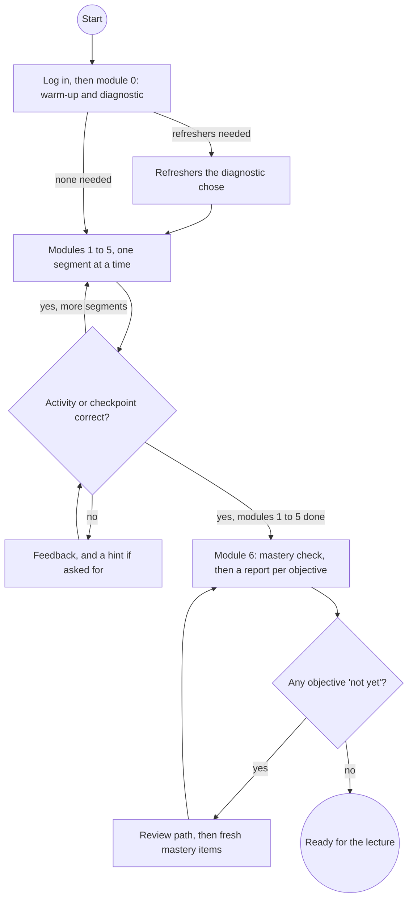
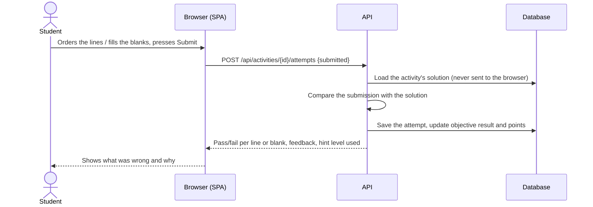
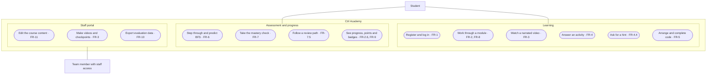
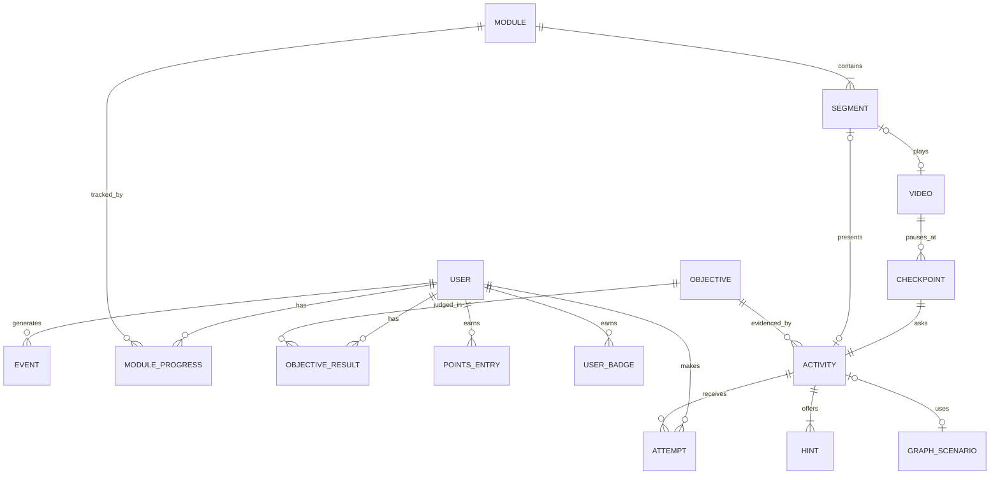

# Overview & Purpose

> **Scope of this document:** Software engineering only. Instructional-design content (learning theories, learning styles, motivation, pedagogy) is deliberately excluded and lives in the separate ID document.

> **DRAFT 2.** Sections or decisions that are still provisional are tagged **[PROVISIONAL]**. Decisions, risks and future work are collected in §15.

> **Use of generative AI.** Generative AI was used to help draft and revise parts of this document and to build the project's tooling and infrastructure. Every decision in it was made by the team. As the specification requires [1], the tool and the prompts are recorded in the ID document [5], §10.

## Purpose
The COS212 app, Ctrl Academy, is a pre-lecture, tutor-style learning application that teaches **one data structure (Graphs)** and **one algorithm (Breadth-First Search)**. It is used by a student **before** attending the corresponding lecture and assumes **zero prior knowledge** of the topic. The specification asks for one core data structure and one core algorithm from CS2023 [1]; graphs and breadth-first search are both in CS2023's Algorithmic Foundations knowledge area [2].

What the app teaches, in what order, and how it assesses the student is designed in the ID document [5]: seven short modules (0 to 6), a four-level hint ladder, and a mastery check that reports each objective separately. The ID document lists eight learning objectives. The app assesses the first seven: the eighth (the shortest route, measured in edges) has no success criterion, mastery item or review path yet, and the team has still to decide whether to keep it (#70). This document specifies the software that delivers that design. Where the software does not yet do what a requirement says, §15.5 says so.

From an engineering standpoint, the system is a web application composed of:
- a **TypeScript + React frontend** that plays narrated videos, renders interactive activities (including drag-and-drop and fill-in-the-blank code) and the BFS visualiser, and shows each student their progress, points and mastery report;
- a **Python backend** that serves content, manages accounts, checks answers, computes BFS traversals, records every attempt, and decides mastery and scaffolding;
- a **PostgreSQL database** holding users, content, attempts, progress and results.

## Engineering goals
- Every activity type in the ID document can be expressed as **data**, so the ID team adds or changes content without code changes.
- Answers, mastery and points are decided **on the server**; the browser only reports what the student did.
- Code activities are checked by **comparing the student's answer with the solution**, so no student-written code is ever executed on the server (decision §15.3).
- Deterministic, inspectable BFS step generation, so animations, predictions and trace tables all agree with what the lessons teach.
- Every attempt and hint is **logged**, so the ID team's pilot and evaluation have the data they need.

## Primary user & session shape
The primary role is **Student**. Team members also have a **staff** flag, which opens the staff portal (§9.6): editing the course content (FR-11), uploading the narrated videos and placing their checkpoint questions (FR-3.6), the pilot's figures and the evaluation export (FR-10), and the lists of accounts and of team members.

A typical session: register or log in → module 0 (warm-up and diagnostic, designed to pick the refreshers this student needs) → modules 1 to 5 (narrated segments, activities and code tasks, with hints on demand) → module 6 (mastery check) → mastery report per objective → review path for any objective marked "not yet". Progress is saved after every segment, so the student can stop and return. Today the diagnostic does not pick refreshers yet: every student sees all of them (§15.5).



Figure: A student's path through the app.

# Software engineering approach

## Choice: Scrum with one-week sprints

We follow **Scrum** [6], an Agile methodology, with one-week sprints. Each sprint ends with a working
increment deployed to staging, where the whole team, including the instructional designers, reviews it.

The COS750 lifecycle lecture (L11) [3] lists the methodologies we considered. We chose Scrum because of
four properties of this project:

1. **The requirements arrive while we build.** The ID team designs the content, the assessment and
   the scaffolding at the same time as we build the platform. A plan-driven model (Waterfall,
   V-model) needs stable requirements before design starts; Scrum expects them to change and
   reprioritises every sprint.
2. **The deadline is fixed and the scope is not.** The prototype must be demonstrated on
   16/17 November. Time-boxed sprints with a prioritised backlog mean that the most important
   features are finished first, and that something complete and working exists at the end of every
   week.
3. **An educational app has to be tried by learners.** Each sprint ends with a deployed increment
   we can put in front of students and the ID team, so feedback shapes the next sprint instead of
   arriving after the build.
4. **It fits the ID process.** The ID document uses ADDIE as a repeating cycle with rapid
   prototyping inside it, testing early versions of lessons with peers (ID document §4.1). Scrum
   gives those prototypes a fixed rhythm: each sprint's increment on staging is the version the ID
   team tests, and its sprint review is where their formative evaluation feeds back into our
   backlog. ADDIE's Develop and Implement phases run inside Sprints 1 and 2, and the pilot session
   with peers is a backlog item like any other.

**Methodologies we did not choose:**

| Methodology | Why not |
|---|---|
| Waterfall and V-model | They need fixed requirements up front, but ours depend on ID work still in progress. Testing comes last, which leaves no time to recover from what it finds before a fixed demo date. |
| Spiral | Its risk analysis each cycle is designed for large, long, high-risk projects. Too heavy for a two-week build. |
| Incremental (plan-driven) | We do deliver in increments, but planned per sprint, not all fixed at the start. |
| Prototyping | Each sprint review works like a prototype review, but on its own prototyping gives no roles, cadence or backlog to coordinate seven people. |
| XP | We use several XP practices: continuous integration, small releases, collective code ownership through PR review, and coding standards enforced by linters. We don't follow its full discipline of pair programming and test-first development with three engineers across different schedules. |

## Roles

| Role | Who | Responsibilities |
|---|---|---|
| Scrum Master | Matthew Els, chosen by the team on 1 November 2026 | Runs the events, removes blockers, keeps the board and the process honest, and facilitates backlog ordering. |
| Development team | Matthew Els, Ayanda Juqu, Reece Schmidt (software engineering); Joshua Wereley, Simphiwe Nhlapo, Mohtashim Hussain, Jacobus Hoogenboezem (content, assessment and scaffolding design) | Build the increment. ID members own content items on the same backlog. |

**No Product Owner.** Standard Scrum has a Product Owner who owns the backlog and accepts work. We
deliberately don't appoint one, because the product's requirements are fixed by sources outside the
team: the examination specification (from the COS212 lecturer, our client) and the ID document's
learning outcomes. The Product Owner's duties are shared instead:

- **Backlog order** is agreed by the whole team at sprint planning, facilitated by the Scrum Master.
  Items that cover the specification's hard requirement (an assessment that gives struggling
  students extra scaffolding) always come first.
- **Acceptance** is checked against each item's acceptance criteria at the sprint review. Content
  items are accepted by the ID members; platform items by an engineer other than the author.

## Timeline

| Sprint | Dates | Goal |
|---|---|---|
| Sprint 0 | 22 Oct – 1 Nov | Foundation. Spec issued 22 Oct, group registered 23 Oct, topic chosen (graphs + BFS), repository and branch flow, CI, hosting on staging and production, database layer with migrations, backups, staging login. |
| Sprint 1 | 2 – 8 Nov | **A complete path through the app.** A student can register, open a lesson, answer a checkpoint question in a video, step through BFS on a predefined graph, arrange and complete BFS in a code activity, take the mastery check, and be sent to the review path for any objective marked "not yet", all with placeholder content, deployed to staging. |
| Sprint 2 | 9 – 15 Nov | **Real content and the full feature set.** The ID team's content, questions and scaffolds loaded; all activity kinds, hints, points and badges; narrated videos; pilot by team members on 10–11 Nov (§14.7); end-to-end tests; accessibility pass. |
| Release | 12 – 16 Nov | Feature freeze **Thu 12 Nov**. `staging` → `master` (production) **Fri 13 Nov**. Demo rehearsals on production 14–15 Nov. SE and ID documents submitted before **08:00 on Mon 16 Nov**. Presentation and demo on 16 or 17 Nov. |

## Artefacts

- **Product backlog:** the GitHub Project board of the `ctrl-group-cos750` organisation, linked to the repository. Every group member is in the organisation's Ctrl Group team, which can edit the board. Each item is an issue
  written as a user story ("As a student with no graph knowledge, I want …, so that …"), with
  acceptance criteria and the requirement IDs it covers (FR-x.y, §6). ID work (videos, question
  banks, scaffold content) is on the same board with a `content` label, so dependencies between the
  two teams are visible.
- **Sprint backlog:** the items assigned to the current sprint's iteration on the board, with a
  sprint goal.
- **Increment:** whatever is deployed to staging.ctrlacademy.co.za at the end of the sprint.
- **Definition of Done.** An item is done only when:
  1. its acceptance criteria are met;
  2. it has tests (unit or API tests; an end-to-end test for user-facing flows);
  3. its PR is reviewed and approved by another engineer;
  4. CI passes (format, lint, types, tests, builds);
  5. it is merged into `staging`, deployed, and checked on staging.
- **Estimates:** story points on the Fibonacci scale (1, 2, 3, 5, 8), so the board's burn-up
  chart shows progress against each sprint's commitment.

## Events

| Event | When and how | Output |
|---|---|---|
| Daily stand-up | Asynchronous, a short message in the team's Discord #general channel every day: done since last time, doing next, blocked by. | Dated record of progress and blockers. |
| Weekly check-in | Thursday team call at 19:00, mid-sprint. What is done so far is shown on staging; progress against the sprint goal, blockers, and dependencies between the ID and SE work; the sprint backlog is adjusted if the goal is at risk. | Updated sprint backlog; decisions noted in Discord. |
| Sprint review | Sunday, asynchronous. Each engineer posts what they merged with its staging link; team members, including the ID members, check each item on staging and accept or reject it against its acceptance criteria on the board by Monday morning. | Accepted items; feedback added to the backlog. |
| Retrospective | Sunday to Monday, a Discord thread: what went well, what to change, one concrete action for the next sprint. | Retro notes kept with the sprint (`docs/se/sprints/`). |
| Sprint planning | Monday morning. The Scrum Master proposes the sprint goal and the items from the top of the backlog that fit; the team confirms or changes them in Discord before work starts. | Sprint goal and sprint backlog on the board. |

Sprints run from Monday to Sunday. The only meeting is the Thursday call; the events at the sprint boundary are asynchronous, because seven students with different timetables can't meet twice a week during exams. Discord keeps a dated record of all of them.


## Engineering practices that support the process

These are what make a working increment at the end of every week possible. Details are in §13.

- **Branching:** each backlog item gets a feature branch and a PR into `staging`; `staging` is
  promoted to `master` by PR. A CI check rejects PRs into `master` that don't come from `staging`.
- **Code review:** every PR is reviewed by another engineer before it is merged.
- **Continuous integration:** every PR runs formatting, linting, type checks, tests and builds
  for both apps and the Docker images.
- **Continuous delivery:** a merge into `staging` deploys to staging automatically; `master`
  deploys to production. Database migrations run on deploy.
- **Separate environments:** local, staging (behind a team password) and production, each with its
  own database.

## Evidence

| Claim | Where to see it |
|---|---|
| Backlog, sprints, estimates, burn-up | GitHub Project board: <https://github.com/orgs/ctrl-group-cos750/projects/1> |
| Daily stand-ups | Discord #general channel (exported for the appendix) |
| Reviews, retros and planning | `docs/se/sprints/` in the repository |
| Code review and Definition of Done | Merged PRs and their reviews on GitHub |
| CI and continuous delivery | GitHub Actions history; Coolify deployment log |

# Scope

## In scope
1. Accounts: register and log in with email and password.
2. The seven modules of the ID document (0 to 6), in order, with progress saved after each one.
3. Narrated videos (screen recordings with voice-over, no presenter) that pause at checkpoints for an activity.
4. Every activity type in the ID document, with immediate feedback and a four-level hint ladder.
5. Code activities — ordering shuffled lines (Parsons problems) and filling in missing tokens — checked on the server by comparison, running no student-written code.
6. The BFS visualiser, with step controls, next-vertex prediction and trace tables.
7. The mastery check, a per-objective report, and a review path for objectives marked "not yet".
8. The module 0 diagnostic that picks refreshers, skippable worked examples, and optional bonus quests.
9. Private points and badges.
10. An event log and CSV export for the ID team's pilot and evaluation.
11. Seed content: the ID team's modules, activities and graph scenarios, loaded from version-controlled fixtures into an empty database.
12. A content editor in the staff portal, where team members change that content in the database (FR-11).

## Out of scope
- A public leaderboard (see FR-9 for why).
- Topics beyond graphs and BFS (DFS, Dijkstra, trees), and programming languages other than Python.
- Password reset, refresh tokens, and sign-in with the university account (future work, §15).
- Native mobile apps and offline use.

## Success criteria (engineering)
- A new student can complete all seven modules and receive a mastery report on the deployed production site.
- A student with a "not yet" objective is sent to that objective's review path, and can reach "ready for the lecture" after it.
- Every code activity is checked on the server by comparison with the solution, so no student-written code runs anywhere and a malformed answer can at worst be marked wrong.
- The ID team can export the pilot's attempts and results as CSV without help from an engineer.

## Stakeholders

| Stakeholder | Interest | How they shape the system |
|---|---|---|
| COS212 lecturer (the client) | An app that prepares students for the graphs and BFS lecture | Commissioned the app through the examination specification [1], which fixes the topic area, the zero-prior-knowledge assumption and the requirement for an assessment with extra scaffolding |
| COS212 students (the users) | Arrive at the lecture understanding graphs and BFS; know what to revise | Described by the learner profile in the ID document [5] (§2); represented in testing by the pilot (§14.7) |
| Instructional designers (Joshua Wereley, Simphiwe Nhlapo, Mohtashim Hussain, Jacobus Hoogenboezem) | Their learning design is delivered faithfully | Own the ID document, the content fixtures and the content items on the backlog; accept content work at sprint review |
| Software engineers (Matthew Els, Ayanda Juqu, Reece Schmidt) | A system that can be built, tested and demonstrated by 16 November | Own this document and the platform items on the backlog |
| COS750 examination panel and peer groups | A working prototype and documents that justify it | Assess the documents, the presentation and the live demo |

Table: Stakeholders.

## Where the requirements come from

The requirements were not written in one sitting; they were gathered from four sources and refined sprint by sprint:

1. **The examination specification** [1]: the topic constraints, the target learner, and the one hard functional requirement, an assessment that gives struggling students extra scaffolding (FR-7).
2. **The ID document** [5]: the seven modules, the learning objectives and their success criteria, the activity types, the hint ladder and the three mastery results. The traceability table in §6 maps each functional requirement to the part of the ID document it delivers.
3. **Team decisions**, made at meetings and on the team's Discord server: the topic, languages, roles and the Thursday call at the initial meeting on 25 October; the methodology, the tech stack, the code runner, video format, gamification and accounts on 1 November. They are recorded in §15.3 and in the sprint records (`docs/se/sprints/`).
4. **The COS750 lectures**: L11 for the lifecycle [3], L05 for motivation [4], L06 for interaction design [10] (§11.2), L09 and L10 for what kind of software this is and how it would fit the university's systems [11], [13] (§11.3), and the course's treatment of assessment and accessibility.

Each requirement becomes one or more user stories on the board, with acceptance criteria and the requirement IDs they cover (§2.4). When a requirement changes, the change is made in this document through a reviewed PR, so its history is in the repository.

# System Architecture

## High-level architecture

```
Browser
  │  HTTPS, one origin: ctrlacademy.co.za (production), staging.ctrlacademy.co.za (staging)
  ▼
Coolify's Traefik proxy (on our server; Let's Encrypt certificates, Cloudflare DNS)
  ▼
web container: nginx
  ├─ /            React + TypeScript SPA (Vite build)
  ├─ /media/      narrated videos and captions (static files, served with range requests)
  └─ /api/*  ──►  api container: FastAPI on Uvicorn
                    routers → services → SQLAlchemy models
                    run_bfs (the BFS engine), answer checkers, mastery rules
                      │
                      ▼
                  db container:
                  PostgreSQL 18
                  (persistent volume,
                  nightly pg_dump)
```

The three containers are defined in `docker-compose.yml`, and Coolify deploys that file as it is.
nginx serves the SPA and forwards `/api` to the API, so the browser only ever talks to one origin.
That removes the need for CORS and for an API base URL in the frontend. Code activities are checked
in the API by comparing the student's answer with the stored solution, so no student-written code is
executed anywhere; the separate, network-isolated code runner that earlier executed student Python
was removed when the team dropped freeform code writing (§15.3).



Figure: Submitting a code activity. The browser never sees the solution, and the check is a comparison in the API — no code is executed.

## Tier responsibilities
- **Frontend (client tier):** presentation, interaction, animation and video playback. It holds no authority over answers, mastery or points: it reports what the student did, and the backend decides and persists.
- **Backend (application tier):** authentication, content delivery, answer checking (code activities included, by comparison with the solution), BFS computation, hint and attempt logging, mastery and review-path rules, points and badges, and the evaluation export.
- **Data tier:** durable storage of structured data. Media is served by nginx from a volume, not stored in the database.

## Key architectural decisions
- **Thin client for authority-bearing logic.** Answers, mastery and points are decided server-side, so the rules live in one place and the browser can't award itself a result.
- **Code activities checked by comparison, never executed.** Students order shuffled lines (Parsons) or fill in missing tokens; the server compares the submission with the solution. No student-written code runs on the server, which removes the whole untrusted-code-execution attack surface (decision §15.3, superseding the earlier sandboxed runner).
- **BFS computed server-side.** One tested implementation produces the animation steps that predictions are compared with, and checks trace tables, so they can never disagree.
- **Stateless API with token auth.** The token travels in an httpOnly cookie (§5).
- **Content as data.** Modules, activities, hints, tests and graph scenarios are rows in the database. The repository's fixture files seed them, and the ID team edits them in the staff portal (FR-11); videos and their checkpoints are made in the video editor (FR-3.6). Adding content needs no frontend or API change.

# Technology stack

| Layer | Choice | Rationale |
|---|---|---|
| Backend language | **Python 3.12** | Team decision. Good for algorithm code and fast API development. |
| Web framework | **FastAPI** | Pydantic validation, typed request/response models, OpenAPI docs generated at `/api/docs`, which serve as the frontend contract. |
| ASGI server | **Uvicorn** | Runs directly as the API container's process. Docker restarts it if it crashes, so it needs no separate process manager. |
| Validation | **Pydantic v2** | Comes with FastAPI. Validates every request at the API boundary. |
| ORM and migrations | **SQLAlchemy 2.1** + **Alembic** | Typed models. Migrations are applied automatically when the API container starts (`alembic upgrade head`), so a migration that fails stops the deploy instead of running against the wrong schema. Fourteen revisions are in place, `0001` to `0014`. |
| Database | **PostgreSQL 18** in every environment | Local development runs the same Postgres in Docker. Tests use in-memory SQLite, so they run without a database server; CI runs the API tests a second time on Postgres 18, because some failures happen only there (§14.6, round four). Using one database engine everywhere avoids JSON and enum behaviour differing between dev and production. |
| Auth | **JWT** (PyJWT) in an **httpOnly, Secure, SameSite=Lax cookie**; passwords hashed with **Argon2** (pwdlib) | Because the SPA and API share one origin, a cookie is simpler than an `Authorization: Bearer` header, and JavaScript can't read it, so an XSS bug can't steal the token. pwdlib replaces passlib: passlib is no longer maintained and breaks with current bcrypt releases, and FastAPI's own documentation now uses pwdlib. Email is required. Password reset and refresh tokens are future work. |
| Frontend language | **TypeScript 7** | Team decision. Type safety across the UI and the API client. |
| Frontend framework | **React 19** | Team decision, and what the scaffold already uses. |
| Build tool | **Vite 8** | Fast dev server with hot reload; the dev server proxies `/api` to the local API, so dev also uses one origin. |
| Routing | **React Router** | Client-side routing for the multi-view SPA. nginx already serves `index.html` for unknown paths. |
| Server state | **TanStack Query** | Data fetching and caching against the REST API. |
| Graph rendering | **SVG via D3** | For graphs of up to about 50 vertices, SVG is simpler than Canvas (one DOM element per node and edge, easy per-element transitions, highlighting and click handling). |
| Video | **HTML5 `<video>`**, self-hosted MP4 (H.264) with WebVTT captions; narrated screen recordings, no presenter | The player needs full control to pause at checkpoints and block seeking past them. An embedded YouTube player would add adverts, recommendations and a dependency outside our control during the demo. Captions also provide the `text` mode for each video. |
| Code display | A small highlighter of our own (`FillInCode.tsx`) | Colours Python keywords, strings, numbers and comments in a read-only snippet, with a `<select>` for each blank. The snippets are short and only Python, so the code-editor library CodeMirror, named in earlier drafts of this document, was not needed. Students never type free Python. |
| Drag and drop | **Native HTML5 drag and drop**, plus arrow keys | Parsons problems: drag a line, or move it with the up and down arrow keys, and a live region announces each move (NFR-A1). The dnd-kit library, named in earlier drafts, was not needed. |
| Styling and UI components | **Tailwind CSS 4**, and **shadcn** components on **Base UI** (`@base-ui/react`), with **lucide-react** icons | Design tokens in `web/src/styles/tokens.css` (light and dark). The staff portal and some student screens use the shadcn components in `web/src/components/ui/`; the rest use the team's own kit in `web/src/components/` (§11). Merging the two kits is open work. |
| Markdown | **react-markdown** | Renders prompts, hints, text segments and worked examples. It builds elements rather than inserting HTML, and drops raw HTML, so content can't inject a script. |
| Testing (backend) | **pytest** with FastAPI `TestClient`, warnings treated as errors | Unit tests for the BFS engine (`run_bfs`) and services, plus API tests against a fresh SQLite database that every migration has been applied to. |
| Testing (frontend) | **Vitest** + **React Testing Library** | Native fit with Vite; component and logic tests, with coverage reported in CI. |
| End-to-end testing | **Playwright** *(planned, #35)* | To walk through the full student flow (register, a module, a video checkpoint, a code submission, the mastery report, a review path) in a real browser against a running stack. `@playwright/test` is a dev dependency, but no end-to-end test is on `staging` yet (§14.1). |
| Lint and format (Python) | **ruff** (format + lint, including the bandit security rules and the FastAPI rules) and **mypy --strict** | Enforced in CI. |
| Lint and format (TypeScript) | **oxlint** (correctness, suspicious and perf rules plus the React, import, jsx-a11y and Vitest plugins; warnings fail the build) and **Prettier** | oxlint replaces ESLint: it is already configured and runs in under a second. The `jsx-a11y` plugin enforces part of the accessibility requirements (NFR-A). |
| CI | **GitHub Actions** | On every PR into `staging` or `master`, for the parts it touches: format, lint, types, tests and builds for the apps, and the Docker images for the whole stack (a docs-only PR builds only the PDFs). Not again on the merge itself, which the PR already tested; `push-guard` checks every push instead. A `branch-flow` check rejects PRs into `master` that don't come from `staging`. Dependabot opens monthly update PRs into `staging`; security fixes come at once. |
| Hosting | **Coolify** on the team's server, **Docker Compose** build pack | Coolify builds and deploys on every push: `staging` → staging.ctrlacademy.co.za, `master` → ctrlacademy.co.za. Its Traefik proxy terminates HTTPS. Staging sits behind a team-password page so the public can't see unfinished work. |

# Functional Requirements

Each feature is broken into concrete, testable capabilities with IDs (FR-x.y) for traceability. The table at the end of this section links each requirement to the part of the ID document it delivers. The requirements describe the design. Those that `staging` does not meet yet, or meets only in part, are listed in §15.5 with the work that closes each.



Figure: Use cases. The student takes part in every use case in the first two groups; the staff portal is for team members only.

## Accounts (FR-1)
- **FR-1.1** Register with an email address, a password and a display name. The display name is shown only to the student.
- **FR-1.2** Log in and out. A session lasts until logout or 14 days, whichever is first.
- **FR-1.3** A student sees and changes only their own progress, attempts and results.
- **FR-1.4** Seeded demo accounts exist at different points in the course (new, mid-course, finished with a "not yet" objective, ready for the lecture), so the demo can show any stage without working through 75 minutes of content.
- **FR-1.5** A student can change their password: they give the current one, the new one must meet the password rules (NFR-S1), and every other session is logged out.
- **FR-1.6** A student can choose a profile picture from a set the team provides (graph shapes, never an uploaded photo), shown only to them, like the display name.
- **FR-1.7** A profile page, reached from the account menu in the header, shows the student their own objectives met and, unless hidden (FR-9.5), points and badges.
- **FR-1.8** Staff can list every account, search it by name or email, open one to see its totals (answers, correct answers, hints viewed), its progress through each video and its last ten answers (whether each was right, never what was answered), and delete an account with everything stored about it. Nobody can delete their own account there.
- **FR-1.9** Staff can make another registered account a team member, or take staff access away. It takes effect on the next request. Nobody can remove their own access, so the portal always keeps at least one team member.

## Modules and progress (FR-2)
- **FR-2.1** Present the seven modules of the ID document (0 to 6) in order. A module opens once the one before it is complete; module 0 is always open. A module with no segments yet (its content not written) is passed over, so it never locks the modules after it.
- **FR-2.2** Each module is an ordered sequence of segments: narrated video, text, worked example, refresher, or activity (a code activity is one kind of activity).
- **FR-2.3** Each module starts by stating its objectives in plain words ("By the end of this module you can …"), taken from the content.
- **FR-2.4** Each module from module 2 onwards opens with one or two retrieval questions on earlier modules.
- **FR-2.5** Save progress after every segment. A student who returns resumes at the segment they left.
- **FR-2.6** Show a module map with each module's state (locked, open, in progress, complete) and estimated duration.
- **FR-2.7** A student moves past a segment only once it is done: an activity segment once its activity has been answered at least once (a wrong answer counts), a video segment once every checkpoint in the video is passed. Other segments are done when shown. An activity whose kind has no student UI yet (today `trace`, `fix_the_bug` and `choose_tests`) counts as done until its UI exists, so it never strands a student. A module is complete once its last segment is done. A complete module can be reread freely.

## Narrated video with checkpoints (FR-3)
- **FR-3.1** Play narrated videos (screen recordings with a voice-over, no presenter) with play, pause and seek.
- **FR-3.2** Show captions, on by default, and a transcript below the video. The transcript is the text version of the segment.
- **FR-3.3** Pause automatically at each configured checkpoint and show its activity.
- **FR-3.4** At a checkpoint, give immediate feedback. A wrong answer can be retried, with the hint ladder available (FR-4.4). Playback resumes once the activity is answered correctly.
- **FR-3.5** Prevent seeking past a checkpoint that has not been answered correctly. Seeking backwards is always allowed.
- **FR-3.6** Staff make the videos in the portal: upload the MP4 and its WebVTT captions to the media volume, write the transcript, and place checkpoints on the timeline, each with a multiple-choice question, a reason for each wrong option and up to four hints. Each checkpoint question is saved as an activity, so it is checked, logged and hinted like any other (FR-4). Editing a video keeps each existing checkpoint's attempts.
- **FR-3.7** Staff can export a video from one site as a JSON file and import it on another, with its MP4 and captions, because staging and production have separate databases and media volumes.

## Activities, feedback and hints (FR-4)
- **FR-4.1** Support these activity kinds, each defined entirely by content data:
  multiple choice; matching; labelling vertices and edges on a diagram; classifying graphs (directed or undirected); building a graph by adding vertices and edges; predicting the next BFS vertex; filling in a BFS trace table (current vertex, queue, visited set, order); Parsons problems (ordering shuffled lines of code); completing code by choosing a token for each blank; fixing a faulty BFS; choosing the test cases that expose a bug.
- **FR-4.2** Check every answer on the server and return feedback straight away. Feedback says why an answer is wrong, not only that it is wrong. A right answer can say why it is right too: the content gives an optional `explanation`, shown in place of the plain "Correct."
- **FR-4.3** Tag every activity with the learning objective it gives evidence for (1 to 7) and its purpose: practice, diagnostic, retrieval, mastery, review or bonus.
- **FR-4.4** Offer a four-level hint ladder on every activity, one level at a time. Level 4 is the worked solution.
- **FR-4.5** Record every attempt with the answer, the result and the highest hint level used. Hint levels 3 and 4 make a later correct answer count as "with support" (FR-7.2).

## Code activities (FR-5)

Code activities never execute student-written code. The student constructs code by **ordering shuffled lines (Parsons problems)** or **filling in missing tokens/lines from a given set**, and the server checks the result by comparison with the stored solution. This runs no untrusted code at all (decision §15.3; the earlier sandboxed code runner was removed).

- **FR-5.1** Render the activity's code with Python syntax highlighting and line numbers (read-only display), and present the lines to reorder or the blanks to fill. Blanks are filled by choosing from a given set of tokens, not by free typing.
- **FR-5.2** **Check** compares the student's arrangement against the solution and shows which lines or blanks are wrong, with a message for each. There is no code execution, so there are no run-time limits or output to show. A check is practice: it is not graded and not recorded as an attempt.
- **FR-5.3** **Submit** records a graded attempt: the server compares the submission with the solution (which the browser never receives) and returns which lines or blanks were wrong and a message for each, without revealing the full solution.
- **FR-5.4** Parsons problems, and the fixed program in fix the bug (FR-5.5), are checked by the order of the lines, and every order the content accepts passes: a solution lists one order, in which a group of lines may go in any order among themselves (the BFS starting values; `visited.add(n)` and `queue.append(n)`), plus any alternative orders, and the seed refuses one that uses an unknown line, a line twice, a group of one or an alternative the others already accept. The BFS items accept every order that runs as BFS except two kept as conventions: the import after the function, and `order.append(v)` anywhere but straight after `popleft()`. A wrong order is compared with the closest accepted order by relative order (longest common subsequence), so only the lines that must move are marked, not every line after one misplaced line; fill-in activities are checked token by token against the expected tokens, and a wrong token gets the content's reason for that blank and token where it gives one (FR-4.2).
- **FR-5.5** Objective 7 uses two more kinds, also checked by comparison. **Fix the bug** shows a faulty BFS: the student marks each faulty line and chooses its correction from a given set of lines, or moves a line that is in the wrong place, as in a Parsons problem. **Choose tests** shows a faulty BFS and four to six test cases, each a small graph, a start vertex and the expected order: the student selects every test case that the faulty version fails and the correct version passes. No student code or student-written test runs.
- **FR-5.6** Because nothing is executed, a code activity always returns promptly with per-line or per-blank feedback, never a run-time error page.

## BFS visualiser (FR-6)
- **FR-6.1** Load a graph scenario (vertices, edges, directed or not, start vertex) and its BFS steps from the backend.
- **FR-6.2** Draw the graph and animate BFS step by step, showing the current vertex, the queue, the visited set and the traversal order side by side.
- **FR-6.3** Provide controls: step forward, step back, play and pause, reset, and speed.
- **FR-6.4** In prediction mode, pause before each step and ask the student to pick the next vertex; the animation then confirms or corrects the prediction.
- **FR-6.5** Neighbours are visited in alphabetical order of their labels, the convention the lessons teach, so a correct prediction is always marked correct.
- **FR-6.6** Trace-table activities are checked step by step against the engine's steps.

## Mastery check and scaffolding (FR-7)
- **FR-7.1** Module 6 is a mastery check: unseen activities on every objective, checked against the success criteria in the ID document's Table 1.
- **FR-7.2** Give each objective one of three results: **met independently** (criterion met without hint level 3 or 4), **met with support** (met after using level 3 or 4), or **not yet** (criterion not met).
- **FR-7.3** Show a mastery report: each objective's result in plain words, with next steps.
- **FR-7.4** A student is **ready for the lecture** when no objective is "not yet". An objective whose mastery items are not all answered yet isn't met either, so in practice every objective must be met, with or without support.
- **FR-7.5** For each "not yet" objective, open a review path: that objective's review segments and activities, followed by fresh mastery items for it. The objective's result updates when they are completed. The path opens only once the mastery check marks the objective "not yet", so its fresh items are still unseen, and there is one path per objective: a student still "not yet" after it is told to bring that objective to the lecture.
- **FR-7.6** Results are computed on the server from recorded attempts, and recomputed if the rules change.

## Diagnostic, fading and challenge (FR-8)
- **FR-8.1** Module 0's diagnostic quiz (queues and basic Python) selects which refreshers the student sees; refreshers the student doesn't need are skipped.
- **FR-8.2** A worked example can be skipped after the student passes a short check, as the ID document's fading design requires.
- **FR-8.3** Offer optional bonus quests after modules for students who want more challenge. They give points but never affect mastery.

## Points and badges (FR-9)
- **FR-9.1** Award points for completed modules, correct activities and objectives met, from a server-side rules table.
- **FR-9.2** Award fewer points for a correct answer reached after hint level 3 or 4, matching "met with support".
- **FR-9.3** Award badges for milestones (first module, every objective met, all bonus quests).
- **FR-9.4** Points and badges are **private**: each student sees only their own. There is no public leaderboard, because public ranking discourages the students who most need the app (those motivated by avoiding failure, L05 [4]).
- **FR-9.5** A student can hide points and badges. They are still earned while hidden, and the per-objective mastery report is never hidden. About a third of students in a data-structures course found badges demotivating [9], so opting out is the student's choice.
- **FR-9.6** Points are never taken away and each thing is rewarded once; a badge, once earned, is never removed. Recomputing results (FR-7.6) may add badges but never removes them, and an objective badge only goes up, from bronze (met with support) to gold (met independently). No badge counts hints, attempts, days or speed, so none can be earned by clicking through hints or guessing.

The rules, as confirmed by the ID document (§7.2):

| Event | Points |
|---|---|
| Activity correct without hint level 3 or 4 | 10 |
| Activity correct after hint level 3 or 4 | 4 |
| Module completed | 25 |
| Objective met independently / with support | 30 / 15 |
| Bonus quest completed | 20 |

Table: Points rules, stored on the server and tunable without a code change.

## Evaluation data (FR-10)
- **FR-10.1** Log every event (segment viewed, video checkpoint reached, attempt, hint requested, module completed, result changed) with the user and time.
- **FR-10.2** Staff can download the log, attempts and objective results as CSV, for the ID team's pilot and evaluation. A pilot page in the staff portal shows the same data as counts: per activity, how many students tried it, answered wrongly and needed hint 3 or 4; per video, how many started it, passed each checkpoint and finished it.
- **FR-10.3** The export identifies students by an internal ID, not by email or display name.

## Content editing (FR-11)
Agreed by the team on 8 November 2026, so the ID team can change content without a pull request.
- **FR-11.1** Staff can edit every piece of course content in the staff portal: objectives and their mastery rules, modules and their segments (order, text, which activity or video each shows), review paths, activities with their answers and hints, and graph scenarios. They can add new ones of each.
- **FR-11.2** The database holds the content. The repository's fixtures seed an empty database and refresh what nobody has edited on every deploy; an item staff have edited is never overwritten by the seed. After each deploy the seed checks all the content together, as a save does (FR-11.3), and logs a warning if the repository's content and the staff edits don't fit together; the API still starts, so staff can fix it in the portal.
- **FR-11.3** Every save is checked with the same rules CI applies to the fixtures (NFR-M5): the item on its own, then all the content together. A save that breaks a rule is refused with a message naming it, and nothing changes.
- **FR-11.4** "Use the repository's version" drops the portal's edit of one item and loads the fixture again.
- **FR-11.5** Staff can download the content as fixture files, to commit to the repository, so the repository can catch up with the portal and the next environment is seeded with it. Once the committed fixtures match an edited item, the next deploy clears its edited mark, so later changes to it in the repository reach the database again.
- **FR-11.6** An activity students have answered is never deleted, only taken out of use, so the evaluation data keeps it (FR-10). Earlier attempts keep the result they were given.

## Traceability to the ID document

Section and table numbers refer to the ID document [5].

| Requirement | Delivers (ID document) |
|---|---|
| FR-2 Modules and progress | Lesson sequence, modules 0–6 (§4.4, Table 4); Gagné events 2 and 9 (Table 3); retrieval practice (§5.4) |
| FR-3 Narrated video | Gagné event 4, present the content (Table 3); interactive video (§5.1) |
| FR-4 Activities, feedback, hints | Gagné events 5–7 (Table 3); active learning (§5.1); hint ladder and scaffolding (§5.3) |
| FR-5 Code activities | Objectives 6 and 7 (§3.1, Table 1); Parsons problems (§5.3) |
| FR-6 BFS visualiser | Objectives 4 and 5; signalling and segmenting (§5.2); prediction before animation (§5.4) |
| FR-7 Mastery and scaffolding | Three result states and readiness rule (§3.2); review path (§7); the specification's requirement for extra scaffolding |
| FR-8 Diagnostic and fading | Warm-up and refreshers (module 0); fading support and bonus quests (§5.2) |
| FR-9 Points and badges | Motivation and gamification (§7.1, §7.2) |
| FR-10 Evaluation data | ADDIE Implement and Evaluate phases (§4.2, Table 2); evaluation (§8) |
| FR-11 Content editing | ADDIE as a repeating cycle: pilot findings go straight back into the Develop phase (§4.1, §8.5) |

Table: Which part of the ID document each functional requirement delivers.

# Non-Functional Requirements

## Performance
- **NFR-P1** BFS computation for scenario sizes up to about 50 vertices returns in well under 200 ms server-side.
- **NFR-P2** Answer checks for non-code activities return in under 300 ms under light load. **[PROVISIONAL target]**
- **NFR-P3** A code activity is checked and returns its result within 1 second: the check is a comparison in the API, with no code execution.
- **NFR-P4** The BFS animation runs from precomputed steps, with no server calls per frame.
- **NFR-P6** Under more load than it can serve, the API stays up and answers every request, at worst with a quick "busy" (503 within 5 seconds), and recovers as soon as the load drops. It never stalls (see §14, "Load testing").
- **NFR-P5** Videos are served by nginx from a volume with range requests, so seeking doesn't download the whole file and video never passes through the API.

## Usability
- **NFR-U1** Laptop and desktop are the primary devices, because the code activities in modules 2, 4 and 5 need a keyboard and a wide screen: lines of code that move with the arrow keys, and results beside the code. Every other module also works on a tablet and a phone (from 360 px wide).
- **NFR-U2** Clear, consistent controls for video, BFS stepping, activities and hints across all modules.
- **NFR-U3** Every answer gets visible feedback within the activity; errors from the system are written for students, never as stack traces.
- **NFR-U4** Before the feature freeze, team members pilot every module they did not build, and the defects they find are fixed or recorded (§14.7).

## Security & Authentication
- **NFR-S1** Passwords stored only as salted hashes (Argon2, via pwdlib). A new password has at least 8 characters, a lowercase and an uppercase letter, a number and a symbol (a space counts), and doesn't contain the student's name or the first part of their email. The register page lists these rules and ticks each one off as the student types; the API checks the same rules (`api/app/passwords.py`, `web/src/auth/passwordRules.ts`).
- **NFR-S2** Authenticated endpoints require a valid **JWT in the session cookie**; every query is scoped to the logged-in user, so one student can never read another's data. Each token carries the user's session version; logging out increases it, so every earlier token, including a copied cookie, stops working on every device. Password reset and refresh tokens are future work (§15).
- **NFR-S3** All traffic over HTTPS in deployed environments.
- **NFR-S4** Server-side validation of all inputs (Pydantic schemas); answers, results and points are never accepted from the client.
- **NFR-S5** No secrets in the repository; configuration via environment variables.
- **NFR-S6** Standard protections: the session cookie is httpOnly, Secure and SameSite=Lax; state-changing requests require JSON bodies (blocking cross-site form posts); parameterised queries via the ORM; rate limiting on login (per address and account, and per address) and registration, keyed on the student's real address (Cloudflare's `CF-Connecting-IP`, believed only from Cloudflare's own servers), and per student on password changes and on the events the browser reports; security headers on every page (a Content Security Policy allowing only our own scripts, styles and fonts, no framing, HSTS, `nosniff`). The app and the API share one origin, so no CORS is configured. Answer submissions and hint requests are not rate limited yet: that limit, with size limits on submissions, is in progress (#139).
- **NFR-S7** **No untrusted code execution.** Code activities run no student-written code anywhere in the system. The student constructs code by ordering shuffled lines (Parsons) or filling in tokens from a given set, and the server checks the submission by comparison with the solution (FR-5). This removes the untrusted-code-execution attack surface entirely, rather than trying to contain it.

  An isolated code runner was built and hardened earlier (a network-less container running each submission as a separate seccomp-confined process) and was pentested on staging across several rounds (see the security review under §14). Those rounds confirmed the escape defences held but also found that the in-process grading channel could be forged to fake a pass, and — because staging shares a personal server with unrelated personal data — the residual risk of executing arbitrary student code was judged not worth the marks a freeform editor earned. The team therefore dropped freeform code writing and removed the runner (decision §15.3, 3 November). The runner's code is preserved in git history (tag `archive/code-runner`) should the decision be revisited with a stronger sandbox (gVisor or a per-submission microVM — §15.4).
- **NFR-S8** **Privacy (POPIA [8]).** The app stores only what it needs: email (to log in), a display name, and learning data. It shows no student's data to another student, and exports only internal IDs (FR-10.3). Staff do see students' emails and display names: the accounts pages (FR-1.8) list and search them. Those pages show whether an answer was right but never the answer. Test and demo data never uses real students' details.

## Maintainability
- **NFR-M1** Layered backend (routers → services → data) with the BFS engine (`run_bfs`), the answer checkers and the mastery rules isolated from web concerns and unit-testable in isolation.
- **NFR-M2** Typed boundaries on both sides (Pydantic + TypeScript); the TypeScript API types in `web/src/api/` are generated from the OpenAPI schema by `scripts/gen-api.sh`, and CI fails if they are out of date.
- **NFR-M3** ruff, mypy --strict, oxlint and Prettier enforced in CI on every PR.
- **NFR-M4** Database migrations tracked with Alembic.
- **NFR-M5** Content (modules, activities, hints, tests, scenarios) is validated by one set of rules wherever it is changed: the fixture files in CI, so a broken fixture fails its PR, and every staff edit in the portal, so a broken edit is refused before it reaches a student (FR-11.3).

## Accessibility
- **NFR-A1** Every activity, the video player and the BFS controls can be operated with the keyboard alone, including Parsons problems (move lines with arrow keys as well as by dragging).
- **NFR-A2** Text and controls meet WCAG 2.1 AA contrast [7]; BFS state is never shown by colour alone (vertices also carry labels and a marker for current, queued and visited).
- **NFR-A3** Semantic HTML and ARIA roles for custom controls; oxlint's jsx-a11y rules enforce part of this in CI.
- **NFR-A4** Every video has captions and a transcript.

# Data Model



Figure: Entities and relationships.

## Entities

**User**: `id`, `email` (unique, required), `display_name`, `password_hash`, `is_staff` (team members; opens the staff portal), `is_demo` (a seeded demo account, FR-1.4, left out of the evaluation export), `session_version` (NFR-S2), `created_at`.

**Objective**: `id` (1 to 7, as numbered in the ID document), `text`, `bloom_level`, `criterion` (the success criterion from the ID document's Table 1, in words), and the same criterion as the rule the mastery service evaluates: `pass_fraction` (at least this fraction of the parts right: "at least 4 of 5" is 0.8) or `max_wrong` (at most this many wrong: "with at most one error" is 1), exactly one of the two. Parts are what the checker grades: an option, a trace step, a matching pair, a line or blank of code. Only the student's first attempt at each module 6 item counts, and the result stays `not_attempted` until every item on the objective is answered. An answer given after hint 3 or 4 counts as wrong for "met independently" and as right for "met with support" (`app/services/mastery.py`).

**Module**: `id` (the module number, 0 to 6), `slug`, `title`, `goals` (the "By the end of this module you can …" sentences), `estimated_minutes`, `position`.

**Segment**: `id`, `module_id` or `review_objective_id` (exactly one: a segment is a step of a module, or of an objective's review path, FR-7.5), `position`, `kind` (`video` | `text` | `worked_example` | `activity` | `refresher`), `title`, `body` (Markdown for text and worked examples), `activity_id` (for an `activity` segment), `skip_check_activity_id` (optional: passing this activity lets the student skip the segment: a worked example after a short check, FR-8.2, or a refresher after its diagnostic item, FR-8.1), `refresher_for` (a refresher's diagnostic topic, e.g. `queues`).

**Video**: `id`, `title`, `segment_id` (the `video` segment that plays it, at most one; empty until it is placed in a module), `media_path`, `captions_path`, `transcript` (Markdown), `duration_seconds`.

**Checkpoint**: `id`, `video_id`, `at_seconds`, `activity_id`.

**Activity**: `id`, `module_id` (empty for an activity on a review path, which belongs to an objective rather than a module, and for one made in the video editor), `objective_id` (nullable for diagnostic items), `purpose` (`practice` | `diagnostic` | `retrieval` | `mastery` | `review` | `bonus`), `kind` (one of the kinds in FR-4.1), `title`, `visible` (the seed sets it to false when an activity leaves the fixtures after students have answered it, so it is kept for its attempts but taken out of use), `config` (JSON, shape depends on the kind: the prompt in Markdown, options, code with blanks, lines to order, a graph to trace …), `solution` (JSON, never sent to the browser: correct options, expected line order or tokens, the fixed program, or the test cases that expose a bug, together with the content's messages for wrong answers). A trace table has no stored solution: it is checked against the BFS engine (FR-6.6).

**Hint**: `activity_id`, `level` (1 to 4), `body` (Markdown). Level 4 is the worked solution.

**GraphScenario**: `id`, `name`, `directed`, `vertices` (JSON), `edges` (JSON), `start_vertex`. Neighbours are always taken in alphabetical order of their labels (FR-6.5).

**Attempt** (append-only): `id`, `user_id`, `activity_id`, `submitted` (JSON: the answer — for a code activity, the chosen line order or filled-in tokens), `correct`, `score` (0 to 1, for partial results such as trace tables), `hint_level` (highest level shown before this attempt), `detail` (JSON: per-line or per-blank results for a code activity), `created_at`.

**Event** (append-only): `id`, `user_id`, `type`, `ref` (what it was about: `video:3`, `checkpoint:12`, `segment:301`, `activity:301`, `objective:5`), `payload` (JSON: a hint's level, a result's old and new state), `created_at`. The server logs `hint_shown` and `result_changed` itself; the browser reports `video_started`, `video_completed`, `checkpoint_reached` and `segment_viewed` through `POST /api/events`, which takes only those types, each about a video, checkpoint or segment that exists, and no free text (`app/services/events.py`). On `staging` the web app sends only the video events; `segment_viewed` and a server-side `module_completed` are planned (#141). Answers and hints shown also have their own tables, `Attempt` and `HintView`.

**ModuleProgress**: `user_id`, `module_id`, `status` (`open` | `in_progress` | `complete`), `current_segment_position` (the furthest segment reached), `completed_at`.

**ObjectiveResult**: `user_id`, `objective_id`, `state` (`not_attempted` | `met_independently` | `met_with_support` | `not_yet`), `evidence` (IDs of the attempts the decision was based on), `updated_at`.

**PointsRule**: `event`, `points`; the points table above, editable without a code change.

**PointsEntry** (append-only, never negative): `user_id`, `event`, `ref`, `points`, `created_at`. `ref` names what was rewarded (`activity:12`, `objective:5`) and is unique per student, so nothing is rewarded twice. A student's total is the sum.

**UserBadge** (never deleted): `user_id`, `badge`, `ref`, `tier`, `awarded_at`, `upgraded_at`, `seen_at`. `badge` is an id from the badge catalogue: the rules that award it are in `app/services/rewards.py`, and its name, wording and picture in `web/src/components/achievements.ts`. `ref` tells apart badges earned more than once (one per bonus quest). `tier` is bronze or gold for objective badges. `seen_at` stays empty until the app has announced the badge. **User** also has `hide_rewards` (FR-9.5) and `avatar` (FR-1.6: the picture chosen from the set, empty for the student's initial).

## Notes
- **Attempts and events are the source of truth.** Module progress, objective results, points and badges are derived from them by the services, and can be recomputed if a rule changes (FR-7.6).
- **Answers never leave the server.** No activity the API sends carries its `solution` (`ActivityOut` has no such field); a code activity's solution (the correct line order and the expected tokens) stays on the server and is only ever compared against, never returned.
- **JSON columns** hold the parts that differ by activity kind (`config`; `solution`, which also holds the wrong-answer messages; `submitted`; `detail`). Each kind has a Pydantic schema, so the JSON is still validated when fixtures load, when staff save content and when attempts arrive.
- **Content lives in the database and is seeded from fixtures** (`api/app/seed/`), versioned in the repository and validated in CI (NFR-M5). Each module has its own file (`module-3.json`) holding the module, its segments in order and its activities; the objectives are in `objectives.json`; each objective's review path (a worked example, practice of purpose `review` with the full hint ladder, then fresh items of purpose `mastery`, none of them in a module) is in `review.json`. Re-running the seed inserts what is missing and updates what nobody has edited, without touching users' attempts. Staff edits in the portal (FR-11) set `edited_at` on the row (objectives, modules, activities, graphs) or `segments_edited_at` on a module or objective for its list of segments; the seed leaves those rows alone and names them in its log, unless the fixtures now say exactly what the row says (an export was committed), in which case it clears the mark. After loading, the seed runs the content editor's whole-content check on the database and logs any problem without stopping the API. Content made in the portal gets ids from 50 000, below the video editor's 100 000, so an exported copy can be committed as fixtures without colliding with either.

# API Design (REST)

Base path: `/api`. JSON over HTTPS. Auth via the session cookie set by `/api/auth/login`, except where noted. Request and response bodies are validated by Pydantic, and the OpenAPI schema at `/api/docs` is the contract the frontend is built against. The tables below list every endpoint on `staging`. JSON field names are camelCase (`hintLevel`); path parameters are named as in the routers (`{module_id}`).

## Auth
| Method | Path | Auth | Purpose |
|---|---|---|---|
| POST | `/api/auth/register` | public | Create an account (email, password, display name). |
| POST | `/api/auth/login` | public | Check credentials and set the session cookie. |
| POST | `/api/auth/logout` | public | Clear the session cookie. Succeeds without a valid session, so logging out never fails. |
| GET | `/api/auth/me` | user | The logged-in user. |
| PUT | `/api/me/avatar` | user | Choose a profile picture from the set, or none (FR-1.6). |
| POST | `/api/me/password` | user | Change the password: the current one, then a new one that meets the rules; every other session ends (FR-1.5). |

## Modules and content
| Method | Path | Auth | Purpose |
|---|---|---|---|
| GET | `/api/modules` | user | All modules with this student's state (locked, open, in progress, complete). |
| GET | `/api/modules/{module_id}` | user | The module's segments, in order, with this student's position, which segments are done, and the module's retrieval questions (FR-2.4). 403 while the module is locked. Activities come without answers. Every refresher is listed: the diagnostic does not filter them yet (FR-8.1, §15.5). |
| POST | `/api/modules/{module_id}/position` | user | Save the segment the student is on (FR-2.5). Refuses (409) to move past a segment that isn't done (FR-2.7). |
| GET | `/api/videos/{video_id}` | user | The video's title, duration, media and captions paths, the transcript as text, and its checkpoints in order, each with its activity and whether this student has passed it (FR-3.5). The media itself comes from `/media/`. |

## Activities, hints and code
| Method | Path | Auth | Purpose |
|---|---|---|---|
| GET | `/api/activities/{activity_id}` | user | The activity to show: kind, title and config, never the solution. 403 for an item on a review path that isn't open yet (FR-7.5). |
| GET | `/api/activities/{activity_id}/hints` | user | The hint levels this student has already seen, so a reload shows them again. |
| POST | `/api/activities/{activity_id}/hints` | user | Reveal the next hint level and record it. Returns the hint, whether there are more, and whether the next one counts as support (FR-7.2). 409 once every level is shown. |
| POST | `/api/activities/{activity_id}/attempts` | user | Submit an answer. The server checks it (a code activity is compared against its stored solution), records the attempt, updates results and points, and returns the outcome. A submission in the wrong shape for the kind is 422. |

The ungraded **Check** of FR-5.2 has no endpoint yet: every submission is graded and recorded (§15.5).

Example `POST /api/activities/405/attempts`, one of module 4's two fill-in activities, with one wrong token. The shape of `submitted` depends on the kind: `{"order": [...]}` for a Parsons problem, `{"selected": "b"}` for multiple choice.
```json
// request
{ "submitted": { "answers": { "1": "queue.pop()", "2": "visited.add(n)", "3": "queue.append(n)" } } }

// response (201)
{
  "id": 812,
  "activityId": 405,
  "correct": false,
  "score": 0.6666666666666666,
  "parts": [
    { "ref": 1, "correct": false,
      "message": "Not quite. pop() takes from the back of the queue, the vertex that joined last. ..." },
    { "ref": 2, "correct": true, "message": null },
    { "ref": 3, "correct": true, "message": null }
  ],
  "feedback": "2 of 3 correct.",
  "hintLevel": 0
}
```

`parts` has one entry per graded part (a blank here; a position in a Parsons problem, an item in matching, a step in a trace table). The message is shortened here. `hintLevel` is the highest hint seen before this attempt; 3 or 4 means "with support". Points are not in the response: the app reads them from `GET /api/rewards`.

## BFS
| Method | Path | Auth | Purpose |
|---|---|---|---|
| GET | `/api/graphs/{scenario_id}` | user | Scenario detail (vertices, edges, start). |
| GET | `/api/graphs/{scenario_id}/bfs` | user | BFS steps from the scenario's start vertex, for animation. |

Example `GET /api/graphs/{scenario_id}/bfs` response:
```json
{
  "startVertex": "A",
  "order": ["A", "B", "C", "D"],
  "steps": [
    {
      "visitedVertex": "A",
      "queue": ["B", "C"],
      "visited": ["A"],
      "order": ["A"],
      "discovered": ["B", "C"],
      "frontierEdges": [{ "source": "A", "target": "B" }, { "source": "A", "target": "C" }]
    }
    // ...one entry per dequeued vertex
  ]
}
```

Each step is one vertex taken from the queue, with the state after it. The visualiser receives the steps and animates them; its next-vertex predictions are checked in the browser and are not recorded (FR-6.4, §15.5). A trace-table activity carries its own graph in its config, gets no steps, and is checked against the engine on the server when it is submitted (FR-6.6).

## Progress, results and events
| Method | Path | Auth | Purpose |
|---|---|---|---|
| POST | `/api/events` | user | Report something only the browser sees (`video_started`, `video_completed`, `checkpoint_reached`, `segment_viewed`) for the event log (FR-10.1); 120 a minute per student. |
| GET | `/api/rewards` | user | This student's points total and badges, and whether they are hidden (FR-9). |
| POST | `/api/rewards/seen` | user | The app has announced every new badge, so none is announced twice. |
| PUT | `/api/rewards/settings` | user | Hide or show points and badges (FR-9.5). |
| GET | `/api/me/report` | user | The mastery report: each objective's result, whether the student is ready for the lecture, and the review path's progress for each "not yet" objective. |
| GET | `/api/me/review/{objective_id}` | user | That objective's review path: its steps in order and which the student has answered. 403 until the mastery check marks the objective "not yet"; the activities on it are 403 until then too. |

Progress, results and points change only as a side effect of attempts and segment completion. There is no endpoint for a client to set them.

## Staff portal (staff only)
| Method | Path | Auth | Purpose |
|---|---|---|---|
| GET | `/api/staff/export/{table}.csv` | staff | `events`, `attempts`, `hints` or `objective_results` as CSV, students identified by internal ID only, staff and demo accounts left out (FR-10). |
| GET | `/api/staff/insights` | staff | The pilot page's counts per activity and per video, real students only (FR-10.2). |
| POST | `/api/staff/media?kind=…` | staff | Upload an MP4 (`kind=video`, up to 95 MB) or a WebVTT file (`kind=captions`, up to 1 MB) to the media volume, as the raw body with that exact `Content-Type`. Returns its `/media/` path (FR-3.6). |
| GET, POST | `/api/staff/videos` | staff | List the videos, or make one with its checkpoints (FR-3.6). |
| GET, PUT | `/api/staff/videos/{video_id}` | staff | One video with every checkpoint's question, answer and hints; PUT replaces it, keeping the attempts of each checkpoint it keeps. |
| GET | `/api/staff/accounts` | staff | Every account: email, display name, staff or not, created, last active (FR-1.8). |
| GET, DELETE | `/api/staff/accounts/{user_id}` | staff | One account's totals and last ten answers; DELETE removes it and its history (FR-1.8). |
| GET, POST | `/api/staff/members` | staff | The team members; make a registered account one, by exact email (FR-1.9). |
| DELETE | `/api/staff/members/{user_id}` | staff | Take staff access away; 409 for one's own (FR-1.9). |

## Content editor (staff only)
| Method | Path | Auth | Purpose |
|---|---|---|---|
| GET | `/api/staff/content` | staff | Everything the editor lists, each marked edited in the portal or not, and in the repository or not (FR-11.1). |
| GET, PUT | `/api/staff/content/{objectives,modules,review-paths,activities,graphs}/{id}` | staff | One item, with answers and hints; PUT replaces it (a module or review path with its whole list of segments, in order). 422 names the rule a save breaks (FR-11.3). |
| POST | `/api/staff/content/{objectives,modules,activities,graphs}` | staff | A new item. |
| DELETE | `/api/staff/content/{modules,activities,graphs}/{id}` | staff | Delete one made in the portal; an activity students used, or one the repository has, is taken out of use instead (FR-11.6). |
| POST | `/api/staff/content/{kind}/{id}/use-repository` | staff | Drop the portal's edit and load the fixture again (FR-11.4). |
| GET | `/api/staff/content/export` | staff | The content as fixture files, zipped as `api/app/seed/` is laid out (FR-11.5). |

## Conventions **[PROVISIONAL]**
- Standard HTTP status codes; error bodies `{ "detail": "..." }`. `429` with a retry hint when a rate limit is reached.
- OpenAPI/Swagger auto-published at `/api/docs` (FastAPI) and used as the frontend contract.
- `GET /api/health` (public) answers Docker's health check, and is exempt from the busy limit (NFR-P6).

## Code activity checking (internal)
Code activities are checked inside the API, with no separate service and no code execution. A **Parsons** submission is a permutation of the activity's line IDs; the checker compares it with the closest order the solution accepts (groups of interchangeable lines, alternative orders) and marks only the lines outside the longest run already in order, plus a missing part for each line left out, which the summary names. A **fill-in** submission is a map from each blank to a chosen token; the checker compares each against the expected token, and a wrong token gets the message the content gives for that blank and token, or a generic one. The solution (the correct order, the expected tokens) lives only on the server and is never sent to the browser, so the student cannot read it or fake a pass. There is nothing to run, so there are no run-time limits.

An earlier design executed student Python in a sandboxed code runner (`POST /run`); it was removed when the team dropped freeform code writing (§15.3).

# BFS Engine Design

## Responsibilities
The engine is one function, `run_bfs` in `api/app/services/bfs.py`, independent of web and database concerns. It:
1. Accepts a graph scenario (vertices, edges, directed or not) and its start vertex.
2. Produces the BFS traversal **order** and a list of **steps** rich enough for the frontend to animate without re-deriving the algorithm.
3. Is the reference that trace-table attempts are checked against (FR-6.6) and that choose-tests fixtures are validated with (§10.5).

Next-vertex predictions in the visualiser are compared in the browser with the steps the engine sent; they are not checked or recorded on the server (FR-6.4, §15.5).

## Graph representation
- Input (`GraphScenario`, or the graph inside a trace-table or choose-tests activity): `vertices` as a list of labels; `edges` as `{source, target}`, unweighted; a `directed` flag.
- Internal: an **adjacency list** `dict[vertex, list[vertex]]`. For undirected graphs, each edge is inserted in both directions; parallel edges and self-loops collapse to one neighbour. Neighbours are visited in **alphabetical order of their labels**, the convention the lessons teach (FR-6.5), so animations, predictions and trace tables are reproducible and testable.

## Algorithm & step emission
Standard BFS with a FIFO queue (a Python list, `pop(0)`, which is fine at up to about 50 vertices) and a `discovered` set. A vertex is marked discovered when it is enqueued, so it is enqueued once. Each time a vertex is taken from the queue, the engine emits a **step record** with the state after that vertex is handled:

```
take current from the front of the queue; append it to order
for each neighbour of current, alphabetically:
    if neighbour not discovered:
        mark it discovered, add it to the back of the queue
emit step: { visitedVertex: current, queue, visited, order,
             discovered: [neighbours enqueued in this step],
             frontierEdges: [(current, neighbour) ...] }
```

The returned payload (see §9.4) contains:
- `order`: the final visitation order (the core result the lessons teach);
- `steps`: one snapshot per dequeued vertex (the queue after the step, the vertices visited so far, the newly discovered vertices and the edges they were found along), so the frontend can highlight vertices and edges and show the queue at each step.

In a step, `visited` lists the vertices already taken from the queue, so it always equals `order`. The lessons in module 4 use "visited" for the set of vertices found, which is the engine's internal `discovered` set. A trace table therefore checks the same thing twice in its visited and order columns; how to present the two words is part of the trace-table work in progress (#136).

## Design properties
- **Deterministic** output for a given scenario and start vertex (reproducible animations, easy tests).
- **Pure and stateless** computation (no database access inside the engine; the scenario is passed in).
- **Validated inputs**: an unknown start vertex, a repeated vertex or an edge to an unknown vertex raises `InvalidGraph` with a clear message, which the API returns as 422.
- **Precomputed, not streamed:** the entire step list is returned in one response; the frontend controls playback locally (step back and replay without extra calls). This suits graphs of up to about 50 vertices.

## Testing
- Unit tests (`api/tests/test_bfs.py`) over known graphs with asserted `order` and `steps`: a single vertex, a line, alphabetical neighbour order, level-by-level order, directed edges, a disconnected graph, self-loops and parallel edges, the three invalid inputs, and that each step is a snapshot rather than a live reference.
- When fixtures load, every choose-tests test case (FR-5.5) is run through the engine, and its expected order must match what the correct BFS gives. Which test cases expose the bug is taken from the fixture: no faulty BFS is run to confirm it (§14.1).

# Frontend Component Breakdown (React + TypeScript)

The components as they are on `staging`, organised by feature as in `web/src/features/`. Each route is one page component; `web/src/App.tsx` lists the routes.

- **App shell**
  - `App`: the route definitions. `SignedInLayout` wraps every signed-in page in the header (`AppShell`, the account menu, a Staff link for team members) and announces new badges (`BadgeAnnouncer`).
  - `useCurrentUser`, `useLogin`, `useRegister`, `useLogout`: the session, held in the TanStack Query cache (no separate context); logging out clears the cache.
  - `api` (`web/src/api/client.ts`): a small fetch wrapper that sends JSON on the same origin and turns errors into `ApiError` with a student-friendly message; the request and response types are generated from the OpenAPI schema (`schema.d.ts`, NFR-M2).
- **Auth**
  - `LoginPage`, `RegisterPage` (with `PasswordChecklist`, NFR-S1), `RequireAuth` (sends visitors to log in, then back), `GuestOnly` (sends logged-in students past the log-in page), `RequireStaff` (the staff portal).
- **Modules**
  - `ModuleMap` (the home page): the modules with their state, duration and minutes done (FR-2.6).
  - `ModulePage`: the module's goals, its retrieval questions (FR-2.4), then its segments one at a time; saves the position and holds **Next** until the segment is done (FR-2.7).
  - `SegmentView`: picks the view for a segment. Text, worked examples and refreshers are rendered as Markdown; a worked example has no skip check yet (FR-8.2). Videos use `VideoView`, activities `ActivityRenderer`.
- **Narrated video**
  - `NarratedVideoPlayer`: wraps the HTML5 video element with captions on by default, enforces checkpoint pauses and the seek limit (`checkpointGate.ts`, FR-3), shows the transcript below the video and reports the video events (FR-10.1).
  - `CheckpointQuestion`: the checkpoint's multiple-choice question, with feedback and the hint ladder; playback resumes once it is correct.
- **Activities**
  - `ActivityRenderer`: chooses the component for the activity's kind, and adds `FeedbackPanel` (the result and the reason for each wrong part) and `HintLadder` (hints one level at a time, with a warning before level 3 that a later correct answer counts as "with support").
  - One component per kind with a student screen: `MultipleChoice`, `Matching`, `ParsonsProblem` (reorder lines by dragging or with the arrow keys) and `FillInCode` (a `<select>` for each blank in a read-only, highlighted snippet). Trace tables, fix the bug and choose tests have no screen yet and show "This activity kind is not available yet" (FR-4.1, §15.5); their screens (`TraceTable`, `FixTheBug`, `ChooseTests`) are in progress (#136).
  - `ActivityPage`: one activity on its own page, at `/activities/{id}`.
- **BFS visualiser** (`/graphs/{id}`)
  - `BfsVisualizer`: the step controls (forward, back, play and pause, reset, speed), the state panel (current vertex, queue, visited, order) and prediction mode, driven by `bfsPlayback.ts` from the engine's steps.
  - `GraphCanvas`: draws vertices and edges as **SVG via D3**; marks current, queued and visited vertices with a glyph as well as colour, and gives a text alternative (NFR-A2).
- **Mastery**
  - `ReportPage`: each objective's result in plain words, "ready for the lecture" or not, and next steps (FR-7.3).
  - `ReviewPage`: one objective's review path, its worked example, practice and fresh mastery items (FR-7.5).
- **Points, badges and profile**
  - `BadgesPage`: the student's own points and badges, with the switch to hide them (FR-9.4, FR-9.5). `ProfilePage`: display name, picture, objectives met, points and the password change (FR-1.5 to FR-1.7). There is no leaderboard.
- **Staff portal** (`/staff`)
  - `StaffVideosPage`, `StaffVideoEditorPage` and `StaffVideoImportPage` (FR-3.6, FR-3.7); `StaffAccountsPage` and `StaffAccountPage` (FR-1.8); `StaffMembersPage` (FR-1.9); `StaffPilotPage`, the insights and the CSV downloads (FR-10.2).
- **Shared**
  - The team's UI kit in `web/src/components/` (`AppShell`, `Button`, `TextField`, `Card`, `Alert`, `Tag`, `MasteryStatus`, `ProgressBar`, `Spinner`, `Avatar`, `AchievementBadge`, `Markdown`), built on the design tokens in `web/src/styles/tokens.css`. The live reference is `/ui-kit.html` and the rules are in `docs/brand/README.md`.
  - shadcn components in `web/src/components/ui/` (`button`, `card`, `alert`, `input`, `label`, `radio-group`, `badge`, `separator`), used by the staff portal and some student screens. Two kits doing one job is a known inconsistency (NFR-U2, §15.5).

## Main screens

Low-fidelity wireframes of the main screens, drawn from the requirements and the ID document's lesson design [5] before Sprint 1 built the screens. They are kept as the design; §11.2 gives the reasons behind their layout. The built screens differ in these ways:

- The header holds Modules, Report and the account menu. Points and badges are on the Badges and Profile pages, reached from the account menu, not in the header or on the module map.
- Code activities have **Submit** only. The ungraded **Check** is not built (FR-5.2).
- The visualiser is its own page (`/graphs/{id}`), opened from a link in a module 3 text segment. It has no hint button, and its predictions are not recorded (FR-6.4).
- A video's checkpoint question appears below the video rather than beside it.

```
+----------------------------------------------------------------------------------------+
| Ctrl Academy    Modules · Report                       * 240 points   Account v        |
+----------------------------------------------------------------------------------------+
| Graphs and breadth-first search                            About 75 minutes in total   |
|                                                                                        |
|   + 0  Warm-up and queue refresher            5 min    complete                        |
|   + 1  What is a graph?                      12 min    complete                        |
|   % 2  A graph in Python                     10 min    in progress · segment 3 of 6    |
|   - 3  Meet BFS                              12 min    opens after module 2            |
|   - 4  Write BFS                             15 min                                    |
|   - 5  Test and debug                        10 min                                    |
|   - 6  Mastery check and report              10 min                                    |
|                                                                                        |
| Badges  * First module   * Queue master   o (2 more to earn)                           |
|                                                                                        |
| [ Continue module 2 > ]                                                                |
+----------------------------------------------------------------------------------------+
```

Figure: The module map: the seven modules, their state and duration, and badges (FR-2.6, FR-9).

```
+----------------------------------------------------------------------------------------+
| Ctrl Academy    Modules · Report                       * 240 points   Account v        |
+----------------------------------------------------------------------------------------+
| Module 3 · Meet BFS                               Segment 4 of 9   ########....        |
| By the end of this module you can trace BFS on a graph by hand.                        |
|                                                                                        |
| +--------------------------------------------+  +------------------------------------+ |
| |                                            |  | Checkpoint                         | |
| |         narrated walkthrough               |  | The queue holds B, C.              | |
| |         (paused at a checkpoint)           |  | Which vertex comes next?           | |
| |                                            |  |                                    | |
| |                                            |  | (o) B   ( ) C   ( ) D              | |
| | > 02:14 / 06:30  ====@====|====|===  CC    |  | [ Check ]   [ Hint 1 of 4 ]        | |
| +--------------------------------------------+  +------------------------------------+ |
|                                                                                        |
| Transcript v  ".B was added first, so it leaves the queue first."                      |
|                                                                                        |
| [ < Previous ]                                     [ Next > ]  (after the check)       |
+----------------------------------------------------------------------------------------+
```

Figure: A module page with a narrated video paused at a checkpoint (FR-2, FR-3, FR-4.4).

```
+----------------------------------------------------------------------------------------+
| Ctrl Academy    Modules · Report                       * 240 points   Account v        |
+----------------------------------------------------------------------------------------+
| Module 3 · Meet BFS · The campus graph                 Prediction mode   Step 3 of 7   |
|                                                                                        |
| +----------------------------------------+  +----------------------------------------+ |
| |                                        |  | Current vertex:  A                     | |
| |       (A)-------(B)                    |  | Queue:           B, C, D               | |
| |        | \       |                     |  | Visited:         A                     | |
| |        |  \      |                     |  | Order so far:    A                     | |
| |       (C)  (D)--(E)                    |  |                                        | |
| |               \                        |  | Which vertex comes next?               | |
| |               (F)                      |  | [ B ] [ C ] [ D ] [ E ] [ F ]          | |
| |                                        |  |                                        | |
| |   @ current  % queued  o visited       |  |                                        | |
| |   (labels shown as well as colour)     |  |                                        | |
| +----------------------------------------+  +----------------------------------------+ |
|                                                                                        |
| [ | Reset ]  [ < Back ]  [ > Play ]  [ Step > ]     Speed  ==@==     [ Hint 1 of 4 ]   |
+----------------------------------------------------------------------------------------+
```

Figure: The BFS visualiser in prediction mode (FR-6).

```
+----------------------------------------------------------------------------------------+
| Ctrl Academy    Modules · Report                       * 240 points   Account v        |
+----------------------------------------------------------------------------------------+
| Module 4 · Build BFS                                 Task 2 of 3: fill in the blanks   |
| Complete bfs(graph, start) by choosing a token for each blank.                         |
|                                                                                        |
| +----------------------------------------------+  +----------------------------------+ |
| |   1  from collections import deque           |  | Results (submitted)              | |
| |   2                                          |  |                                  | |
| |   3  def bfs(graph, start):                  |  | + blank 1  deque                 | |
| |   4      visited = {start}                   |  | + blank 2  popleft               | |
| |   5      queue = [1 deque  ]([start])        |  | x blank 3  visited.add(v)        | |
| |   6      order = []                          |  |   v is already visited. Mark n   | |
| |   7      while queue:                        |  |   as visited when it is queued,  | |
| |   8          v = queue.[2 popleft]()         |  |   not when it leaves the queue.  | |
| |   9          order.append(v)                 |  |                                  | |
| |  10          for n in sorted(graph[v]):      |  | 2 of 3 blanks correct            | |
| |  11              if n not in visited:        |  |                                  | |
| |  12                  [3 visited.add(v) ]     |  |                                  | |
| |  13                  queue.append(n)         |  |                                  | |
| |                                              |  |                                  | |
| | Tokens: deque  popleft  pop  visited.add(n)  |  |                                  | |
| | [ Check ]   [ Submit ]                       |  |                                  | |
| +----------------------------------------------+  +----------------------------------+ |
|                                                                                        |
| [ Hint 2 of 4 ]   Hints 3 and 4 mark this objective as "met with support".             |
+----------------------------------------------------------------------------------------+
```

Figure: A fill-in code activity after a submission, with per-blank results and the hint ladder (FR-5, FR-4.4).

```
+----------------------------------------------------------------------------------------+
| Ctrl Academy    Modules · Report                       * 240 points   Account v        |
+----------------------------------------------------------------------------------------+
| Your mastery report                                       Not ready yet: 1 objective   |
|                                                                                        |
|   Objective                                        Result                              |
|   1  Define a data structure, algorithm, graph      + Met independently                |
|   2  Vertices, edges, directed or undirected        + Met independently                |
|   3  Model a real problem as a graph                + Met with support                 |
|   4  When to use BFS, and why                       + Met independently                |
|   5  Trace BFS by hand                              x Not yet  > [ Review path ]       |
|   6  Implement BFS in Python                        + Met with support                 |
|   7  Test and debug BFS                             + Met independently                |
|                                                                                        |
| Next step: the review path for objective 5 (about 10 minutes), then 3 fresh items.     |
| "Met with support" means you used hint 3 or 4. That's fine for the lecture.            |
|                                                                                        |
| [ Start review path ]                                         [ Back to modules ]      |
+----------------------------------------------------------------------------------------+
```

Figure: The mastery report with one objective not yet met (FR-7).

## Interaction design

The COS750 UX lecture (L06) [10] defines user experience by ISO 9241-210 as "a person's perceptions and responses that result from the use or anticipated use of a product, system or service" (slide 2), and lists the standard's parts: part 11 on usability and part 20 on accessibility (slide 10). We take usability as ISO 9241-11 defines it [17]: the effectiveness, efficiency and satisfaction with which specified users achieve specified goals in a specified context of use. Here the user is a COS212 student before the graphs lecture, and the task is to reach "ready for the lecture". The pilot (§14.7) and the evaluation data (FR-10) measure the three. Effectiveness: how many students answer each activity, pass each video's checkpoints and reach a result on the mastery check (the attempts, events and objective results). Efficiency: the time per module, which on `staging` comes from the survey, because the log does not yet record when a segment is viewed or a module completed (§15.5). Satisfaction: the SUS and the survey answers. Accessibility follows WCAG 2.1 AA [7] (NFR-A).

**Who the users are.** L06 sorts users into casual, novice, knowledgeable intermittent and expert (slide 56), and separates experience of the domain and the technology from the expertise the designer expects (slide 55). Our students are **novices** in the domain: the specification assumes no prior knowledge of graphs and BFS [1]. They are experienced with the technology: by their second year they use a browser and ClickUP in every module. So the app keeps its controls ordinary (links, buttons, a video player, a list of choices) and puts the effort into the content.

L06's strategies to enhance performance (closure, attitude and anxiety; slides 33–35) shape the design:

- **Closure.** "Inexperienced users rely heavily on STM and need many small operations to keep them engaged" (slide 34). A module is a sequence of short segments, each one idea or one activity, with **Next** after each (FR-2.2, FR-2.7). A later version could let a student who passes a check skip a worked example (FR-8.2), since L06 warns that experienced users find many small operations tedious.
- **Attitude and anxiety.** "Anxiety reduces STM and slows learning down. Failure to be able to understand the system can promote anxiety" (slide 35). There are no timers, a wrong answer can be tried again, hints come on request, points are private (FR-9.4), and the mastery report's worst result is "not yet", with a review path, not "fail" (FR-7.2). L06's "intuitive, friendly and forgiving" system (slide 36) is the same aim.

L06's model of memory (slides 28–32) adds one rule: short-term memory holds information for only 20–30 seconds, so a design should use it as little as it can (slide 30). The visualiser keeps the queue, the visited vertices and the order on screen beside the graph (FR-6.2), so the student never has to hold them in mind while watching a step, and the step controls set the presentation rate, which L06 says must be kept low (slide 29).

**Dialogue styles.** L06 lists menus, form-filling, command languages, natural language and direct manipulation (slide 57), and its design sequence starts by choosing among them (slide 58). We use three:

| Style | Where | Why |
|---|---|---|
| Menus | The module map, the header, the account menu, multiple choice, a `<select>` for each blank in a fill-in activity | Choosing from what is shown needs no recall, which suits novices, and a choice can't be malformed. Choosing tokens rather than typing code also keeps NFR-S7: no student code to run. |
| Direct manipulation | Dragging lines in a Parsons problem; stepping the BFS animation forward and back | The student acts on the thing being learned: the order of the lines, the progress of the traversal. Each drag also has a keyboard equivalent (NFR-A1). |
| Form-filling | Registration and log-in; the trace table (in progress, #136) | A trace table is a form by nature: one row per step, one field per column. |

Table: The dialogue styles the app uses (L06, slide 57).

Command languages and natural language are not used: both need recall, and free text could not be checked by comparison (FR-5).

**Dialogue characteristics.** L06 names eleven desirable characteristics of a dialogue (slides 38–51). The table maps each to the requirement that delivers it.

| Characteristic (L06) | How the app meets it | Requirement |
|---|---|---|
| Initiative | Computer-initiated, as menus are (slide 40): the module leads, one segment at a time. Within it the student starts a hint, a replay or a visualiser step when they choose. | FR-2.7, FR-4.4, FR-6.3 |
| Flexibility | More than one way to do a task: drag a line or move it with the keys; watch the video or read its transcript; play the animation or step it. | NFR-A1, FR-3.2, FR-6.3 |
| Complexity | Each screen does one thing: a segment, a report, a review path. Staff functions are in a separate portal that students never see. | FR-2.2, FR-1.8 |
| Power | Low by design: one action does one visible thing, which suits novices. The visualiser's Play is the one powerful command. | FR-6.3 |
| Information load | One idea per segment; the module's goals are stated first; the BFS state is shown, not remembered. | FR-2.2, FR-2.3, FR-6.2 |
| Consistency | Every activity has the same Submit, feedback panel and hint ladder; one set of design tokens. Two component kits are still in use, which works against this (§15.5). | NFR-U2 |
| Feedback | "Immediate, unambiguous feedback … Never leave the user wondering" (slide 46). Every answer gets a result at once, part by part, with the reason a wrong part is wrong; **Next** says why it is held. | FR-4.2, NFR-U3 |
| Observability | The student sees the BFS state the algorithm keeps, but not the rules behind mastery: the report says the result in plain words. | FR-6.2, FR-7.3 |
| Controllability | The student "must be able to determine where they have been, where they are now, and where they are going" (slide 48): the module map shows each module's state, the module page its progress, and the report what is left. | FR-2.6, FR-7.3 |
| Efficiency | Slide 49 means the throughput of human and computer together. The app's share is to answer at once and never make the student redo work: an answer is checked within a second (NFR-P2, NFR-P3), and progress saves after every segment. It is the weakest fit of the eleven, because speed is not a goal for a learner. | NFR-P2, NFR-P3, FR-2.5 |
| Balance | The computer does the routine, exact work (running BFS, checking answers, recording attempts); the student does the reasoning (predicting, ordering, tracing), which is what is being learned. | FR-6.1, FR-4.2 |

Table: L06's desirable dialogue characteristics, and where the app meets each.

**Screen design.** L06's screen-design principles (slide 59) are the reasons for the wireframes above:

- *Logical sequencing* and *revealed structure*: the module map lists the modules in teaching order with their state; the module page shows "segment n of m".
- *Spaciousness* and *simplicity*: one segment per screen, with white space and no side panels a segment does not need.
- *Grouping* and *relevance*: in the visualiser, the graph is on one side and its state on the other (on a wide screen); a Parsons problem marks each line right or wrong in place, and the feedback panel sits under the activity it is about.
- *Consistency*: the same header, buttons and feedback panel on every screen, from one set of tokens (NFR-U2).
- *Illusion of manipulable objects*: Parsons lines are bordered rows that can be picked up and moved; vertices change as BFS reaches them.
- *Visual order and user focus*: one primary action per screen (Submit or Next); the current vertex carries a glyph as well as a colour (NFR-A2).

## Where the app fits

**Kind of educational software.** L09 [11] asks what educational software is and how to classify it, and treats a taxonomy as a hierarchy in which a node may sit in more than one place (slide 8). Among the kinds it names (slide 5: tutorial, drill, simulation, problem solving, game, CAI, CML and others), Ctrl Academy is a **tutorial** (it presents new content in a set order, with checks), with **drill and practice** (activities with immediate feedback and a review path), a **simulation** (the BFS visualiser, at the "responding" level of Naps et al.'s engagement taxonomy [12], because the student predicts each step) and embedded **computer-managed learning** (the mastery check decides what the student does next, and the export reports it to staff). It is used before the lecture, so the lecture can start from what the students already know.

**Fit with UP's systems.** L10 [13] places a university's systems in three groups: the ERP (at UP, PeopleSoft's Student Centre: enrolment and grades), the CMS (the UP Portal) and the LMS (ClickUP, which is Blackboard Learn Ultra) (slides 2, 11). It lists the LMS's integration routes: a REST API, webhooks, SCORM, xAPI, cmi5 and LTI (slide 10). Ctrl Academy runs on its own today, with its own accounts. To use it in COS212 it would join ClickUP:

- **LTI launch.** ClickUP opens the app from the COS212 course with an LTI 1.3 launch, which signs the student in and says who they are and their role in the course. The class list comes from LTI Advantage's Names and Role Provisioning Services. The app would trust the launch instead of its own password (FR-1), and would no longer need to show staff anyone's email (NFR-S8).
- **Grade passback.** The app returns one result per student to ClickUP's grade centre over LTI: "ready for the lecture" or the number of objectives met. It should stay a completion mark rather than a grade, so the low stakes the design depends on (FR-9.4) are kept.
- **xAPI.** The event log (FR-10.1) already records who did what to which item and when, which is the actor, verb and object of an xAPI statement. Sending those statements to a learning record store would give the lecturer ClickUP-side analytics, one of the LMS functions L10 lists (slide 7), without a new data model.

These are future work (§15.4). The existing CSV export and pilot page (FR-10.2) are the stand-in for now.

# Repository structure

Repository: `ctrl-group-cos750/cos750-project`, as it is on `staging`.

```
cos750-project/
├─ README.md                    run it, checks, database, branches and deploys
├─ docker-compose.yml           web + api + db, deployed by Coolify as it is
├─ docker-compose.local.yml     publishes ports for local use
├─ .env.example
├─ .github/
│  ├─ workflows/ci.yml          one `checks` job: web, api and compose steps
│  ├─ workflows/docs.yml        builds this document and the ID document into PDFs
│  ├─ workflows/branch-flow.yml, push-guard.yml, delete-guard.yml
│  ├─ rulesets/                 branch rules for staging and master
│  ├─ dependabot.yml
│  └─ pull_request_template.md
├─ scripts/
│  ├─ check.sh                  every CI check locally; --fix formats first
│  ├─ gen-api.sh                regenerates the frontend's API types (NFR-M2)
│  ├─ load-test.py              the load test (§14.5)
│  ├─ security-probe.py         attacks a deployed copy (§14.6)
│  └─ apply-branch-rules.sh
├─ api/
│  ├─ Dockerfile                runs migrations and the seed, then Uvicorn
│  ├─ requirements.txt          runtime dependencies (pinned)
│  ├─ requirements-dev.txt      + pytest, ruff, mypy
│  ├─ pyproject.toml            ruff, mypy and pytest settings
│  ├─ alembic.ini
│  ├─ migrations/versions/      one file per schema change (0001 to 0014)
│  ├─ app/
│  │  ├─ main.py                FastAPI app, router registration, the busy limit (NFR-P6)
│  │  ├─ db.py                  engine, Base, DbSession dependency
│  │  ├─ models/                SQLAlchemy models
│  │  ├─ schemas/               Pydantic request/response models, camelCase in JSON
│  │  ├─ routers/               auth, profile, modules, activities, videos, graphs, mastery,
│  │  │                         rewards, events; staff, staff_accounts, staff_evaluation
│  │  ├─ services/              bfs (the engine), checking (one checker per activity kind),
│  │  │                         content (fixture rules), mastery, rewards, attempts, modules, ...
│  │  ├─ auth.py                CurrentUser and StaffUser, for any route that needs one
│  │  ├─ security.py            Argon2 hashing, session JWTs, the session cookie
│  │  ├─ passwords.py           the password rules (NFR-S1)
│  │  ├─ rate_limit.py          per-client limits (NFR-S6)
│  │  ├─ media.py               uploads to the media volume (FR-3.6)
│  │  ├─ staff.py               `python -m app.staff grant <email>`: the first team member
│  │  └─ seed/                  modules, activities, hints, review paths, graphs, demo accounts
│  └─ tests/
├─ web/
│  ├─ Dockerfile                Vite build, then nginx
│  ├─ nginx.conf                SPA, /api proxy, /media, /healthz
│  ├─ staging-gate.sh, gate/    staging team-password page
│  ├─ package.json, vite.config.ts, .oxlintrc.json, .prettierrc.json, .nvmrc
│  └─ src/
│     ├─ main.tsx, App.tsx
│     ├─ api/                   API client: JSON, errors as ApiError; generated types (schema.d.ts)
│     ├─ auth/                  log-in and register pages, session hooks, route guards
│     ├─ pages/                 signed-in layout, account menu, home, not found
│     ├─ components/            the team's UI kit: AppShell, Button, TextField, Card, Alert, Tag, ...
│     ├─ components/ui/         shadcn components
│     ├─ styles/                tokens.css (design tokens, light and dark), base.css, global.css
│     ├─ ui-kit/                the /ui-kit.html reference page
│     ├─ features/              module, video, activities, bfs, mastery, rewards, profile, staff
│     ├─ lib/                   utils.ts: the class-name helper the shadcn components use
│     ├─ theme/                 light and dark theme, and its toggle
│     └─ test/                  test setup
├─ assets/                      Ctrl Group logo pack
└─ docs/
   ├─ se/se-document.md         this document; se/sprints/ the sprint records
   ├─ id/id-document.md         the ID document
   ├─ build/                    builds both into PDFs (npm run pdf)
   ├─ brand/README.md           brand and UI guide: logo, colour, type, components, writing
   ├─ pilot/                    the pilot kit: survey and think-aloud sheet (§14.7)
   ├─ spec/, references/, course-material/
   └─ deploy/coolify.md
```

# Build, run and deploy

## Local development

The whole stack, built the same way Coolify builds it:

```bash
cp .env.example .env
docker compose -f docker-compose.yml -f docker-compose.local.yml up --build
# http://localhost:8080
```

With hot reload, Postgres in Docker and the rest on your machine:

```bash
docker compose -f docker-compose.yml -f docker-compose.local.yml up -d db

cd api && python3 -m venv .venv && .venv/bin/pip install -r requirements-dev.txt
.venv/bin/alembic upgrade head
DEMO_PASSWORD=... .venv/bin/python -m app.seed   # content fixtures, then the demo accounts (FR-1.4)
.venv/bin/uvicorn app.main:app --reload            # http://localhost:8000/api/docs

cd web && npm install && npm run dev               # http://localhost:5173, proxies /api to :8000
```

## Checks

`scripts/check.sh` runs everything CI runs except the Docker build: Prettier, oxlint, Vitest and
the production build for `web`; ruff, mypy and pytest for `api`. `scripts/check.sh --fix` formats
and auto-fixes first.

## Branches, CI and review

- Work happens on a feature branch, which goes into `staging` through a reviewed PR. `staging` goes into `master` through another PR.
- CI must pass before merging. A PR into `master` from any branch other than `staging` fails the `branch-flow` check.
- Branch rules (`.github/rulesets/`): `staging` and `master` change only through a PR with one approval from someone other than the last person to push and a green `checks` job (`master` also `source-is-staging`); no force-pushes or deletion. They take effect once the organisation is on GitHub Team (free for students through GitHub Education). Until then the `push-guard` workflow flags any push to either branch that isn't a PR merge, and production deploys only when started deliberately.
- A merge into `staging` deploys to staging.ctrlacademy.co.za, where the team checks it behind the team password before it is promoted.

## Deployment

- Coolify watches the repository and deploys on push using the Docker Compose build pack: `staging` → staging.ctrlacademy.co.za and `master` → ctrlacademy.co.za. Each environment has its own database and its own `POSTGRES_PASSWORD`.
- The API container applies pending migrations and then runs the seed before serving, so schema and content changes reach each environment with its deploy. A fixture that breaks a rule stops the container, but CI catches it first (NFR-M5).
- Postgres is backed up nightly by a Coolify scheduled task (`pg_dump`, kept for 14 days).
- Videos are stored in a `media` volume, written by the API when staff upload them (FR-3.6) and served by nginx from the web container at `/media/`, outside git and outside the image.
- Secrets are environment variables set in Coolify (database password, JWT secret, `STAGING_PASSWORD`). None are committed (`.env` is gitignored; only `.env.example` is in the repo).

# Testing strategy

Testing follows the Definition of Done (§2.4): no item is done until it has tests and they pass in CI. The levels below go from the fastest and most numerous to the slowest and fewest. The table says what each level covers on `staging`; the end-to-end and automated accessibility levels are planned and not built yet.

## Test levels

| Level | What it covers | Tools | When it runs |
|---|---|---|---|
| Unit | The BFS engine, one answer checker per activity kind, the mastery rules, the points rules; React components and hooks, including every activity component | pytest; Vitest + React Testing Library | Every PR (CI) |
| API | Every endpoint against a freshly migrated database: correct and wrong answers, hint recording, progress and result updates; that one student can never read another's data; that no response ever contains an activity's `solution`; every attack from the security review (§14.6) | pytest + FastAPI `TestClient`, on SQLite and again on Postgres 18 | Every PR (CI) |
| Migrations | Every migration applies to an empty database, the models match the migrations, and there is one head | pytest + Alembic | Every PR (CI) |
| Content | Every fixture file matches its schema; every activity's config and solution have its kind's shape, and the solution is one a student can reach (a correct option or token is one on offer, a fixed program uses only lines that exist); a fill-in activity may not carry a wrong-answer message for its right token (the other kinds only check that each message names a real option, item, line or test case); every trace-table graph runs in the BFS engine; every choose-tests test case is run through the BFS engine and its expected order must be the correct BFS's; a choose-tests answer may not select every test case. Which test cases expose the bug is trusted from the fixture: no faulty BFS is run to confirm it (NFR-M5) | pytest (`test_seed.py`, `services/content.py`) | Every PR that touches content (CI) |
| End-to-end *(planned, #35)* | The student's path in a real browser against the full stack: register, module 0 and its diagnostic, a video checkpoint, a code activity (ordering and completing code), the mastery report and a review path; plus logging in as each demo account | Playwright | Not built: no end-to-end test is on `staging`, and CI has no such step. Until it is, the path is checked only by hand on staging (exploratory, below) |
| Accessibility | Lint rules on every component (jsx-a11y, warnings fail the build); colour contrast of the design tokens (`contrast.test.ts`); one module completed with the keyboard only | oxlint jsx-a11y and Vitest on every PR (CI); a manual pass. Automated page checks with axe-core are planned with the end-to-end tests (#35) | Every PR (lint, contrast); the manual keyboard pass is not recorded yet |
| Exploratory | The item's acceptance criteria tried by hand on staging, by someone other than its author | Staging | Every item, before it is accepted (DoD) |
| Pilot | A usability and defect walkthrough of modules 0 to 6 by team members (§14.7) | Staging, think-aloud notes, the event export, a short survey | 10–11 Nov |

Table: Test levels.

## Coverage

CI enforces **at least 90% line and branch coverage** on the code that decides results: the BFS engine, the answer checkers (code activities included), the mastery rules and the points rules (`app.services.bfs`, `checking`, `mastery` and `rewards`). Everywhere else, coverage is reported on every PR but not enforced, so effort goes into tests that protect results rather than into covering UI wiring. The threshold is enforced from the PR that first adds each of these modules.

## Acceptance testing

Every backlog item carries acceptance criteria taken from its requirements (FR-x.y). At the sprint review, each item is checked against them on staging and accepted or sent back (§2.2). Automated tests name the requirement they check in their docstring or a comment (for example "FR-2.7" in `test_modules.py`), so searching for a requirement ID finds most of its tests. Test names describe the behaviour instead (`test_unknown_start_vertex_is_rejected`); the `test_fr_…` naming described in earlier drafts was not adopted, and not every test file names its requirement yet.

## Defects

Defects found in review, exploratory testing or the pilot are filed as issues labelled `bug`, with steps to reproduce and a severity:

- **Blocker:** breaks the demo path or loses a student's data. Fixed before anything else.
- **Major:** wrong result, feedback or mastery decision. Fixed in the current sprint.
- **Minor:** cosmetic or rare. Fixed if time allows before the freeze on 12 Nov.

Every fix comes with a test that fails without it, so the defect can't return.

## Load testing

`scripts/load-test.py` loads a deployed copy with simulated users, each sending requests back to back over one connection: a ramp (more users every 15 seconds), a burst (requests released at one instant), sustained load, and a burst of logins. Staging shares its server with other applications, so load tests run only when nobody is testing or presenting, never during the pilot or the demo.

**First run, 2 November (staging, before the fix).** Most of the time a request takes is the trip to the server: Cloudflare answers from Johannesburg in 5 ms, and a request through to our API takes about 190 ms.

| Users | Requests per second | Median | 95th percentile | Over 0.5 s | Failed |
|---|---|---|---|---|---|
| 1 | 5 | 188 ms | 211 ms | 1.3% | 0 |
| 20 | 99 | 190 ms | 214 ms | 0.1% | 0 |
| 80 | 307 | 222 ms | 327 ms | 0% | 0 |
| 120 | 316 | 355 ms | 457 ms | 1.1% | 0 |
| 160 | 299 | 510 ms | 636 ms | 53.5% | 0 |
| 240 | 38 | 545 ms | 30 s | 59.6% | **all connections timed out** |

Table: Ramp on staging before the fix.

At 240 users, and again for a single burst of 300 requests, **the API stalled for four to six minutes**, though nginx and the server stayed up. Reproduced locally: a request takes its database connection in one thread job and runs its handler in another, so it can hold a connection while waiting for a thread. Under a burst, requests held all 15 connections while all 40 threads waited for one. Nothing moved until 30-second timeouts failed requests, and the queue then drained slowly.

**The fix.** At most 30 API requests run at once, fewer than the 40 threads and the 50 database connections, so the deadlock can't form. Further requests wait in a queue that holds neither, and one that waits 5 seconds gets a quick 503 ("busy, try again"). The health check is exempt, so Docker's check still gets an answer when the API is busy.

| Test (one local API process) | Before | After |
|---|---|---|
| 150 requests at once | Stalled: 30 s, then 500s | All answered in 0.2 s |
| 1,000 requests at once | Stalled | All answered in 1.6 s |
| 500 users for 15 s | — | 688 requests per second, none failed, median 546 ms |
| 50 logins at once (four hashed at a time) | — | All answered, slowest 1.4 s |

Table: The stall and the fix, measured locally.

## Security review

On 2 November the team attacked the deployed accounts feature on staging, as an outsider would, and simulated a stolen copy of the database.

| Attack | Result | Action |
|---|---|---|
| Forge a session: `alg: none`, a swapped user ID, guessed signing keys | Refused | None needed |
| Make yourself staff by sending `isStaff` when registering | Refused | None needed |
| Cross-site request from another website (form post, `text/plain`, CORS) | Refused | None needed |
| Script in the display name (stored XSS) | Shown as text | None needed |
| Learn which emails have accounts from login responses or timing | Same message and time | None needed |
| Replay a copied session cookie after its owner logs out | **Still worked** | Fixed: session version (NFR-S2) |
| Get round the login rate limit | Limits were counted per Cloudflare server, shared by many students, not per student | Fixed: real client address, per-account limit (NFR-S6) |
| Frame the app in another site; check security headers | **Headers missing** | Fixed: CSP, `X-Frame-Options`, HSTS (NFR-S6) |
| Learn which emails have accounts from registering | A taken email is reported (409) | Accepted: needed for a clear message; would need email verification to avoid |

Table: Security review of the accounts feature, round one.

A second round on the same day, after the fixes were deployed, kept every attack as a test: `api/tests/test_attacks.py` runs in CI, and `scripts/security-probe.py` attacks a deployed copy (`STAGING_PASSWORD=… python3 scripts/security-probe.py --base https://staging.ctrlacademy.co.za`) and fails if any attack works. It adds:

| Attack | Result | Action |
|---|---|---|
| Fourteen kinds of forged token, including `kid`, `jku` and embedded-key headers, HS512, an RS256 header, and editing a real token's user, version or expiry | Refused | None needed |
| Replay a cookie after logout, also from a second device | Refused | None needed (round one fix) |
| Fake `X-Forwarded-For`, `X-Real-IP`, `Forwarded`, `CF-Connecting-IP` or `True-Client-IP` to reset the login limit | Limit held; Cloudflare refuses a forged `CF-Connecting-IP` outright | None needed |
| Get past the staging gate with path tricks (`//api`, `/API`, `%61pi`, `/__gate/../api`, `%00` …) | Refused | None needed |
| SQL and NoSQL-style values, null bytes, wrong types, a 200 kB password, a 2 MB body | Refused (401, 413 or 422) | None needed |
| JSON nested 5,000 deep | **Server error (500)** on Python 3.12: the standard error response echoed the input and its encoder ran out of stack | Fixed: validation errors no longer repeat the input, which also stops them echoing a rejected password |
| Read `.env`, `.git/config`, the nginx config or `/etc/passwd` | Nothing revealed | None needed |
| From another site, while the victim is logged in: log them out with a form, read their account with `fetch`, send a JSON login | Refused by SameSite cookies and the absence of CORS | None needed |
| Script in the display name or the URL; an injected inline script | Not run; the CSP blocks inline scripts | None needed |
| Frame the site from another site | The app refuses; **the staging gate page could be framed** (the gate cookie isn't sent in a cross-site frame) | Fixed: the gate page refuses framing too |

Table: Security review, round two.

A third round on the same day reran both rounds against the deployed fixes (all passed, including in a browser from another site) and added:

| Check | Result | Action |
|---|---|---|
| Known vulnerabilities in dependencies (`pip-audit`, `npm audit`) | None in the API, the web app or the document builder | None needed |
| Secrets in the repository's history (`gitleaks`, every commit) | None | None needed |
| Session cookie attributes | `HttpOnly`, `Secure`, `SameSite=Lax`, `Path=/`, no `Domain`, 14 days; a failed login sets none; logout deletes it | None needed |
| Five registrations of one email at the same moment | Exactly one account | None needed |
| Login time for a wrong password and for an unknown email | The same (379 ms and 387 ms) | None needed |
| Look-alike emails (full-width or Cyrillic letters) | Become separate accounts; none opens the real one | None needed |
| `TRACE` and `CONNECT` | Refused | None needed |
| Caching of API responses | **No `Cache-Control`**: a shared computer's browser could keep a student's account details | Fixed: every API response is `no-store` |
| The API container's user | **Ran as root** | Fixed: runs as an unprivileged user |

Table: Security review, round three.

The team keeps repeating the review: each round reruns every earlier attack against staging, then adds new ones. Round four:

| Check | Result | Action |
|---|---|---|
| Every earlier attack, the browser attacks, dependency audits and the secrets scan | All passed | None needed |
| A NUL character in a display name | **Server error (500)**: Postgres refuses NUL in text, SQLite accepts it, so the tests (on SQLite) never saw it | Fixed: names refuse control and invisible characters (`NoHiddenCharacters`, `api/app/schemas/text.py`), and CI now also runs every API test on Postgres |
| Newlines, right-to-left overrides, zero-width spaces and byte-order marks in names | Accepted, so one name could be made to look like another | Fixed: refused by the same rule, in the API and the register page |
| A session cookie planted by another `*.ctrlacademy.co.za` site | Possible: the cookie was called `session` | Fixed: `__Host-session`, which browsers only accept from this exact host |
| Which nginx version runs | **Shown** on error pages | Fixed: `server_tokens off` |
| `Permissions-Policy`, `Cross-Origin-Opener-Policy`, `Cross-Origin-Resource-Policy` | **Missing** | Fixed: added; camera, microphone, location and payments are off |
| `/api/docs` and the OpenAPI schema in production | Would be public | Fixed: `API_DOCS=off` hides them in production; staging keeps them |
| Logging in as another user while logged in; duplicate JSON keys; unknown API routes | Switches cleanly; no confusion; a plain 404 | None needed |
| Invisible or bidirectional characters in the source code ("Trojan Source") | One appeared in a test while this round was written | Fixed: a test now fails if any source file contains one |

Table: Security review, round four.

Round five:

| Check | Result | Action |
|---|---|---|
| Every earlier attack (127 checks), the browser attacks, audits and the secrets scan | All passed; the API tests passed on SQLite and Postgres | None needed |
| Register with a weak password (`password1`, `12345678`, `password123`) | **Accepted** (only a length of 8 was required); round one cracked `password1` from its hash in 0.26 s | Fixed: password rules (NFR-S1), checked by the API and shown on the register page as a checklist that ticks off while the student types |
| A password containing the student's own email name or display name | **Accepted** | Fixed: one of the rules |
| Many logins at once | Each Argon2 hash takes 64 MiB, so 40 at once would need 2.5 GiB | Fixed: at most four hashes run at a time; the rest wait their turn (12 at once answered in under a second) |
| A 12 kB cookie header, a 312-character email, `HEAD` requests | Refused, never a server error | None needed |
| Who can change `staging` and `master` | **Anyone with write access can push straight to either**, without a PR or CI: GitHub's free plan has no branch protection for private repositories | Rules written (`.github/rulesets/`), applied once the plan allows; meanwhile `push-guard` flags any push that isn't a PR merge, and production no longer deploys on push |

Table: Security review, round five.

**The code runner, pentested on staging (3 November).** With the runner deployed, the team tried to break out of it from inside the real containers, through Coolify scheduled tasks:

| Attempt | Result | Action |
|---|---|---|
| Reach the internet, DNS, the database or the host from the runner container itself (outside the sandbox) | **Reached the internet and the database**: Coolify adds its own network to every service | Fixed (#53, #54): no network at all (`network_mode: none`), a Unix socket to the API; staging now shows only loopback |
| Every hostile-code check (26) from the API, over the socket | All passed | None needed |
| io_uring, namespaces, mounts, chroot, keyrings, eBPF, perf, userfaultfd, kernel modules, file handles, fanotify | Refused, but **only by Docker's default seccomp profile**, which an older Docker or a changed setting would not apply | Fixed: the runner's own filter refuses them all |
| Write to the harness's report pipe without a newline | **The runner held it all in memory** (13.7 GB in 16 s locally; on staging the container's limit stopped it) | Fixed: the pipe is read in bounded chunks and closed at 1 MB |
| Write to a memory file (memfd) | **Not held to the file-size limit** or counted by the memory limit, so it could fill the container | Fixed: memory files can't be made |
| Kernel buffers held in pipes and socket pairs | Bounded by the open-file limit | Lowered from 32 to 16 files |
| The server's kernel version (`uname`, `/proc/version`) | Visible | Accepted: the server is kept patched |

Table: The code runner, pentested.

A second break-out round the same day, after those fixes, went after the doors the filter didn't name:

| Attempt | Result | Action |
|---|---|---|
| A queued signal (`rt_sigqueueinfo` with `SI_QUEUE`) to the runner | **Allowed**: the kernel lets it reach any process of the same user, so with `SIGKILL` it could kill the runner around the `kill` rule | Fixed: queued signals only to the run's own process |
| Make the runner the owner of a pipe (`F_SETOWN`), pick `SIGKILL` (`F_SETSIG`), then write to it | **Allowed**: the kernel would signal the runner | Fixed: file owners and their signals are refused (`fcntl` and `ioctl`) |
| SysV shared memory, semaphores, message queues; POSIX message queues | **Allowed, and they outlive the run**: an 8 MB segment was still there afterwards, so runs could fill the container over time | Fixed: all refused |
| Change the runner's scheduling (`sched_setattr`); read its robust-futex list | **Allowed** (the older scheduling calls were already refused) | Fixed: refused |
| Page migration of another process | Refused, but only by Docker's profile | Now refused by the runner's own filter too |
| Grow an output file past 1 MB with `fallocate` or `ftruncate` | Refused (`EFBIG`) | None needed |

Table: The code runner, second break-out round.

A third round, after those fixes reached staging:

| Attempt | Result | Action |
|---|---|---|
| The 32-bit system-call table (`int 0x80` socketcall), from a few bytes of machine code | Refused by the filter (`EPERM`; `EFAULT` would have meant it reached the kernel) | None needed |
| Replace itself with another program (`execve /bin/sh`) | **Allowed**, and the new program would no longer be non-dumpable | Fixed: `execve` and `execveat` refused |
| `sync` and `syncfs` | **Allowed**: they flush every filesystem on the server, which other applications on it would feel in a loop | Fixed: refused (flushing its own files still works) |
| Locking memory (`mlock`, `mlockall`) | Refused by the locked-memory limit | None needed |
| Deeply nested JSON on the report pipe | **The runner's reader thread died** with `RecursionError` (the student's own run failed; the runner survived) | Fixed: such a line is ignored |

Table: The code runner, third break-out round.

A fourth round turned from breaking *out* of the sandbox to breaking the *grading*, which matters more for a marked activity:

| Attempt | Result | Action |
|---|---|---|
| `membarrier(GLOBAL)` and inotify watches | **Allowed**, and both reach past the container (a host-wide memory barrier; a per-user kernel resource shared across the box) | Would be fixed: both refused by the filter |
| Forge the result channel: write `{"event":"passed"}` for every test and `{"event":"done"}`, then `os._exit(0)`, so the real tests never run | **All tests reported passed** on staging with the function never defined — the grader trusted a `passed` line it should only have accepted for a visible code test, bypassing the hidden-answer comparison entirely | Drove the decision below |

Table: The code runner, fourth round (grading integrity).

The fourth round is why the runner was removed rather than patched further. The escape defences held across every round, but the grading channel ran inside the student's own process, and a forged "passed" faked a clean pass without solving anything. That hole was fixable, but it showed the grader's trust boundary was inside untrusted code; combined with staging sharing a personal server with unrelated personal data, the team dropped freeform code writing in favour of ordering and fill-in activities checked by comparison, and removed the runner (decision §15.3, 3 November). The tables above are kept as the record of that assessment.

**Branch protection.** All seven members have write access, and nothing stops a direct push to `master`. Until the organisation has a plan with branch protection (GitHub's education offer gives organisations of students the Team plan free), the team relies on the rule that every change goes through a PR into `staging`, and production deploys are started deliberately rather than on every push.

**For later features.** Every free-text field a student sends (answers, code, feedback) adds `NoHiddenCharacters` or strips NUL before it is stored: Postgres refuses NUL in `text` and `jsonb` alike.

**Accepted risks.** Without email verification, anyone can register with an email address that isn't theirs, and registering reveals that an address already has an account. The staging gate's team password is weak and shared, which is acceptable because staging holds no real student data. Each deploy makes staging unavailable for about a minute while containers are replaced, so nobody merges during the pilot or the demo.

**A stolen database** holds emails, display names and Argon2id password hashes (64 MiB, 3 passes). It holds no sessions and not the signing key, so it gives no way in by itself. A strong password costs years to crack per account, but a common one such as `password1` fell in under a second to an eight-word list. Write access to the database, or the `SECRET_KEY` from the server's environment, would let someone become any user; both exist only on the server and in Coolify. A leak would also be a POPIA breach, because emails are personal information (NFR-S8).

## Pilot

Before the feature freeze, on 10 and 11 November, team members pilot the app on staging. Each member works through the modules they did not build, from a new account, thinking aloud while another member takes notes. Afterwards each completes a short survey: the System Usability Scale (SUS), the clarity of feedback and hints, and the time per module. The survey, the note-taker's sheet and the schedule are in `docs/pilot/`. The ID team uses the event export (FR-10) and the survey for the Implement and Evaluate phases of ADDIE (ID document [5], §8); defects go onto the board labelled `bug` (§14.4).

**What the pilot is.** It is a **usability and defect walkthrough**, not a test of whether the app teaches. In ADDIE's terms it is formative evaluation, as the ID document's §8.1 puts it, and in L06's terms it checks the dialogue characteristics of §11.2 with real use. It can find usability problems, defects, unclear feedback, dead ends and timing.

**What it cannot show.**

- *Learning.* The participants are at most the seven team members. They already know graphs and BFS, and they know the design. Their mastery results say nothing about a student who starts with no knowledge, so neither document reports them as learning. For that the ID document plans a separate, delayed post-test without hints, with real COS212 students (ID document §8.4).
- *A usability score to compare.* Seven SUS responses are too few for a stable score. SUS itself is reliable over large samples [16], but we report each participant's score and the mean only as a rough signal, and do not compare it with published norms.
- *Every problem.* Small think-aloud rounds find many problems when they are repeated, with fixes in between [14]; one round with people who know the design will miss the problems only novices have. Studies of algorithm-visualisation tools that measured usability alone are called shallow by the review that surveyed them [15]. So the pilot's findings decide what to fix, not whether the app works.

The pilot's findings, the defects fixed and the defects left open are added here when it is done (#76). A round with 5 to 8 real novices, such as first-year students before COS212, in repeated think-aloud rounds with fixes between them, is future work (§15.4).

# Assumptions, Risks, Decisions and Future Work

## Assumptions
- The ID team delivers the content for each module in time for the sprint that builds it, as fixture files or by editing it in the staff portal (FR-11); engineers load placeholders until then.
- Graphs stay small (up to about 50 vertices), so precomputing every BFS step per request and drawing with SVG are both fine.
- Pilot and demo users are COS750 classmates and the panel, so a few dozen accounts and at most a handful of simultaneous code submissions.
- Students use a laptop or desktop for the code modules (NFR-U1).

## Risks

| Risk | Likelihood | Impact | Mitigation |
|---|---|---|---|
| A student submission escapes the sandbox or exhausts the server | **Retired** | High | Removed at the source: the code runner was dropped and code activities now run no student-written code at all (decision §15.3, NFR-S7). Previously mitigated by a network-less, limited container; the pentest record is under §14. |
| Coolify doesn't honour the `internal` network, giving a service internet access | **Happened** | High | Found on staging (#25) while the runner existed: Coolify added its own network, and the runner reached the internet and the database. Then fixed with `network_mode: none` and a Unix socket; now moot, as the runner has been removed. The lesson stands for any future service that must be network-isolated on Coolify. |
| Content arrives late: seven modules, about 75 minutes of activities, hints and tests | High | High | Engineers build against placeholder fixtures from Sprint 1; content is a tracked backlog item per module; the demo path needs modules 0, 3 and 6 first. |
| Narrated videos not recorded in time | Medium | Medium | Videos are screen recordings of our own visualiser with a voice-over, so no filming; every video also has a transcript, so a segment works as text if the video is late. |
| Video gating behaves differently across browsers | Medium | Low | The player enforces checkpoints itself from `timeupdate` and `seeking` events, with unit tests of the gate (`checkpointGate.test.ts`, `NarratedVideoPlayer.test.tsx`). Browser tests in Chromium, Firefox and WebKit come with the end-to-end tests (#35); until then the server still requires every checkpoint answered before the segment counts as done (FR-2.7). |
| Too much scope for two sprints | Medium | High | Backlog ordered so the specification's hard requirement (assessment with scaffolding) and the demo path are built first; bonus quests and badges come last. |

Table: Risk register.

## Decisions

1. **Graph rendering** → **SVG via D3** (§5, §11).
2. **Database** → **PostgreSQL** in every environment, including local development; SQLite only inside the tests (§4, §5, §13).
3. **Deployment** → **Docker Compose on Coolify**, already live: staging.ctrlacademy.co.za and ctrlacademy.co.za, with Traefik terminating HTTPS and nginx serving the app and proxying `/api` (§13.4).
4. **Video** → **narrated screen recordings**, no presenter on camera, with captions and a transcript; checkpoints use `retry_until_correct`: feedback and hints on a wrong answer, no lockout (FR-3).
5. **Assessment and scaffolding** → **per objective**, three results (met independently, met with support, not yet), as the ID document defines; a review path for every "not yet" objective (FR-7).
6. **Code activities** → **no code execution; checked by comparison** (FR-5, NFR-S7). The student orders shuffled lines (Parsons) or fills in tokens from a given set, and the server compares the result with the solution. This **supersedes the 1 November decision** to run student Python in an isolated code runner: pentesting on staging (§14) found the in-process grader could be forged to fake a pass, and the residual risk of executing arbitrary code on a shared personal server outweighed what a freeform editor added, so on 3 November the team dropped freeform code writing and removed the runner. Running Python in the browser (Pyodide) was considered and rejected for the same era, as every test would then be visible in the browser; comparison-based activities avoid both problems. The ID document's objectives 6 and 7 are unchanged — Parsons performance is an established proxy for code-writing ability (ID document §5) ; objective 7 uses the fix-the-bug and choose-tests activities (FR-5.5).
7. **Gamification** → **private points and badges, no public leaderboard** (FR-9). The initial meeting on 25 October included leaderboards; on 1 November the team replaced them with private points, because public ranking discourages students who are motivated by avoiding failure [4].
8. **Accounts** → **email and password**, JWT in an httpOnly cookie (FR-1, §5).
9. **Content** → **in the database, seeded from fixture files in the repository, and edited by staff in the portal** (FR-11, NFR-M5). Until 8 November content was fixtures only, with no authoring interface. At the team meeting on 8 November the team agreed that staff, the ID team above all, edit content in the portal as they already do videos (FR-3.6), so that pilot findings can be fixed the same day without a pull request. The seed never overwrites a staff edit, and every edit is held to the same rules as a fixture in CI.
10. **BFS neighbour order** → **alphabetical by label**, matching the lessons (FR-6.5).

## Future work
- Password reset and refresh tokens; sign-in with the university account, which needs UP's IT to register the app.
- Forms for each activity kind in the content editor; today the config and solution of an activity are edited as JSON, with a template for each kind.
- Student-built graphs in the visualiser, and topics beyond BFS (DFS, Dijkstra, trees).
- If freeform code writing is reintroduced (for example to assess objective 6 by writing rather than ordering), run it in a stronger sandbox than the removed in-process runner — gVisor or a per-submission microVM — and move the grading decision out of the process that runs the student's code. The removed runner is preserved at git tag `archive/code-runner`.
- Joining ClickUP: an LTI 1.3 launch, grade passback of "ready for the lecture", and xAPI statements from the event log (§11.3).
- A usability round with 5 to 8 real novices, in repeated think-aloud rounds with fixes between them (§14.7), and the ID document's delayed post-test with real COS212 students.

## Known limitations

What `staging` (commit `e8973c5`) does not yet do, or does only in part, against the requirements above. Each row names its card, marked in progress (being worked now) or planned (not started); none of it is counted as done here.

| Area | Limitation on `staging` | Requirement | Work |
|---|---|---|---|
| Activity screens | Trace tables, fix the bug and choose tests have a server checker but no student screen: the student sees "This activity kind is not available yet", and the segment counts as done. Labelling a diagram, classifying graphs, building a graph and predicting the next vertex as an activity are not built as kinds; module content uses multiple choice and matching for them, and prediction exists only in the visualiser. | FR‑4.1, FR‑5.5, FR‑6.6 | Screens for the first three in progress (#136) |
| Objectives 5 and 7 | Their mastery items (a trace table; fix the bug and choose tests) have no screen, so a real student's result for them stays "not attempted", and nobody can become "ready for the lecture" except the seeded demo accounts. The review paths for 5 and 7 can't open for the same reason. | FR‑7.1, FR‑7.4, FR‑7.5 | In progress (#136); review paths that meet the ID design planned (#148) |
| Module 5 | Test and debug has one retrieval question and no segments, so module 6 opens without it and objective 7 is not taught. | FR‑2.1, ID Table 4 | Content (#86) |
| Objective 8 | In the ID document, but not in the app: no criterion, mastery item or review path. | FR‑4.3 | Decision pending (#70) |
| Diagnostic, fading, bonus | The diagnostic is recorded but does not pick refreshers; every refresher is shown. Worked examples can't be skipped (four check activities exist but are in no segment). There are no bonus quests. | FR‑8.1–FR‑8.3 | #31, #87 |
| Practice **Check** | No ungraded check: every submission is graded and recorded. | FR‑5.2 | Not scheduled |
| Module locks on activities | An activity can be opened and answered by id before its module is open, so a module 6 item can be seen early. | FR‑7.1 | In progress (#137) |
| Concurrency | Two saves at once can fail: a deadlock on module 6 answers on Postgres, and a server error on a double-click. | NFR‑U3 | In progress (#138) |
| Answer rate limit | No rate limit or size limit on answers and hints. | NFR‑S6 | In progress (#139) |
| Segment done rule | A wrong answer counts as done, by design (FR-2.7); requiring a real answer is planned. | FR‑2.7 | Planned (#143) |
| Mastery check | Feedback and hints 3–4 are available on mastery items, and the result shows at once. | FR‑7.1, FR‑7.2 | Planned (#144) |
| Parsons | Only the one stored line order is accepted, though some lines could validly swap. | FR‑5.4 | In progress (#145) |
| Points and events | Module completion earns no points (the 25-point rule is never applied). The web app does not send `segment_viewed`, and no `module_completed` event is logged, so neither time per module nor module completion can be measured from the log. | FR‑9.1, FR‑10.1 | Planned (#141) |
| Badges | No "first module" badge; the bonus-quest badges can't be earned; "every objective met" can't be earned by a real student (see objectives 5 and 7). | FR‑9.3 | Follows #136, #87 |
| Visualiser | Predictions are checked in the browser and not recorded, so they give no evidence for an objective. The visualiser is reached only from a link in module 3. | FR‑6.4 | Not scheduled |
| Videos | The fixtures hold no videos: staff upload them on each site. Placing a video in a module segment needs a database change on `staging`; the content editor adds it (#128). A video segment without a video shows "Video not available" and counts as done. | FR‑3, NFR‑A4 | #37; #128 (open pull request); text fallback planned (#149) |
| Rendering and accessibility | Tables in worked examples and code indentation render wrongly in places; several issues from a browser walk-through (focus, contrast, labels). Two component kits are in use. | NFR‑U2, NFR‑A1–A3 | In progress (#140, #142) |
| Navigation | Some dead ends: review-path steps and the visualiser have no way back, and a page that gets a 403 or 404 retries for several seconds. | NFR‑U3 | Planned (#146) |
| Staff view of students | The staff accounts pages list every student's email and display name (FR-1.8), more than the evaluation needs. | NFR‑S8 | Planned (#146) |
| Content | A content pass on answer positions, giveaways and wording is in progress; evidence-based improvements (subgoals, self-explanation, misconceptions) are planned. | FR‑4.2 | In progress (#147); planned (#150) |
| Tests | No end-to-end or automated accessibility tests (§14.1); no timing test for NFR-P1 to NFR-P3, which are met by design (no execution, small graphs) but not measured. Definition of Done item 2 asks for an end-to-end test for each user-facing flow; no item has met it yet. | §14.1, NFR‑P | #35 |
| Responsive layout | 360 px wide (NFR-U1) is not yet checked on every page. | NFR‑U1 | In progress (#142) |
| Sprint records | Only Sprint 0's record is in `docs/se/sprints/`. | §2.7 | Not yet written |

Table: Known limitations of the build on `staging`.

# References

<div class="references">

[1] Department of Computer Science, University of Pretoria. *COS750 Educational Software Development: Examination Specification*, 22 October 2026. In the repository at `docs/spec/cos750-exam-spec-v1.pdf`.

[2] A. N. Kumar, R. K. Raj, S. G. Aly, M. D. Anderson, B. A. Becker, R. L. Blumenthal, E. Eaton, S. L. Epstein, M. Goldweber, P. Jalote, D. Lea, M. Oudshoorn, M. Pias, S. Reiser, C. Servin, R. Simha, T. Winters, and Q. Xiang. *Computer Science Curricula 2023.* Association for Computing Machinery, New York, NY, USA, 2024. <https://doi.org/10.1145/3664191>

[3] L. Marshall. *L11: Educational Software Development (Lifecycles and Instructional Design).* COS750 lecture slides, University of Pretoria, 2026. In the repository at `docs/course-material/l11-lifecycles/`.

[4] L. Marshall. *L05: Motivation* (based on slides by K. Malan). COS750 lecture slides, University of Pretoria, 2026. In the repository at `docs/course-material/l05-motivation/`.

[5] Control Group. *Ctrl Academy: Instructional Design Document.* COS750, University of Pretoria, 2026. In the repository at `docs/id/id-document.md`.

[6] K. Schwaber and J. Sutherland. *The Scrum Guide: The Definitive Guide to Scrum: The Rules of the Game.* November 2020. <https://scrumguides.org/scrum-guide.html>

[7] World Wide Web Consortium. *Web Content Accessibility Guidelines (WCAG) 2.1.* W3C Recommendation, 2018, updated 2023. <https://www.w3.org/TR/WCAG21/>

[8] Republic of South Africa. *Protection of Personal Information Act 4 of 2013* (POPIA). Government Gazette No. 37067, 26 November 2013.

[9] L. Haaranen, P. Ihantola, L. Hakulinen and A. Korhonen. How (not) to introduce badges to online exercises. In *Proceedings of the 45th ACM Technical Symposium on Computer Science Education (SIGCSE '14)*, pages 33–38. ACM, 2014. <https://doi.org/10.1145/2538862.2538921>

[10] L. Marshall. *L06: User Experience (Interaction).* COS750 lecture slides, University of Pretoria, 27 August 2026. In the repository at `docs/course-material/l06-user-experience/`.

[11] L. Marshall. *L09: Educational Software (for learning).* COS750 lecture slides, University of Pretoria, 1 October 2026. In the repository at `docs/course-material/l09-educational-software/`.

[12] T. L. Naps, G. Rößling, V. Almstrum, W. Dann, R. Fleischer, C. Hundhausen, A. Korhonen, L. Malmi, M. McNally, S. Rodger and J. Á. Velázquez-Iturbide. Exploring the role of visualization and engagement in computer science education. In *ITiCSE Working Group Reports (ITiCSE-WGR '02)*; *ACM SIGCSE Bulletin* 35(2), pages 131–152, 2003.

[13] L. Marshall. *L10: Educational Software for Administration.* COS750 lecture slides, University of Pretoria, 2026. In the repository at `docs/course-material/l10-administrative-software/`.

[14] J. Nielsen and T. K. Landauer. A mathematical model of the finding of usability problems. In *Proceedings of INTERCHI '93*, pages 206–213. ACM, 1993.

[15] J. Urquiza-Fuentes and J. Á. Velázquez-Iturbide. A survey of successful evaluations of program visualization and algorithm animation systems. *ACM Transactions on Computing Education* 9(2), article 9, 2009. <https://doi.org/10.1145/1538234.1538236>

[16] A. Bangor, P. T. Kortum and J. T. Miller. An empirical evaluation of the System Usability Scale. *International Journal of Human–Computer Interaction* 24(6), pages 574–594, 2008.

[17] International Organization for Standardization. *ISO 9241-11:2018, Ergonomics of human-system interaction — Part 11: Usability: Definitions and concepts.* ISO, Geneva, 2018.

</div>

*End of the Software Engineering document, Draft 2. Instructional-design content is in the separate ID document, as the examination specification requires.*

